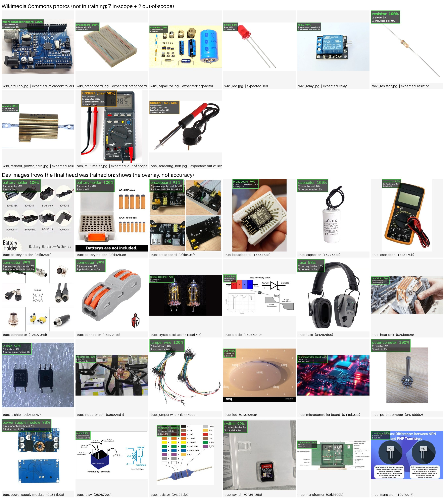

# Demo: classify components in pictures

`src/compclass/demo.py` runs the exported final model on an image file, a folder, an http(s) URL or a webcam. It
draws the top-3 labels with calibrated probabilities on the picture, or **UNSURE** when the model is not
confident. It also prints one line per image.

The model is a frozen SigLIP So400m/384 image tower plus two fused linear heads, run with **onnxruntime**
(`exports/final/model.onnx`). OpenCV handles image I/O, webcam capture, drawing and the window only. Its DNN module
cannot load this graph: `cv2.dnn.readNetFromONNX` segfaults on it (exports/final/export_report.json), while
onnxruntime matches PyTorch.



*Top: Wikimedia Commons photos the model never saw (7 in-scope, 2 out-of-scope). Bottom: 24 dev images, one or two
per class. The final head was trained on these dev rows, so the bottom half shows what the overlay looks like. It
says nothing about accuracy (see [Accuracy to expect](#accuracy-to-expect)).*

## 1. Get the model onto the laptop

The repo does not track the exported model (`*.onnx` and `*.onnx.data` are gitignored; together ≈1.6 GB). Copy it
from the GPU PC over Tailscale:

```bash
cd ~/Work/Prototypes/626-Project
mkdir -p exports/final
rsync -avP -e "ssh -p 2222" \
  carl@carlpc2.tail498db1.ts.net:~/Projects/626-Project/exports/final/ exports/final/
```

You need `model.onnx` together with `model.onnx.data`, which holds the weights. The graph refers to the data file by
name, so keep both in the same folder. You also need `labels.json` and `preprocess.json`. `head.npz` is only used by
`--backend torch`.

To regenerate the model instead (CUDA machine with `data/v2/images` present):

```bash
uv run python -m compclass.final fit             # OOF check, calibration, abstain threshold, head.npz
uv run python -m compclass.final export --force  # model.onnx + labels.json + preprocess.json + parity report
```

Keep `--force` if a `model.onnx` already exists. `export` reuses an existing `model.onnx`, which has the *old* head
baked in, while it still rewrites `preprocess.json` from the new `head.npz`.

## 2. Run it

From the repo root, inside the project environment (`uv sync` once):

```bash
uv run python -m compclass.demo --source photo.jpg                     # one file
uv run python -m compclass.demo --source pics/ --out annotated/        # a folder (add --recursive for sub-folders)
uv run python -m compclass.demo --source "https://upload.wikimedia.org/wikipedia/commons/c/ce/Resistor_1.0_MOhm_0.167_Watt_PTH.jpg"
uv run python -m compclass.demo --source 0 --every 10                  # webcam 0
```

| flag | meaning |
|---|---|
| `--source` | image file, folder, `http(s)://` URL, or webcam index (`0`, `1`, …) |
| `--model-dir` | export folder (default `exports/final`) |
| `--backend onnx\|torch` | onnxruntime (default) or the same model in PyTorch via `compclass.final.load_final` |
| `--device auto\|cpu\|cuda` | `auto` uses CUDA when the installed onnxruntime/torch supports it |
| `--out DIR` | write annotated JPEGs (long side ≤ `--max-side`, default 1024 px) |
| `--no-window` | never open a window (servers, SSH, batch runs) |
| `--every N` | webcam: classify every Nth frame and keep showing the last result |
| `--max-frames N` | webcam: stop after N frames |
| `--json FILE` | append one JSON record per image (`label`, `top3`, `unsure`, `ms`, `error`) |
| `--user-agent S` | HTTP User-Agent for URLs (see below; `""` sends urllib's default) |

Output line format (tab-separated): `source  label|UNSURE  top-prob  top3: a p, b p, c p  N ms`.

**Inputs.** Files and URLs are decoded with Pillow: JPEG, PNG, WebP, BMP, GIF, TIFF, and AVIF through the
`pillow-avif-plugin` dependency. The EXIF orientation is applied and transparency is flattened onto white, the same
as `tools/build_dataset_v2.py` did for the training images. A file that cannot be decoded, a failed download or a
bad URL prints an `ERROR` line, and the run continues with the next image.

**URLs.** Downloads use `urllib` with a 20 s timeout and a 20 MB limit. Wikimedia rejects Python's default
`Python-urllib/3.x` User-Agent with HTTP 403 and asks automated clients to identify themselves (robot policy,
<https://w.wiki/4wJS>), as verified on the PC. The demo therefore sends an honest descriptive agent:
`compclass-demo/0.2 (educational image-classification demo; Python urllib)`. Add a contact address with
`--user-agent "compclass-demo/0.2 (you@example.org)"` if you fetch a lot.

**Webcam.** CPU inference takes ~0.9 s per image, so only every Nth frame is classified (`--every`, default 10).
The window keeps the last result on screen. Keys: `q` quits, `s` saves the annotated frame to `--out` (default
`webcam_frames/`). Webcam mode was not exercised in testing, because neither the sandbox nor the PC has a camera.

### Showing a window

The project depends on `opencv-python-headless`, which has no GUI. Without a GUI (or without `DISPLAY` /
`WAYLAND_DISPLAY` on Linux) the demo says so and runs headless, writing to `demo_out/` when `--out` is not given.
For a window, run the demo as a plain script in a throwaway uv environment that has the GUI build of OpenCV:

```bash
uv run --no-project --python 3.12 --with numpy --with pillow --with opencv-python --with onnxruntime \
  python src/compclass/demo.py --source pics/
```

`demo.py` only needs numpy, Pillow, OpenCV and onnxruntime; torch is needed only for `--backend torch`. This
route also skips the multi-GB torch install on the laptop. The same command with `opencv-python-headless` was run
in the sandbox (on a stand-in model) and on the PC. The GUI build itself was **not tested**, because no display was
available. To switch the project environment permanently, run `uv remove opencv-python-headless && uv add
opencv-python`. Never install both: they provide the same `cv2` module.

## 3. Speed

All numbers were measured on the GPU PC (16-core CPU, RTX 4060 Ti 8 GB), batch 1, preprocessing included. The first
image is slower (warm-up). Source: results/demo/demo_parity.json and results/demo/demo_predictions.jsonl.

| backend | median ms / image | first image |
|---|---|---|
| onnxruntime CPU (`onnxruntime` 1.31.0) | 898 (64 dev images), 909 (wiki images) | 976–980 |
| onnxruntime CUDA (`onnxruntime-gpu[cuda,cudnn]` 1.31.0) | 67 | 350 |
| PyTorch CUDA (`--backend torch`, torch 2.11 cu128) | 80 | 270 |

Model load took 0.7 s for ONNX (file already in the page cache) and 4.5 s for torch. On the laptop expect CPU speed
to depend on its core count. The RTX 3060 Laptop GPU has not been measured, but the fp32 weights (1.6 GB) fit
comfortably in its memory.

### Using the laptop GPU (onnxruntime-gpu)

`onnxruntime-gpu` **replaces** the CPU `onnxruntime` package: both install the same `onnxruntime` Python module, so
keep exactly one in an environment. Version 1.31.0 uses CUDA 13 user-space libraries. The `[cuda,cudnn]` extra pulls
them in as `nvidia-*` wheels (`nvidia-cublas` 13.x, `nvidia-cudnn-cu13` 9.x), so no system CUDA toolkit is needed.
A recent NVIDIA driver that supports CUDA 13 is required; check `nvidia-smi`.

Verified on the PC, without touching the project environment:

```bash
uv run --no-project --python 3.12 --with numpy --with pillow --with opencv-python-headless \
  --with "onnxruntime-gpu[cuda,cudnn]" python src/compclass/demo.py --source pics/ --device cuda --no-window --out annotated/
```

The startup line should say `[CUDAExecutionProvider]`. If it says `CPUExecutionProvider`, CUDA could not be loaded
and the demo fell back to CPU. Swap in `opencv-python` to get a window as well.

To make it the project default (changes `pyproject.toml`/`uv.lock`, and the PC environment on its next sync):
`uv remove onnxruntime && uv add "onnxruntime-gpu[cuda,cudnn]"`. Revert with `uv remove onnxruntime-gpu && uv add
onnxruntime`. This in-project combination with torch's CUDA 12.8 wheels is **untested**. The throwaway-environment
command above is the tested route.

## 4. UNSURE

`probs` are temperature-calibrated probabilities (temperature 0.898, fitted on out-of-fold scores; ECE 0.050 → 0.029,
exports/final/fit_report.json). If the top probability is below `abstain_threshold` = **0.50** (from
`preprocess.json`), the overlay shows **UNSURE (top < 50%)** in orange, followed by the three best guesses. The
threshold was chosen on out-of-fold predictions as the smallest confidence at which accepted predictions are at
least 90 % correct:

| data | coverage (not UNSURE) | accuracy of accepted predictions |
|---|---|---|
| dev out-of-fold (2512 images) | 84.6 % | 90.9 % |
| sealed test (418 images, one look) | 87.1 % | 90.9 % |

UNSURE means "low confidence among these 20 classes". It is **not** an out-of-distribution detector. Both
out-of-scope photos tried here were flagged (multimeter top 0.36, soldering iron top 0.49), but the soldering iron
only just made it. An unfamiliar object can still get a confident wrong label.

## 5. Accuracy to expect

| evaluation | accuracy |
|---|---|
| dev out-of-fold, cluster-grouped 5-fold CV | 82.6 % (macro-F1 82.6 %) |
| sealed test split (418 images) | 83.7 % (macro-F1 83.4 %); 86.9 % on in-scope rows |

Sources: exports/final/fit_report.json, results/final/final_test_v2.json. The demo on the dev images is **not** an
accuracy check: the final head was refit on all dev rows, so 24/24 correct there is expected. The overlay also
reproduces dataset label noise. In the contact sheet a multimeter is labelled *capacitor* and ear defenders are
labelled *fuse*, and the model has learnt those rows. This is probably why the out-of-scope multimeter's top guess
is "capacitor".

### Example predictions on Wikimedia photos (onnxruntime CPU)

| file | expected | prediction | p | 2nd |
|---|---|---|---|---|
| wiki_resistor.jpg | resistor | resistor | 0.998 | diode 0.001 |
| wiki_resistor_power_hard.jpg | resistor (finned power resistor) | resistor | 0.853 | heat sink 0.054 |
| wiki_capacitor.jpg | capacitor | capacitor | 0.997 | inductor coil 0.001 |
| wiki_led.jpg | led | **diode** (wrong) | 0.509 | led 0.407 |
| wiki_arduino.jpg | microcontroller board | microcontroller board | 0.996 | breadboard 0.003 |
| wiki_breadboard.jpg | breadboard | breadboard | 0.996 | jumper wire 0.003 |
| wiki_relay.jpg | relay | relay | 0.988 | power supply module 0.004 |
| oos_multimeter.jpg | (out of scope) | UNSURE | 0.362 | potentiometer 0.219 |
| oos_soldering_iron.jpg | (out of scope) | UNSURE | 0.487 | potentiometer 0.110 |

That is 6/7 in-scope correct and 2/2 out-of-scope abstained. This is an anecdote of nine pictures, not a
benchmark. The LED/diode miss is a known ambiguity: an LED *is* a diode, and the training "diode" class contains
red-LED photos. onnxruntime CUDA and torch CUDA gave the same labels on all seven in-scope images, with top-1
probabilities within 0.0004 of the CPU result. A perceptual-hash check found no near-copy of these photos among the
dev images. That check is weak on white-background product shots, so a mirrored copy in the web-scraped data cannot
be fully excluded.

## 6. Correctness check (preprocessing + ONNX parity)

`tools/demo_parity.py` compares the demo pipeline against the training-side reference on 64 dev images covering all
20 classes; the sealed test split is never read. The demo pipeline is `open_image` → `preprocess` (Pillow/numpy) →
onnxruntime CPU. The reference is `compclass.final.load_final` in PyTorch CPU fp32 on
`compclass.data.build_transforms(train=False)` tensors. Result (results/demo/demo_parity.json):

| metric | value |
|---|---|
| max \|input tensor difference\| | 0.0 (bit-identical preprocessing) |
| max \|probability difference\| | 9.1e-6 |
| argmax agreement | 64 / 64 (100 %) |
| UNSURE-decision agreement | 64 / 64 (100 %) |

`tests/test_demo.py` (17 tests, offline) also checks the preprocessing against torchvision's eval transform on
synthetic images of several aspect ratios. It covers normalisation and channel order, source parsing, folder
listing, broken files, URL download (a local test server, size limit, 404, closed port) and an end-to-end headless
run on a tiny stand-in ONNX model with the same I/O contract:

```bash
uv run python -m pytest -q tests/test_demo.py
```

## 7. Known limits

- **20 classes only** (`labels.json`). Anything else is forced into one of them, or shown as UNSURE when the scores
  are spread out.
- **One dominant object per picture.** The model classifies a centre crop of the whole image; it does not detect or
  localise. Crop to the component for multi-part scenes (PCBs, kits).
- **Centre crop.** The short side is resized to 427 px and the central 384×384 is used, so objects near the edges
  of wide images are cut off.
- Label ambiguities inherited from the web-scraped training data: LED vs diode, breadboard vs jumper wire, and power
  resistor vs heat sink.
- CPU latency (~0.9 s) makes webcam use choppy; use `--every` or a GPU.

## 8. Deploying elsewhere (e.g. a Rust GPUI app via the `ort` crate)

> **Built:** the GPUI desktop app now exists at [`apps/gpui-demo/`](../apps/gpui-demo/README.md)
> (`cd apps/gpui-demo && cargo run --release --locked`). It implements exactly the contract below; its headless
> `classify` mode matches the Python pipeline on 64/64 dev images (`results/demo/gpui_parity.json`).

The export folder is a self-contained contract. Any onnxruntime binding (Rust `ort`, C++, C#) can reproduce the demo
from these three files:

**`model.onnx` (+ `model.onnx.data` in the same folder).** ONNX opset 18, IR version 10 (results/demo/onnx_io.json).

| tensor | name | dtype | shape | meaning |
|---|---|---|---|---|
| input | `input` | float32 | `[1, 3, 384, 384]` | one preprocessed image; batch is **fixed at 1** |
| output | `logits` | float32 | `[1, 20]` | fused, temperature-scaled scores |
| output | `probs` | float32 | `[1, 20]` | `softmax(logits)`: calibrated probabilities; use these |

Both heads, the fusion and the temperature are inside the graph. Do not apply softmax or temperature again. To
batch, run one image per call; the exporter specialised the batch dimension to 1.

**`labels.json`.** A JSON array of 20 class names; index *i* names column *i* of `probs`.

**`preprocess.json`.** The fields used, applied in this order to an 8-bit RGB image:

1. Decode, apply the EXIF orientation, flatten alpha onto white, convert to RGB (`color_order: "RGB"`).
2. Resize so the **short side = `resize_short_side` (427)**. The long side is `floor(427 · long / short)`.
   Resampling is `interpolation: "bicubic"` as implemented by Pillow (Keys cubic, a = −0.5, antialiased when
   downscaling). Skip the resize if the short side is already 427.
3. Centre-crop `input_size` × `input_size` (384), at `left = round((W − 384) / 2)`, `top = round((H − 384) / 2)`.
4. Convert to float32 and multiply by `scale` (1/255).
5. Normalise per channel: `(x − mean) / std` with `mean = std = [0.5, 0.5, 0.5]`, giving values in [−1, 1].
6. HWC → CHW, add the batch axis → `[1, 3, 384, 384]`, row-major (`layout: "NCHW"`).

**Decision rule.** `k = argmax(probs)`. If `probs[k] < abstain_threshold` (0.50), show UNSURE plus the top-3. Otherwise
show `labels[k]` and `probs[k]`.

The other keys are provenance: `model`, `temperature`, `t_zs`, `w_zs`, `manifest_fingerprint`, and `crop_pct` (from
which 427 = round(384 / 0.9)). Resize implementations differ: OpenCV's `INTER_CUBIC`, and Rust `image`'s
`CatmullRom`, may not match Pillow bit-for-bit. The model tolerates small differences, but verify a new front end
against golden tensors. In this repo, `compclass.demo.preprocess(compclass.demo.open_image(path), pre)` returns
the exact reference array for any image, which you can save with `numpy.save`. Then compare probabilities with
the demo's `--json` output (expect differences around 1e-5). The `ort` crate needs the onnxruntime shared library
(its `download-binaries` feature or a system install), and its CUDA execution provider is optional.

## 9. Web holdout results

The final model was evaluated once on `data/web_holdout_v1/`: 407 Wikimedia Commons photos collected after the
model was frozen, excluding the nine demo photos above and any image too similar to the training data
(`results/final/final_test_web_holdout_v1.json`):

| | Web holdout (n = 407) |
|---|---:|
| Accuracy | 0.821 (95 % CI 0.780–0.855) |
| Macro-F1 | 0.816 |
| Answered (not UNSURE) at threshold 0.5 | 85.3 % of images, 89.1 % of them correct |

Expect it to be weakest on real toggle/slide switches (often called *ic chip*), LEDs (often called *diode*) and
mains transformers (often called *inductor coil*); see `docs/report/REPORT.md` Section 8.

## Credits (Wikimedia Commons images used in the demo)

Downloaded from Wikimedia Commons on 2026-10-18 at the URLs below (1280-px thumbnails where the original was larger).
Licences as stated on each file page; see `results/demo/wikimedia_credits.json`.

| file | subject | Commons file page | author | licence | downloaded URL |
|---|---|---|---|---|---|
| wiki_resistor.jpg | resistor | [Resistor 1.0 MOhm 0.167 Watt PTH.jpg](https://commons.wikimedia.org/wiki/File:Resistor_1.0_MOhm_0.167_Watt_PTH.jpg) | SparkFun Electronics from Boulder, USA | CC BY 2.0 | https://upload.wikimedia.org/wikipedia/commons/c/ce/Resistor_1.0_MOhm_0.167_Watt_PTH.jpg |
| wiki_resistor_power_hard.jpg | resistor (power, finned) | [Resistor (4540999005).jpg](https://commons.wikimedia.org/wiki/File:Resistor_(4540999005).jpg) | bengt-re from Sweden | CC BY 2.0 | https://thumb.wikimedia.org/wikipedia/commons/thumb/e/e3/Resistor_%284540999005%29.jpg/1280px-Resistor_%284540999005%29.jpg |
| wiki_capacitor.jpg | capacitor | [Electrolytic capacitors-P1090328.JPG](https://commons.wikimedia.org/wiki/File:Electrolytic_capacitors-P1090328.JPG) | Elcap | CC0 | https://upload.wikimedia.org/wikipedia/commons/f/f6/Electrolytic_capacitors-P1090328.JPG |
| wiki_led.jpg | LED | [5mm Red LED.jpg](https://commons.wikimedia.org/wiki/File:5mm_Red_LED.jpg) | oomlout | CC BY-SA 2.0 | https://thumb.wikimedia.org/wikipedia/commons/thumb/c/c8/5mm_Red_LED.jpg/1280px-5mm_Red_LED.jpg |
| wiki_arduino.jpg | Arduino board | [Arduino Uno board.jpg](https://commons.wikimedia.org/wiki/File:Arduino_Uno_board.jpg) | JrawX | CC0 | https://thumb.wikimedia.org/wikipedia/commons/thumb/d/de/Arduino_Uno_board.jpg/1280px-Arduino_Uno_board.jpg |
| wiki_breadboard.jpg | breadboard | [400 points breadboard.jpg](https://commons.wikimedia.org/wiki/File:400_points_breadboard.jpg) | oomlout | CC BY-SA 2.0 | https://thumb.wikimedia.org/wikipedia/commons/thumb/7/73/400_points_breadboard.jpg/1280px-400_points_breadboard.jpg |
| wiki_relay.jpg | relay | [SRD-05VDC-SL-C 5V one-channel relay module.jpg](https://commons.wikimedia.org/wiki/File:SRD-05VDC-SL-C_5V_one-channel_relay_module.jpg) | Suyash Dwivedi | CC BY-SA 4.0 | https://thumb.wikimedia.org/wikipedia/commons/thumb/5/56/SRD-05VDC-SL-C_5V_one-channel_relay_module.jpg/1280px-SRD-05VDC-SL-C_5V_one-channel_relay_module.jpg |
| oos_multimeter.jpg | multimeter (out of scope) | [Digital Multimeter Aka.jpg](https://commons.wikimedia.org/wiki/File:Digital_Multimeter_Aka.jpg) | André Karwath aka Aka | CC BY-SA 2.5 | https://upload.wikimedia.org/wikipedia/commons/a/a6/Digital_Multimeter_Aka.jpg |
| oos_soldering_iron.jpg | soldering iron (out of scope) | [Soldering iron (UK Plug).jpg](https://commons.wikimedia.org/wiki/File:Soldering_iron_(UK_Plug).jpg) | oomlout (derivative work; see file page) | CC BY-SA 2.0 | https://thumb.wikimedia.org/wikipedia/commons/thumb/b/bf/Soldering_iron_%28UK_Plug%29.jpg/1280px-Soldering_iron_%28UK_Plug%29.jpg |

The annotated copies in `results/demo/demo_examples.jpg` are adaptations of these images under the same licences.
The dev-set tiles come from the Kaggle "electronic-component-recognizer" dataset (web-scraped; licence as given by
that dataset).
