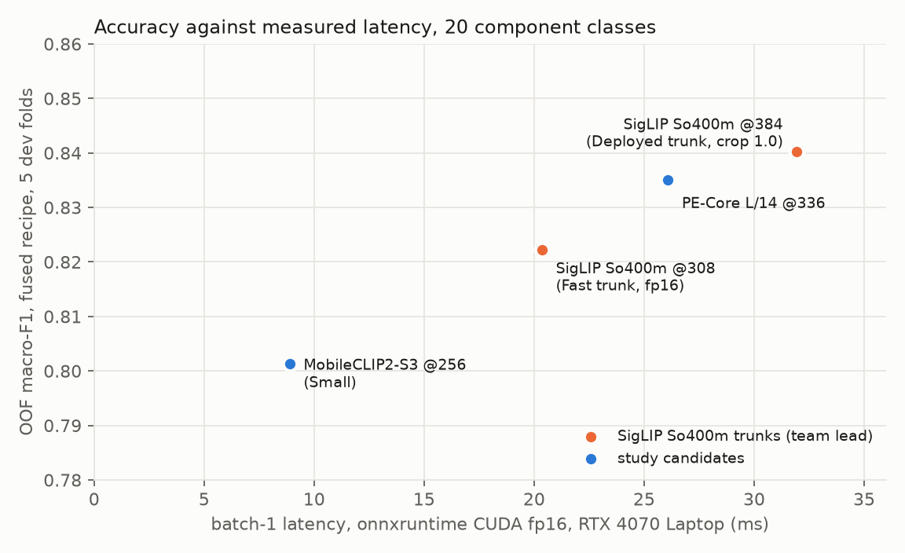

# A smaller model for the 20 component classes: an efficiency study

Meiring van Niekerk, ITRI626, 2026-11-05. Branch `Meiring`. All model selection on the five cluster-grouped
development folds of data v2 (fingerprint `431315e87d2612cb`, 2,512 rows); the sealed test split and the Wikimedia
holdout were not scored. Dated detail, per-fold numbers and the exact commands are in `EXPERIMENT_LOG.md`
(2026-11-05 entries) and `results/efficiency/`.

## Question

The deployed classifier is a frozen SigLIP So400m/14 image tower (428 M parameters, 384 px) with two linear heads:
a logistic-regression probe trained on the development rows and the tower's own zero-shot text classifier, fused,
temperature-calibrated, abstaining below 0.5. It is accurate (83.7 % on the sealed test) and heavy (1.7 GB of fp32
weights, 604 GFLOPs per image). The Fast variant keeps the same tower at 308 px in INT8 under TensorRT. The study asks
whether a much smaller image-text backbone, given the same recipe, can do the job, and at what cost in accuracy and
what gain in latency and size.



*Out-of-fold macro-F1 of the fused recipe on the development folds against measured batch-1 latency under
onnxruntime's CUDA provider (fp16 graphs, RTX 4070 Laptop). The study's candidates in blue, the team lead's SigLIP
trunks in orange; the Fast trunk is shown at fp16 because its INT8 TensorRT engine cannot be built on this machine.*

## Method

**Protocol.** Every backbone is scored the same way the deployed model was developed: features of the frozen tower
for all development rows (cached once), a StandardScaler + multinomial logistic-regression probe with C chosen by
grouped 3-fold CV inside each training fold, out-of-fold (OOF) macro-F1 and accuracy over the five folds, and paired
per-fold differences against SigLIP (mean ± standard error, folds in favour). The zero-shot head uses the backbone's
own text tower through the project's six prompt templates (`compclass.zeroshot`); for every candidate but SigLIP the
timm image features sit before the checkpoint's projection into the text space, so that projection is read from the
checkpoint and applied before the cosine (`tools/views/heads.py`). Fusion weights are the deployed ones, fixed a
priori: log p_probe + 0.25 · log softmax(50 · cos).

**Input view.** SigLIP's default preprocessing resizes the short side to 427 px and centre-crops 384 (crop fraction
0.9); PE-Core's resizes to the input size and cuts nothing (1.0). A first comparison mixed the two and credited
PE-Core with +1.0 pt. The control (`tools/views/view_fusion.py`) showed the gain was the view: SigLIP at crop 1.0
is +1.48 ± 0.25 pt over its own default, 5/5 folds. Every number below is at crop 1.0 for every backbone.

**Cost.** GFLOPs per image from `torch.utils.flop_counter`; batch-1 latency measured twice, in PyTorch eager fp16
(`tools/views/latency.py`) and under onnxruntime's CUDA execution provider on exported fp16 graphs with IO binding
(`tools/views/ort_latency.py`), five rounds of 60 runs interleaved across models so clock drift hits them alike.
Models are timed in their inference form (timm `reparameterize_model`).

## Step 1: twelve small backbones, frozen, linear probe

Candidates were image-text encoders between 6 M and 316 M parameters with a text tower available in open_clip:
PE-Core T/S/B (Meta), SigLIP 2 B/16, MobileCLIP2 S2/S3/B (Apple), DFN-2B, MetaCLIP 2.5B and EVA-02 B/16, a CLIP
ConvNeXt-B, and PE-Core L/14 as the large reference. No backbone pretrained on electronic components exists at
scale; the few Hugging Face fine-tunes found cover 3 to 6 classes.

| Backbone (probe, crop 1.0) | params | px | GFLOPs | CV macro-F1 | Δ vs SigLIP probe 0.833 |
|---|---:|---:|---:|---:|---:|
| PE-Core L/14 | 316 M | 336 | 352 | 0.830 | −0.3 ± 0.5 (noise) |
| MobileCLIP2-S3 | 123 M | 256 | 30 | 0.792 | −4.1 ± 0.4, 0/5 |
| MobileCLIP2-B | 86 M | 224 | 34 | 0.778 | −5.5 |
| PE-Core B/16 | 93 M | 336 | 77 | 0.765 | −6.8 |
| SigLIP 2 B/16, DFN-2B, MetaCLIP, EVA-02, ConvNeXt-B, PE-Core S/T, MobileCLIP2-S2 | 6–93 M | | 6–100 | 0.62–0.77 | −6 to −21 |

Every small backbone sits at least four points below SigLIP; MobileCLIP2-S3 is the best of them at 5 % of SigLIP's
compute. The full table is in `tools/views/small_sweep_summary.py`'s output in the log.

## Step 2: the deployed recipe on each candidate

| Backbone | probe F1 | zero-shot F1 | fused F1 | fused acc | fusion gain | vs SigLIP fused 0.840 |
|---|---:|---:|---:|---:|---:|---:|
| SigLIP So400m @384 | 0.833 | 0.764 | **0.840** | 0.842 | +0.7 ± 0.2, 5/5 | reference |
| PE-Core L/14 @336 | 0.830 | 0.790 | 0.835 | 0.837 | +0.5 ± 0.4, 4/5 | −0.5 ± 0.3 |
| MobileCLIP2-S3 @256 | 0.792 | 0.725 | 0.801 | 0.803 | +0.9 ± 0.4, 5/5 | −3.9 ± 0.2 |
| MobileCLIP2-B @224 | 0.778 | 0.705 | 0.785 | 0.787 | +0.7 ± 0.2, 5/5 | −5.6 ± 0.4 |
| PE-Core B/16 @336 | 0.765 | 0.705 | 0.776 | 0.778 | +1.0 ± 0.2, 5/5 | −6.4 ± 0.6 |

The zero-shot head helps every backbone, on every fold for the small ones, so the deployed design is not
SigLIP-specific. It does not close the gap: the small text towers know the 20 component names less well (0.705 to
0.725 zero-shot against 0.764 and 0.790). The ViT-B models are dominated by MobileCLIP2-S3 on accuracy and cost at
once and drop out.

## Step 3: does fine-tuning the small backbone help?

Two recipes for MobileCLIP2-S3, fixed before looking at folds: full (all 123 M parameters) and partial (stem and
stages 0 to 3 frozen, stage 4 + final conv + head, 61 M). Both start from the fold's own fitted probe as the head
(LP-FT, Kumar et al. 2022) with BatchNorm statistics frozen: a randomly initialised head at the CLIP-safe learning
rate reached only 0.40 in 30 epochs on fold 0, with validation swinging 0.15 to 0.40 as the BatchNorm statistics
drifted on small batches, and that run is kept in the log as evidence. Batch 16 × 2 with gradient checkpointing
(batch 32 pages out of the 8 GB card).

| Run | trainable | best epoch (mean) | CV macro-F1 | vs S3 probe 0.792 | vs S3 fused 0.801 |
|---|---:|---:|---:|---:|---:|
| full fine-tune | 123 M | 4.4 | 0.792 ± 0.020 | +0.03 ± 0.79, 3/5 | −0.9 ± 1.0 |
| partial, stage 4 | 61 M | 2.6 | 0.789 ± 0.023 | −0.30 ± 0.72, 2/5 | −1.2 ± 0.7 |

Train accuracy passes 95 % within four epochs and the best epoch is 0 to 5 in eight of ten runs: on 2,000 training
images the frozen features are the ceiling, exactly as October's SigLIP partial fine-tunes found. The deployable
small model is therefore the fused probe on the frozen tower, not a fine-tuned network.

## Step 4: measured latency and size

| Tower, fused recipe, fp16 | px | params | GFLOPs | graph | PyTorch eager, ms | ORT CUDA, ms | batch-8 img/s | OOF fused F1 |
|---|---:|---:|---:|---:|---:|---:|---:|---:|
| SigLIP So400m @384 (Deployed trunk) | 384 | 428 M | 604 | 821 MB | 30.4 | 31.9 | 35 | 0.840 |
| SigLIP So400m @308 (Fast trunk's resolution) | 308 | 428 M | 401 | 821 MB | 18.2 | 20.4 | 58 | 0.822 |
| PE-Core L/14 @336 | 336 | 316 M | 352 | 607 MB | 18.6 | 26.1 | 63 | 0.835 |
| MobileCLIP2-S3 @256 | 256 | 123 M | 30 | 240 MB | 10.6 | 8.9 | 376 | 0.801 |

Three observations the table forces:

1. **FLOPs mis-rank the candidates at batch 1.** Before reparameterisation MobileCLIP2-S3 took 23 ms in eager
   PyTorch, slower than PE-Core L despite 12× fewer FLOPs; a hybrid convolutional network's single-image cost is
   kernel launches, not arithmetic. In inference form it is 10.6 ms, under onnxruntime 8.9 ms. Measured latency, not
   GFLOPs, is the cost axis.
2. **PE-Core L fuses poorly.** 39 % faster than SigLIP in eager PyTorch but only 20 % under onnxruntime, because its
   attention-pooling graph does not fuse as well, so its half-point deficit buys less than the GFLOPs promised. With
   Fast already occupying the middle of the frontier at no accuracy cost on the sealed test, PE-Core L has no
   deployment case; it stays in the results as that finding.
3. **Fast's accuracy cost is the resolution, not the INT8.** SigLIP at 308 px in fp16 loses 1.8 points on every
   fold (0.822), which is the team lead's recorded Fast fit (0.826 OOF accuracy with the INT8 trunk). Against that
   reference MobileCLIP2-S3 is 2.1 points lower and 2.3× faster at equal precision; Fast's INT8 engine will be faster
   than 20 ms by an amount only measurable with TensorRT and its release files.

## The packaged small model

`exports/mobileclip2_s3/` is built by `tools/views/package_candidate.py` exactly as `compclass.final` builds the
deployed model: OOF scores of the exact exported pipeline, temperature by negative log-likelihood on them, abstain
threshold as the smallest confidence at which accepted OOF predictions are at least 90 % correct, the probe refitted
on all development rows, one ONNX graph (tower in inference form, both heads, temperature in-graph; outputs
`logits` and `probs`), parity-checked on 32 development images against onnxruntime (max |Δp| 5e-7, argmax 32/32).
`model.json` and the line in `exports/models.json` come from the team lead's `tools/gen_manifests.py`, so the demo
app lists it as "Small" with no code change; `packaging/bundle.txt` carries its files.

| | Deployed (recorded) | Small |
|---|---:|---:|
| OOF accuracy / macro-F1 | 0.826 / 0.825 (crop 0.9) | 0.803 / 0.802 |
| OOF in-scope accuracy | | 0.837 |
| temperature | 0.898 | 1.100 |
| abstain threshold | 0.50 | 0.55 |
| ECE before → after | 0.050 → 0.029 | 0.025 → 0.032 |
| graph | 1.7 GB fp32 | 479 MB fp32 (240 MB fp16 copy) |
| batch-1, ORT CUDA fp16 | 31.9 ms | 8.9 ms |

The temperature fit minimises NLL, not ECE, and the ECE moved up slightly; the OOF probabilities were already
close to calibrated (T 1.10). The threshold rule landed one grid step above the deployed 0.50.

**The one sealed-test look** (418 images, `tools/views/test_small.py --confirm`, 2026-11-05): accuracy **0.806**,
macro-F1 **0.802**, within 0.4 pt of the out-of-fold estimate; in-scope accuracy 0.833; at the 0.55 threshold it
answers 78 % of images with 91 % accuracy on those. Paired against the deployed model's recorded predictions on
the same rows (0.837 / 0.834): −3.1 pt accuracy, 95 % bootstrap interval [−6.0, −0.2], and −3.1 pt macro-F1
[−6.2, −0.2]; 26 images the deployed model gets right and Small wrong, 13 the other way, 86 % agreement. The gap
the folds predicted is real and of the predicted size. The test split is spent for this model.

**As a course model (D).** For the ITRI626 comparison the same tower was also given a head trained only on the fixed
split's 2,010 training rows, with model C's code, grid and selection rule: test accuracy 0.773, macro-F1 0.770,
5.0 points below C (paired p = 0.0075) and 13.6 above the fine-tuned ConvNeXt-T. That is a different head from the
packaged one above (fitted on all development rows, fused, 0.806), and each was scored on the test split once. The
proposed report text is in `docs/model_d_inserts/INSERTS.md`.

## The deployed model at crop 1.0

`tools/views/deployed_crop100.py` refits and re-exports the deployed SigLIP model with one change, the eval
preprocessing resizes the short side to 384 and cuts nothing, to `exports/final_crop100/` next to the shipped
`exports/final/`, which is untouched. Same tower weights, same text embeddings, same `compclass.final` fit, calibration
and abstain rule, on the crop-1.0 feature cache. OOF accuracy / macro-F1 **0.842 / 0.841** against the recorded
0.826 / 0.826 (+1.6 pt), in-scope 0.873, temperature 0.888, ECE 0.055 → 0.042; the abstain rule now lands on 0.45
instead of 0.50 because the better-calibrated scores reach 90 % accepted accuracy one step earlier. The manifest id is
`deployed_crop100`, head title "Deployed at crop 1.0", listed in `exports/models.json` but not in the default list. It
was not scored on the sealed test: whether to spend a look on it, or simply swap it in for `final`, is the team lead's
decision.

**Licence.** MobileCLIP2's weights are released under the Apple Machine Learning Research Model License
(`apple-amlr`), research and education only; SigLIP and PE-Core are Apache-2.0. For this honours project that is
fine; for any commercial deployment the Small model is ruled out as packaged, and the licence note ships in the
bundle (`LICENSES/MODEL-WEIGHTS-MobileCLIP2.txt`).

## Conclusions

- **Frozen features plus the fused linear heads is the right recipe at every size.** Fusion transfers to every
  backbone; fine-tuning adds nothing at this data scale for the small backbone, as it did not for SigLIP.
- **The trade is 4 points of macro-F1 for a 3.6× latency cut and a 3.4× size cut** (0.801 against 0.840; 8.9 ms
  against 31.9 ms; 479 MB against 1.7 GB), or 2 points and 2.3× against the Fast trunk at fp16.
- **Two findings are independent of the candidate.** Removing the deployed model's 0.9 centre crop gains 1.5 points
  on SigLIP itself, 5/5 folds, at no cost; and batch-1 latency must be measured, because FLOPs mis-order hybrid and
  transformer backbones by up to 2×.
- **Open items** are the team lead's calls: whether to replace `final` with the crop-1.0 export (and spend a test look
  on it), and whether the licence makes the Small model a demo-only model.

## Reproduction

```
uv run python tools/views/extract_views.py siglip_so400m_384 crop100          # SigLIP at crop 1.0 (reference cache)
uv run python tools/views/heads.py --model mobileclip2_s3 --model pe_core_l14_336
uv run python tools/views/fusion_table.py --model pe_core_l14_336 --model mobileclip2_s3 --siglip-view crop100@308
uv run python -m compclass.train --config configs/mobileclip2_s3_full.yaml --fold 0 1 2 3 4   # after probe_heads.py
uv run python tools/views/finetune_summary.py
uv run python tools/views/export_candidate.py --model mobileclip2_s3 --out exports/candidates/mobileclip2_s3
uv run python tools/views/latency.py --model siglip_so400m_384 --model pe_core_l14_336 --model mobileclip2_s3
uv run python tools/views/package_candidate.py --model mobileclip2_s3 --out exports/mobileclip2_s3
uv run python tools/gen_manifests.py --only mobileclip2_s3
```

The onnxruntime CUDA timings need an environment with `onnxruntime-gpu` (1.31 wants NVIDIA's CUDA 13 wheels);
`tools/views/ort_latency.py` imports nothing from the project so it runs from a throw-away venv.
