# Recognising electronic components in web photographs

*A leakage-free comparison of a scratch CNN, a fine-tuned <del>ConvNeXt and</del> <ins>ConvNeXt,</ins> a frozen SigLIP Vision Transformer <ins>and a frozen MobileCLIP 2 hybrid</ins>*

ITRI626, Deep learning for image classification, practical project report. 20 October 2026, revised 5 November 2026.
Markdown edition with model D, prepared by Meiring van Niekerk for the team lead.

> **How to read this file.** It is the course report (`docs/itri626_report/main.tex`) converted to Markdown, with
> model D written in wherever it belongs. <ins>Underlined text is added</ins> and <del>struck-through text is
> removed</del>, both relative to the report as it stands on branch `Meiring`. A note in a quote block like this one
> marks every table or figure that is new or changed. Unmarked text is the report's own, unchanged.
>
> Nothing under `docs/itri626_report/` was edited to make this file. The same additions are listed one by one, with
> their locations and a core or optional mark, in `INSERTS.md` next to this file; the tables are available as LaTeX
> in `tables/`, and the four-model figures as PDF in `results/itri626/figures_four_models/`.
>
> **Three points for the team lead.** (1) The convolution-attention hybrid needs the lecturer's approval as a fourth
> family under "another approved image classification architecture"; A, B and C satisfy the brief without it.
> (2) Page budget: this version was built in LaTeX and its body is 14.8 pages, the same as the report today, provided
> the hyperparameter table (Table 3, now four columns) moves to Appendix B; left in the body it is 15.8. It is shown
> in its present place here only so that the table numbers match the report. (3) Section 5.1 can no longer say that
> all 95 % bootstrap intervals are disjoint: those of C and D overlap and the paired test separates them.
>
> **One proposed cut, to make room.** The distillation experiment on model A is removed: its sentences leave
> Section 6.3, its row leaves Table 7, its clause leaves the conclusion and its reference leaves the list. This is a
> suggestion, marked like the other changes; keep the original text if you prefer.

**Abstract.** We classify web photographs of electronic components into 20 classes (resistor, capacitor, relay, microcontroller board and 16 others) using the public Kaggle dataset *Electronic Component Recognizer*. After exact duplicates and 13 groups with contradictory labels are removed, 2,930 images remain; near-duplicates are grouped so that no image or re-encoded copy crosses a split boundary, giving a stratified split (seed 42) of 2,010 training, 502 validation and 418 test images. <del>Three</del> <ins>Four</ins> model families are trained on this split and scored once on the same test set: (A) a VGG-style CNN trained from scratch, (B) ConvNeXt-Tiny fine-tuned from ImageNet-22k <del>weights and</del> <ins>weights,</ins> (C) a frozen SigLIP So400m Vision Transformer with a trained linear <ins>head and (D) a frozen MobileCLIP2-S3 convolution–attention hybrid, 3.5 times smaller, with the same</ins> head. Test accuracy is 0.400, <del>0.636</del> <ins>0.636, 0.823</ins> and <del>0.823</del> <ins>0.773</ins> (macro-F1 0.392, 0.628, <del>0.817); the 95% bootstrap intervals do not overlap</del> <ins>0.817, 0.770),</ins> and McNemar tests reject equal accuracy for every pair. Pretraining accounts for the ranking: ImageNet fine-tuning adds 23.7 percentage points over the scratch baseline, and <ins>frozen</ins> web-scale image–text <del>pretraining</del> <ins>features</ins> a further <del>18.7.</del> <ins>18.7 with the large encoder or 13.6 with the small one.</ins> Most remaining errors involve look-alike parts or images that do not show the labelled component. We recommend model C, <ins>model D where C is too heavy,</ins> and ConvNeXt-T <del>where inference must be fast or run</del> <ins>for real-time use</ins> on a CPU.

## 1 Introduction and problem motivation

**Problem.** Given one photograph, assign it to exactly one of 20 classes of electronic components and modules (Table 1). This is single-label, multiclass image classification of web photographs of arbitrary origin: product shots, close-ups, cluttered workbenches, renders and some diagrams.

**Motivation.** Recognising a part from a photograph helps to sort mixed parts bins and take inventory, to teach students to tell a diode from a resistor, and as the recognition stage of lab-assistant tools. Earlier work on electronic-component classification fine-tunes ImageNet networks \[1\] or designs dedicated CNNs for varied backgrounds \[2\]; inspection of assembled circuit boards is surveyed by Ling and Isa \[3\]. The task is also a good test of transfer learning. There are only about 100 training images per class, the data are noisy, and several classes look alike (resistor, diode and fuse are small axial bodies with leads; inductor coil and transformer are both windings).

**Aim and scope.** We compare <del>three</del> <ins>four</ins> model families, one trained from scratch and <del>two transfer-learning strategies,</del> <ins>three that use transfer learning (fine-tuning, and frozen features from a large and from a small web-pretrained encoder),</ins> on one leakage-free train/validation/test split, evaluate all of them on the same held-out test set, explain their differences and recommend one. The scope is whole-image classification of the dataset’s 20 classes; detecting several components in one image is out of scope.

**Research question.** Which way of using a neural network (training from scratch, fine-tuning ImageNet features, or a linear classifier on frozen web-scale image–text features) classifies these noisy web photographs best, and at what computational cost?

**Main findings.**

- Model C is the most accurate (accuracy 0.823, macro-F1 0.817), ahead of <ins>model D (0.773, 0.770),</ins> model B (0.636, 0.628) and model A (0.400, 0.392); every pairwise difference is significant (Section 5).

- The ranking follows pretraining: ImageNet fine-tuning adds 23.7 percentage points over training from scratch, and image–text pretraining a further 18.7 (Section 6.1).

- Most remaining errors are look-alike parts or images that do not show the labelled part; data quality, not class imbalance, limits accuracy (Section 6.2).

- We recommend model C, <ins>model D where C is too heavy,</ins> or ConvNeXt-T <del>where</del> <ins>for real-time CPU</ins> inference <del>must be fast or run on a CPU</del> (Section 7).

**Target classes.** We keep the dataset’s 20 classes because they cover the parts on a typical electronics workbench, are defined by a public source (so the work is reproducible), are roughly balanced (Section 2.4), and include genuinely confusable groups that make a model comparison informative.

## 2 Dataset: source, classes, preparation and ethics

### 2.1 Source, licence and usage conditions

The images come from the Kaggle dataset *Electronic Component Recognizer* by the user `mdfaisalahmed025` \[4\], <https://www.kaggle.com/datasets/mdfaisalahmed025/electronic-component-recognizer>, released under the **MIT licence** (use, copying, modification and redistribution with the copyright notice, without warranty). The author collected the images with DuckDuckGo image search, one query per class, so **the labels are the search terms**. The dataset card states 3,661 images, but our download contains 3,530 files; we could not determine the reason (the card may describe an earlier version), and all counts below refer to the files we received. The MIT licence covers the compilation, not the copyright of the individual web images, which stays with their owners. We therefore use the images only for this non-commercial course project, acknowledge the source, and do not commit the images to the project’s Git repository. The download also ships a random train/validation/test assignment of the files; we do not use it, because it places copies of the same image on both sides (Section 2.5).

### 2.2 Class definitions and counts

Table 1 defines each class and gives its image count at every cleaning stage and in every split; Figure 1 shows four random training images per class.

<table>
<caption><strong>Table 1.</strong> The 20 classes, their image counts at each cleaning stage and in each split (<code>data/v2/splits/split_summary.csv</code>).</caption>
<tbody>
<tr>
<td style="text-align: left;"></td>
<td style="text-align: left;"></td>
<td colspan="4" style="text-align: center;">Cleaning</td>
<td colspan="3" style="text-align: center;">Split</td>
<td style="text-align: right;"></td>
</tr>
<tr>
<td style="text-align: left;">Class</td>
<td style="text-align: left;">Definition</td>
<td style="text-align: right;">Raw</td>
<td style="text-align: right;">Uniq.</td>
<td style="text-align: right;">Excl.</td>
<td style="text-align: right;">Final</td>
<td style="text-align: right;">Train</td>
<td style="text-align: right;">Val</td>
<td style="text-align: right;">Test</td>
<td style="text-align: right;">Flag.</td>
</tr>
<tr>
<td style="text-align: left;">battery holder</td>
<td style="text-align: left;">cradle or box holding cylindrical or coin cells</td>
<td style="text-align: right;">220</td>
<td style="text-align: right;">155</td>
<td style="text-align: right;">0</td>
<td style="text-align: right;">155</td>
<td style="text-align: right;">107</td>
<td style="text-align: right;">26</td>
<td style="text-align: right;">22</td>
<td style="text-align: right;">31</td>
</tr>
<tr>
<td style="text-align: left;">breadboard</td>
<td style="text-align: left;">solderless prototyping board with spring-clip holes</td>
<td style="text-align: right;">141</td>
<td style="text-align: right;">135</td>
<td style="text-align: right;">4</td>
<td style="text-align: right;">131</td>
<td style="text-align: right;">89</td>
<td style="text-align: right;">23</td>
<td style="text-align: right;">19</td>
<td style="text-align: right;">22</td>
</tr>
<tr>
<td style="text-align: left;">capacitor</td>
<td style="text-align: left;">two-terminal charge-storage part (electrolytic, ceramic, film)</td>
<td style="text-align: right;">121</td>
<td style="text-align: right;">117</td>
<td style="text-align: right;">1</td>
<td style="text-align: right;">116</td>
<td style="text-align: right;">79</td>
<td style="text-align: right;">20</td>
<td style="text-align: right;">17</td>
<td style="text-align: right;">16</td>
</tr>
<tr>
<td style="text-align: left;">connector</td>
<td style="text-align: left;">plug, socket or pin header joining cables or boards</td>
<td style="text-align: right;">114</td>
<td style="text-align: right;">110</td>
<td style="text-align: right;">0</td>
<td style="text-align: right;">110</td>
<td style="text-align: right;">76</td>
<td style="text-align: right;">18</td>
<td style="text-align: right;">16</td>
<td style="text-align: right;">11</td>
</tr>
<tr>
<td style="text-align: left;">crystal oscillator</td>
<td style="text-align: left;">quartz crystal or oscillator can / SMD clock package</td>
<td style="text-align: right;">232</td>
<td style="text-align: right;">152</td>
<td style="text-align: right;">1</td>
<td style="text-align: right;">151</td>
<td style="text-align: right;">104</td>
<td style="text-align: right;">26</td>
<td style="text-align: right;">21</td>
<td style="text-align: right;">50</td>
</tr>
<tr>
<td style="text-align: left;">diode</td>
<td style="text-align: left;">two-terminal rectifier, usually a banded axial body</td>
<td style="text-align: right;">151</td>
<td style="text-align: right;">148</td>
<td style="text-align: right;">3</td>
<td style="text-align: right;">145</td>
<td style="text-align: right;">99</td>
<td style="text-align: right;">25</td>
<td style="text-align: right;">21</td>
<td style="text-align: right;">56</td>
</tr>
<tr>
<td style="text-align: left;">fuse</td>
<td style="text-align: left;">protective glass, ceramic or blade cartridge</td>
<td style="text-align: right;">148</td>
<td style="text-align: right;">146</td>
<td style="text-align: right;">4</td>
<td style="text-align: right;">142</td>
<td style="text-align: right;">98</td>
<td style="text-align: right;">24</td>
<td style="text-align: right;">20</td>
<td style="text-align: right;">46</td>
</tr>
<tr>
<td style="text-align: left;">heat sink</td>
<td style="text-align: left;">finned metal block that dissipates heat</td>
<td style="text-align: right;">164</td>
<td style="text-align: right;">160</td>
<td style="text-align: right;">0</td>
<td style="text-align: right;">160</td>
<td style="text-align: right;">110</td>
<td style="text-align: right;">27</td>
<td style="text-align: right;">23</td>
<td style="text-align: right;">19</td>
</tr>
<tr>
<td style="text-align: left;">ic chip</td>
<td style="text-align: left;">packaged integrated circuit (DIP, SOIC, QFP)</td>
<td style="text-align: right;">166</td>
<td style="text-align: right;">157</td>
<td style="text-align: right;">0</td>
<td style="text-align: right;">157</td>
<td style="text-align: right;">109</td>
<td style="text-align: right;">26</td>
<td style="text-align: right;">22</td>
<td style="text-align: right;">15</td>
</tr>
<tr>
<td style="text-align: left;">inductor coil</td>
<td style="text-align: left;">wire wound on a core (toroid, choke, coil)</td>
<td style="text-align: right;">244</td>
<td style="text-align: right;">162</td>
<td style="text-align: right;">1</td>
<td style="text-align: right;">161</td>
<td style="text-align: right;">110</td>
<td style="text-align: right;">28</td>
<td style="text-align: right;">23</td>
<td style="text-align: right;">26</td>
</tr>
<tr>
<td style="text-align: left;">jumper wire</td>
<td style="text-align: left;">insulated lead with pin or socket ends</td>
<td style="text-align: right;">250</td>
<td style="text-align: right;">164</td>
<td style="text-align: right;">1</td>
<td style="text-align: right;">163</td>
<td style="text-align: right;">112</td>
<td style="text-align: right;">28</td>
<td style="text-align: right;">23</td>
<td style="text-align: right;">62</td>
</tr>
<tr>
<td style="text-align: left;">led</td>
<td style="text-align: left;">light-emitting diode (dome package, strip)</td>
<td style="text-align: right;">174</td>
<td style="text-align: right;">125</td>
<td style="text-align: right;">1</td>
<td style="text-align: right;">124</td>
<td style="text-align: right;">85</td>
<td style="text-align: right;">21</td>
<td style="text-align: right;">18</td>
<td style="text-align: right;">55</td>
</tr>
<tr>
<td style="text-align: left;">microcontroller board</td>
<td style="text-align: left;">development board with an MCU (Arduino, ESP32)</td>
<td style="text-align: right;">155</td>
<td style="text-align: right;">154</td>
<td style="text-align: right;">0</td>
<td style="text-align: right;">154</td>
<td style="text-align: right;">106</td>
<td style="text-align: right;">26</td>
<td style="text-align: right;">22</td>
<td style="text-align: right;">20</td>
</tr>
<tr>
<td style="text-align: left;">potentiometer</td>
<td style="text-align: left;">variable resistor with shaft or trimmer screw</td>
<td style="text-align: right;">161</td>
<td style="text-align: right;">147</td>
<td style="text-align: right;">0</td>
<td style="text-align: right;">147</td>
<td style="text-align: right;">101</td>
<td style="text-align: right;">25</td>
<td style="text-align: right;">21</td>
<td style="text-align: right;">14</td>
</tr>
<tr>
<td style="text-align: left;">power supply module</td>
<td style="text-align: left;">board-level AC/DC or DC/DC converter</td>
<td style="text-align: right;">251</td>
<td style="text-align: right;">156</td>
<td style="text-align: right;">2</td>
<td style="text-align: right;">154</td>
<td style="text-align: right;">105</td>
<td style="text-align: right;">27</td>
<td style="text-align: right;">22</td>
<td style="text-align: right;">23</td>
</tr>
<tr>
<td style="text-align: left;">relay</td>
<td style="text-align: left;">electrically operated switch (boxed coil and contacts)</td>
<td style="text-align: right;">167</td>
<td style="text-align: right;">160</td>
<td style="text-align: right;">4</td>
<td style="text-align: right;">156</td>
<td style="text-align: right;">107</td>
<td style="text-align: right;">27</td>
<td style="text-align: right;">22</td>
<td style="text-align: right;">61</td>
</tr>
<tr>
<td style="text-align: left;">resistor</td>
<td style="text-align: left;">fixed two-terminal resistor, colour bands or SMD</td>
<td style="text-align: right;">171</td>
<td style="text-align: right;">155</td>
<td style="text-align: right;">2</td>
<td style="text-align: right;">153</td>
<td style="text-align: right;">104</td>
<td style="text-align: right;">27</td>
<td style="text-align: right;">22</td>
<td style="text-align: right;">43</td>
</tr>
<tr>
<td style="text-align: left;">switch</td>
<td style="text-align: left;">manual switch (toggle, push-button, slide, DIP)</td>
<td style="text-align: right;">188</td>
<td style="text-align: right;">177</td>
<td style="text-align: right;">0</td>
<td style="text-align: right;">177</td>
<td style="text-align: right;">121</td>
<td style="text-align: right;">31</td>
<td style="text-align: right;">25</td>
<td style="text-align: right;">121</td>
</tr>
<tr>
<td style="text-align: left;">transformer</td>
<td style="text-align: left;">coupled windings on a laminated core</td>
<td style="text-align: right;">147</td>
<td style="text-align: right;">129</td>
<td style="text-align: right;">1</td>
<td style="text-align: right;">128</td>
<td style="text-align: right;">88</td>
<td style="text-align: right;">22</td>
<td style="text-align: right;">18</td>
<td style="text-align: right;">64</td>
</tr>
<tr>
<td style="text-align: left;">transistor</td>
<td style="text-align: left;">three-terminal semiconductor (TO-92, TO-220)</td>
<td style="text-align: right;">165</td>
<td style="text-align: right;">148</td>
<td style="text-align: right;">2</td>
<td style="text-align: right;">146</td>
<td style="text-align: right;">100</td>
<td style="text-align: right;">25</td>
<td style="text-align: right;">21</td>
<td style="text-align: right;">61</td>
</tr>
<tr>
<td style="text-align: left;">Total</td>
<td style="text-align: left;"></td>
<td style="text-align: right;">3,530</td>
<td style="text-align: right;">2,957</td>
<td style="text-align: right;">27</td>
<td style="text-align: right;">2,930</td>
<td style="text-align: right;">2,010</td>
<td style="text-align: right;">502</td>
<td style="text-align: right;">418</td>
<td style="text-align: right;">816</td>
</tr>
</tbody>
</table>

Raw: files in the Kaggle download. Uniq.: unique images per class folder after collapsing exact duplicates (an image saved under two folders counts in both). Excl.: files in exact-duplicate groups with conflicting labels (removed). Final: images kept. Train/Val/Test: the fixed split. Flag.: images flagged as possibly off-topic (out of distribution) by the CLIP screen (kept).

<figure data-latex-placement="!tbp">
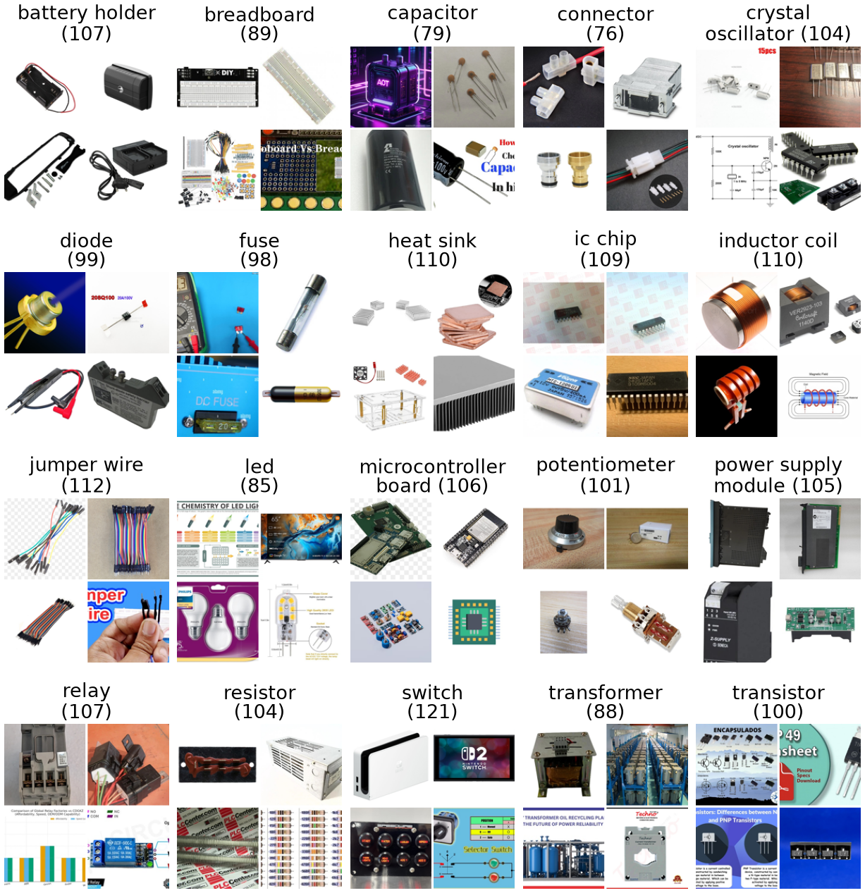
<figcaption><strong>Figure 1.</strong> Four random training images of every class (in brackets: training images of the class). The mix of product photos, close-ups, renders, diagrams and off-topic pictures (e.g. the game console under <em>switch</em>, the infographic under <em>led</em>) is typical of the dataset.</figcaption>
</figure>

### 2.3 Cleaning, label checking and corrections

All cleaning is done by `tools/build_dataset_v2.py`, which writes the manifest `data/v2/manifest.json` and the audit `data/v2/leakage_report.json`; Table 2 summarises the counts.

1.  **Decoding.** Every file was decoded and stored as an RGB JPEG (the unique files were 1,486 JPEG, 787 WebP, 402 PNG, 245 AVIF, 20 GIF and 3 MPO files; 345 transparent images were composited on white). No file was corrupt.

2.  **Exact duplicates.** Files with identical SHA-256 hashes were collapsed into one image (587 redundant copies in 533 groups). 13 groups (27 files) held the same image under two class folders, e.g. *fuse* and *relay*; their labels contradict each other, so they were **removed**, leaving 2,930 images.

3.  **Near-duplicates.** Re-encoded or resized copies were linked when their perceptual-hash distance (the Hamming distance between pHash codes) was at most 10 and the cosine similarity of their CLIP ViT-B/32 \[5\] embeddings at least 0.85, or when the cosine alone was at least 0.92. This gave 91 clusters with 234 images (sizes 2 to 29), which are kept but always assigned to the same split (Section 2.5).

4.  **Irrelevant or uncertain samples.** A CLIP zero-shot screen compares each image with the 20 class prompts and 9 distractor concepts (person, car, food, logo, text screenshot, cartoon or game art, circuit schematic, website screenshot, collage) and flags it when the distractor probability mass exceeds 0.25. It flagged 816 images (27.8%), concentrated in classes whose names are common words: 121 of 177 *switch* images (mostly Nintendo Switch consoles) and 64 of 128 *transformer* images (toy robots, cartoons). Flagged images are **kept and reported separately**: in earlier 5-fold cross-validation, dropping them from training lowered the accuracy of a linear classifier on frozen SigLIP features (a *linear probe*, Section 3.3) from 0.825 to 0.792 overall and from 0.861 to 0.852 on unflagged images.

5.  **Label errors.** A confident-learning audit \[6\] on out-of-fold probe probabilities listed 69 images whose given label is improbable while another class is highly probable.

**How labels were obtained, checked and corrected.** Labels come from the search query. They were checked automatically (conflicting duplicates, CLIP screen, confident-learning audit) and by inspecting the review sheets in `data/v2/review/`. The only correction applied was the removal of the 13 conflicting groups; we did not relabel images, which would need a manual review of all 2,930 images by more than one annotator. The test labels therefore contain the same noise as the training labels, which caps every model’s measurable accuracy.

| Step | Count | Action |
|:---|---:|:---|
| Raw image files in the Kaggle download | 3,530 | – |
| Unique files (distinct SHA-256 of the bytes) | 2,943 | – |
| redundant exact copies (533 duplicate groups) | 587 | collapsed to one |
| corrupt or undecodable files | 0 | – |
| duplicate groups with conflicting labels (27 files) | 13 | removed |
| Final images | 2,930 | kept |
| images in near-duplicate clusters (91 clusters, size 2–29) | 234 | kept, grouped |
| split units: clusters incl. singletons (groups, not images) | 2,787 | – |
| images flagged as possibly off-topic (CLIP screen) | 816 | kept, flagged |

**Table 2.** Cleaning pipeline (`data/v2/leakage_report.json`); indented rows break down the row above.

### 2.4 Class imbalance

After cleaning, the largest class (*switch*, 177 images) is 1.61 times the smallest (*connector*, 110); training classes have 76–121 images and test classes 16–25 (Table 1, Figure B.1 in Appendix B). Because the imbalance is mild we used **no class weights and no re-sampling**. Instead the split is stratified by class, early stopping and model selection use validation macro-F1 (every class counts equally), and we report macro averages and weighted F1.

### 2.5 Train/validation/test split and leakage prevention

The unit of splitting is the *duplicate cluster*: a near-duplicate cluster or a single image without near-duplicates (2,787 clusters). We split in two stages and always keep a cluster whole. First, `StratifiedGroupKFold` (scikit-learn \[7\]; 7 folds, shuffled, **seed 42**) partitions the clusters, and the fold whose class distribution is closest (total-variation distance) to the overall one becomes the **test** set (418 images), which is held out (“sealed”) until the final evaluation. Second, the remaining 2,512 development images are divided by the same method into five grouped folds: fold 0 is the **validation** set (502) and folds 1–4 form the **training** set (2,010), i.e. 68.6/17.1/14.3%, close to the 70/15/15 split suggested in the brief. The class distribution of each split is in Table 1. `tools/export_splits.py` writes the split from the manifest (fingerprint `431315e87d2612cb`) to `data/v2/splits/{train,val,test}.csv` and, with `--check`, verifies the files; the notebook and `make_tables.py` assert that no image and no cluster occurs in two splits. Grouping matters: in the dataset’s original random file split (counted over the raw file entries), 128 of 522 validation and 115 of 523 test entries are byte-identical copies of a training file, which inflates scores \[8\], \[9\] (Section 6.4). The test set was used once per model, after all choices had been fixed on validation data.

### 2.6 Ethical, privacy and licensing considerations

The task uses no health or personal records, and no person is a subject of the classification. As a web scrape, the data contain incidental people (the CLIP screen names “person” as the top distractor for 83 images) and trademarks (game consoles, brand logos). We identify no one; such images appear in our figures only as small thumbnails from the public dataset. Use follows Section 2.1: the source is acknowledged, the use is non-commercial and educational, and the images are not redistributed in the repository (they are rebuilt from the Kaggle download, Appendix D). The 407 photographs of the supplementary web holdout (Section 6.4) are from Wikimedia Commons under public-domain or Creative-Commons licences; author, licence and source of each are listed in `data/web_holdout_v1/ATTRIBUTION.md`. Pretrained weights come from their official `timm` releases \[10\]. The main risk is over-trust in a wrong label, which is why we report confidence and a reject option. Web search results may also over-represent clean product shots, so performance on cluttered workbench photographs can be lower (cf. the Wikimedia holdout in Section 6.4).

## 3 Methodology, selected models and transfer learning

Figure 2 shows the workflow. The same split files feed all <del>three</del> <ins>four</ins> models; each is selected on the validation set only and scored once on the test set.

> **Model D:** this figure is the four-model version; the report currently shows A, B and C.

<figure data-latex-placement="tb">
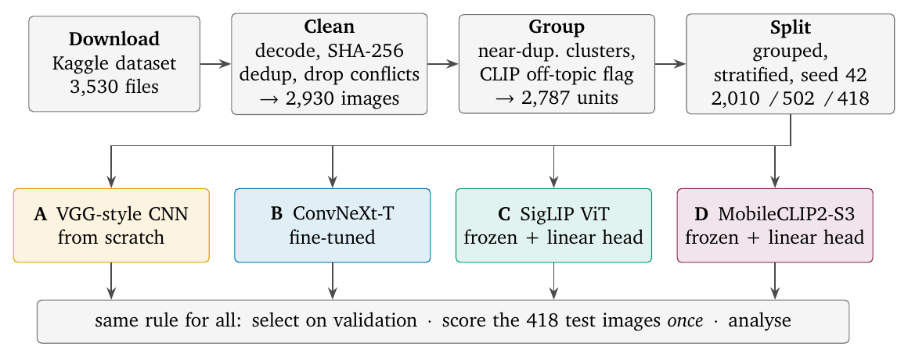
<figcaption><strong>Figure 2.</strong> Workflow. Data preparation (top) is shared; the <del>three</del> <ins>four</ins> models (middle, in the colours used in every figure) use the same split files and selection rule and are evaluated on the same 418 test images.</figcaption>
</figure>

### 3.1 Model A: VGG-style CNN trained from scratch (baseline)

A VGG-style network \[11\] written for this project (`src/compclass/models/scratch_cnn.py`): a stride-2 stem convolution, four stages of two 3×3 convolution–BatchNorm \[12\]–ReLU blocks (32, 64, 128, 256 channels) with max-pooling between stages, global average pooling, dropout 0.3 and a linear classifier; 1,187,636 parameters with He initialisation \[13\] and **no pretrained weights**. It shows what can be learned from about 2,000 images alone.

### 3.2 Model B: ConvNeXt-Tiny, fine-tuned (transfer learning by fine-tuning)

ConvNeXt \[14\] modernises the ResNet design \[15\] with 7×7 depthwise convolutions, inverted bottlenecks, LayerNorm and GELU. We use the Tiny variant (27,835,508 parameters) with the `timm` weights `convnext_tiny.fb_in22k_ft_in1k`, pretrained on ImageNet-22k and fine-tuned on ImageNet-1k \[16\]. The 1000-class head is replaced by a new 20-class linear layer, which is trained alone in the first epoch so that its large initial gradients do not disturb the pretrained features \[17\]. Afterwards all layers are trained, with layer-wise learning-rate decay 0.8 so that early, generic layers change less than late, task-specific ones. Fine-tuning ImageNet networks is the standard transfer recipe for small datasets \[18\], \[19\].

### 3.3 Model C: SigLIP So400m ViT, frozen, with a linear head (transfer learning by feature extraction)

The Vision Transformer \[20\] splits an image into patches and processes the patch tokens with self-attention. SigLIP \[21\] trains a ViT image encoder and a text encoder on WebLI (a web-scale image–text collection) with a pairwise sigmoid loss. We use its shape-optimised So400m/14 encoder at 384×384 pixels (27 blocks, width 1152, patch size 14; `timm` weights `vit_so400m_patch14_siglip_384.webli`). **The backbone is frozen.** Each image is encoded once into its attention-pooled 1152-dimensional embedding; the features are standardised with the training-split mean and standard deviation, and only one `nn.Linear(1152, 20)` layer (23,060 parameters) with softmax output is trained with cross-entropy and AdamW, i.e. the linear-probe protocol used for image–text models \[5\].

### 3.4 Model D: MobileCLIP2-S3 hybrid, frozen, with a linear head (feature extraction, small backbone) *(new, model D)*

<ins>MobileCLIP 2 \[22\] trains image–text encoders for on-device use; its S3 image encoder is a FastViT convolution–attention hybrid \[23\] at 256×256 pixels with 122,775,668 parameters, 3.5 times fewer than C (`timm` weights `fastvit_mci3.apple_mclip2_dfndr2b`). It is used exactly as C, with one `nn.Linear(3072, 20)` head trained by the same code, grid and selection rule. It was added to answer the cost half of the research question and was chosen on the development folds only (`docs/EFFICIENCY_STUDY.md`).</ins>

### 3.5 Rationale for the models and evaluation protocol

The brief lists a small custom CNN, ConvNeXt and the Vision Transformer as separate suitable families; our <ins>first three</ins> models take one from each (plain CNN, modernised CNN, Vision Transformer) and span the transfer-learning spectrum: no transfer (A), full fine-tuning of supervised ImageNet features (B) and frozen features from web-scale image–text pretraining (C). <ins>D repeats C’s strategy with a fourth family, a convolution–attention hybrid (the brief’s “another approved image classification architecture”; A–C satisfy the brief without it).</ins> Between B and C, architecture and pretraining data change together, so the comparison measures *model plus pretraining* as available to a practitioner; the supplementary benchmark (Section 6.4) separates the two factors.

**Evaluation.** On the test set we compute per-class precision, recall and F1, their macro averages (all classes equal) and weighted averages (by support), accuracy, balanced accuracy (equal to macro recall) and log-loss. Uncertainty is estimated with 2,000 bootstrap resamples of the test images \[24\]; pairs of models are compared on the same images with a paired bootstrap of the accuracy difference and an exact McNemar test \[25\], which tests whether, on the images where exactly one of the two models is right, each model is right equally often.

## 4 Experimental setup and hyperparameters

### 4.1 Preprocessing

Every image is decoded to 8-bit RGB, and each model uses the input size and normalisation of its weights. For **evaluation** (validation, test, and the feature extraction of model <del>C)</del> <ins>C and model D)</ins> the short side is resized to the input size divided by the crop fraction (0.875 for A and B, 0.9 for <del>C)</del> <ins>C, 1.0 for D)</ins> and the centre square is cut out: 183→160 px bilinear for A, 256→224 px bicubic for B, 427→384 px bicubic for <del>C.</del> <ins>C, 256 px bicubic with no border removed for D.</ins> Pixels are scaled to [0,1] and normalised per channel (mean and standard deviation 0.5 for A and C; ImageNet statistics for <del>B).</del> <ins>B; CLIP statistics for D).</ins>

### 4.2 Augmentation (training data only)

A and B are trained with `RandomResizedCrop` (aspect ratio 0.75–1.33), horizontal flips (p=0.5) and RandAugment with two operations of magnitude 9 \[26\]; A also uses colour jitter 0.2 and a wider crop range (scale 0.35–1 instead of 0.5–1), because a network trained from scratch needs stronger regularisation (Figure 3). Validation and test images always receive the deterministic evaluation transform. The transformations are realistic for this domain: web photos of parts are taken at arbitrary zoom and framing (random crops), components have no canonical left–right orientation (horizontal flips), and lighting, white balance and compression vary between shops and phones (RandAugment’s photometric operations, colour jitter). Vertical flips were not used because printed text and lighting in product shots have a natural “up”, and MixUp/CutMix were not used because blended components cannot occur. Model C <del>uses</del> <ins>and model D use</ins> no augmentation: <del>its</del> <ins>their</ins> features are computed once from the evaluation <del>crop,</del> <ins>view,</ins> which keeps the frozen-feature protocol simple and cheap.

<figure data-latex-placement="!tbp">
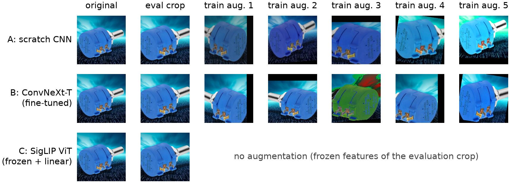
<figcaption><strong>Figure 3.</strong> One training image, its evaluation crop and five random training augmentations <del>per model.</del> <ins>for A, B and C.</ins> Model C <del>uses</del> <ins>and model D use</ins> frozen features of the evaluation <del>crop</del> <ins>view</ins> and therefore no augmentation.</figcaption>
</figure>

### 4.3 Hyperparameters

Table 3 lists every training setting. Settings differ where the architectures require it. A randomly initialised CNN needs a high learning rate, many epochs and strong augmentation. A pretrained network needs a small learning rate and few epochs. A linear head on frozen, standardised features needs neither augmentation nor a learning-rate schedule. The recipe of B was fixed earlier in the project’s grouped 5-fold cross-validation benchmark on the 2,512 development images only (`results/benchmark.csv`), and so was A’s apart from its schedule: the benchmark’s 120-epoch budget stopped A before it had converged, and the improvement study of Section 6.3, again on the development folds only, lengthened it to 200 epochs (patience 40). The 418 test images were never used for any of this. The only choice made here is the weight decay of model C’s head, selected on the validation set from {10⁻⁴,10⁻³,10⁻²,10⁻¹} (Table B.4, Appendix B). The 3 smallest values (10⁻⁴ to 10⁻²) reached the identical best validation macro-F1, because AdamW’s decoupled decay \[27\] is negligible over a few dozen epochs at this learning rate; the tie was broken by the rule, fixed before the grid was run, that the smallest value wins. <ins>Model D’s head went through the same grid under the same rule (Table B.5); there all four values tied.</ins> A and B use label smoothing 0.1 \[28\] and a cosine schedule \[29\]. All models are early-stopped on validation macro-F1, and the best validation epoch is tested.

> **Model D:** this table is changed (rows or columns for D added).

<table>
<caption><strong>Table 3.</strong> Training settings (<code>results/itri626/hyperparameters.csv</code>, <code>results/itri626/runs/*.json</code>). Epochs are counted from 1.</caption>
<thead>
<tr>
<th style="text-align: left;"></th>
<th style="text-align: left;"><strong>A</strong>: scratch CNN</th>
<th style="text-align: left;"><strong>B</strong>: ConvNeXt-T (fine-tuned)</th>
<th style="text-align: left;"><strong>C</strong>: SigLIP ViT (frozen + linear)</th>
<th style="text-align: left;"><strong>D</strong>: MobileCLIP2-S3 hybrid (frozen + linear)</th>
</tr>
</thead>
<tbody>
<tr>
<td colspan="5" style="text-align: left;">model</td>
</tr>
<tr>
<td style="text-align: left;">Model / variant</td>
<td style="text-align: left;">VGG-style CNN (scratch), width 32, 4 stages, dropout 0.3</td>
<td style="text-align: left;">ConvNeXt-Tiny, stochastic depth (drop-path rate) 0.1</td>
<td style="text-align: left;">ViT-So400m/14 (SigLIP), frozen; <code>nn.Linear(1152, 20)</code> head</td>
<td style="text-align: left;">FastViT-MCi3 hybrid (MobileCLIP2-S3), frozen; <code>nn.Linear(3072, 20)</code> head</td>
</tr>
<tr>
<td style="text-align: left;">Pretrained weights</td>
<td style="text-align: left;">none (He initialisation)</td>
<td style="text-align: left;"><code>convnext_tiny.fb_in22k_ft_in1k</code> (ImageNet-22k→1k)</td>
<td style="text-align: left;"><code>vit_so400m_patch14_siglip_384.webli</code> (WebLI)</td>
<td style="text-align: left;"><code>fastvit_mci3.apple_mclip2_dfndr2b</code> (DFNDR-2B)</td>
</tr>
<tr>
<td style="text-align: left;">Trainable / total params</td>
<td style="text-align: left;">1,187,636 / 1,187,636</td>
<td style="text-align: left;">27,835,508 / 27,835,508</td>
<td style="text-align: left;">23,060 / 428,248,660</td>
<td style="text-align: left;">61,460 / 122,775,668</td>
</tr>
<tr>
<td colspan="5" style="text-align: left;">data and augmentation</td>
</tr>
<tr>
<td style="text-align: left;">Input size (px)</td>
<td style="text-align: left;">160×160</td>
<td style="text-align: left;">224×224</td>
<td style="text-align: left;">384×384</td>
<td style="text-align: left;">256×256</td>
</tr>
<tr>
<td style="text-align: left;">Augmentation (training only)</td>
<td style="text-align: left;">RandomResizedCrop (scale 0.35–1), h-flip 0.5, RandAugment (2, 9), colour jitter 0.2</td>
<td style="text-align: left;">RandomResizedCrop (scale 0.5–1), h-flip 0.5, RandAugment (2, 9)</td>
<td style="text-align: left;">none (features of the evaluation crop)</td>
<td style="text-align: left;">none (features of the evaluation view)</td>
</tr>
<tr>
<td style="text-align: left;">Class weights / sampling</td>
<td style="text-align: left;">none (uniform shuffling)</td>
<td style="text-align: left;">none (uniform shuffling)</td>
<td style="text-align: left;">none (uniform shuffling)</td>
<td style="text-align: left;">none (uniform shuffling)</td>
</tr>
<tr>
<td style="text-align: left;">Batch size; grad. accumulation</td>
<td style="text-align: left;">64; none</td>
<td style="text-align: left;">32; none</td>
<td style="text-align: left;">256; none</td>
<td style="text-align: left;">256; none</td>
</tr>
<tr>
<td colspan="5" style="text-align: left;">optimisation</td>
</tr>
<tr>
<td style="text-align: left;">Optimiser</td>
<td style="text-align: left;">AdamW, grad. clip 1.0</td>
<td style="text-align: left;">AdamW, grad. clip 1.0</td>
<td style="text-align: left;">AdamW</td>
<td style="text-align: left;">AdamW</td>
</tr>
<tr>
<td style="text-align: left;">Learning rate</td>
<td style="text-align: left;">0.002</td>
<td style="text-align: left;">0.0002</td>
<td style="text-align: left;">0.001</td>
<td style="text-align: left;">0.001</td>
</tr>
<tr>
<td style="text-align: left;">LR schedule</td>
<td style="text-align: left;">linear warm-up 5 epochs, cosine to 0</td>
<td style="text-align: left;">head only in epoch 1, then all layers; warm-up 2 epochs, cosine to 0; layer-wise LR decay 0.8</td>
<td style="text-align: left;">constant</td>
<td style="text-align: left;">constant</td>
</tr>
<tr>
<td style="text-align: left;">Weight decay</td>
<td style="text-align: left;">0.05 (fixed)</td>
<td style="text-align: left;">0.05 (fixed)</td>
<td style="text-align: left;">0.0001 (grid on val., Table B.4)</td>
<td style="text-align: left;">0.0001 (grid on val., Table B.5)</td>
</tr>
<tr>
<td style="text-align: left;">Loss</td>
<td style="text-align: left;">cross-entropy, label smoothing 0.1</td>
<td style="text-align: left;">cross-entropy, label smoothing 0.1</td>
<td style="text-align: left;">cross-entropy, label smoothing 0.0</td>
<td style="text-align: left;">cross-entropy, label smoothing 0.0</td>
</tr>
<tr>
<td colspan="5" style="text-align: left;">regularisation and stopping</td>
</tr>
<tr>
<td style="text-align: left;">Early stopping</td>
<td style="text-align: left;">val. macro-F1, patience 40</td>
<td style="text-align: left;">val. macro-F1, patience 6</td>
<td style="text-align: left;">val. macro-F1, patience 20</td>
<td style="text-align: left;">val. macro-F1, patience 20</td>
</tr>
<tr>
<td style="text-align: left;">Epochs (max / run / best)</td>
<td style="text-align: left;">200 / 200 / 184</td>
<td style="text-align: left;">20 / 20 / 19</td>
<td style="text-align: left;">200 / 34 / 14</td>
<td style="text-align: left;">200 / 31 / 11</td>
</tr>
<tr>
<td colspan="5" style="text-align: left;">runtime</td>
</tr>
<tr>
<td style="text-align: left;">Numerical precision</td>
<td style="text-align: left;">mixed fp16</td>
<td style="text-align: left;">mixed fp16</td>
<td style="text-align: left;">fp16 features, fp32 head</td>
<td style="text-align: left;">fp16 features, fp32 head</td>
</tr>
<tr>
<td style="text-align: left;">Random seed (training; split)</td>
<td style="text-align: left;">0; 42</td>
<td style="text-align: left;">0; 42</td>
<td style="text-align: left;">0; 42</td>
<td style="text-align: left;">0; 42</td>
</tr>
<tr>
<td style="text-align: left;">Training time</td>
<td style="text-align: left;">390 s (GPU)</td>
<td style="text-align: left;">120 s (GPU)</td>
<td style="text-align: left;">1.7 s for all 4 grid runs (CPU, cached features)</td>
<td style="text-align: left;">2.4 s for all 4 grid runs (CPU, cached features)</td>
</tr>
</tbody>
</table>

### 4.4 Software, hardware and reproducibility

The models are implemented in PyTorch \[30\] with `timm` \[10\]; scikit-learn \[7\] provides the split and the reference probe, and uv \[31\] pins the environment. B was trained on one NVIDIA GeForce RTX 4060 Ti with 7.7 GiB of memory (all versions and the hardware are in Table B.1, Appendix B). The final run of A was trained after the improvement study (Section 6.3) on a second machine, one NVIDIA GeForce RTX 4070 Laptop GPU with 8.0 GiB (Windows 11; the same code, lock file and seed; its software versions are recorded in `results/itri626/runs/A_scratch_cnn.json`). Peak GPU memory was 435 MB for A and 2,312 MB for B, and <del>head</del> <ins>the heads of</ins> C <del>was</del> <ins>and D were</ins> trained on the CPU from cached <del>features.</del> <ins>features (D’s features were extracted, and D was timed, on the second machine).</ins> The training seed is 0 and the split seed 42. GPU training of A is not bit-for-bit reproducible (non-deterministic cuDNN kernels), so a re-run can differ slightly. All result files, the executed notebook `notebooks/ITRI626_four_models.ipynb` and the commands in Appendix D are in the repository.

**Fairness.** All <del>three</del> <ins>four</ins> models use the same 2,010 training, 502 validation and 418 test images, the same selection rule (best validation macro-F1) and a single test evaluation each, with no test-time augmentation. Tuning effort is comparable: the recipes of A and B come from the earlier development-set benchmark, and <del>C’s</del> <ins>the</ins> only tuned setting <ins>of C and of D</ins> is a four-value weight-decay grid on the validation set <del>(Table B.4).</del> <ins>(Tables B.4 and B.5). D’s crop fraction of 1.0 was fixed before any test look; on the development folds that view is worth about 1.5 points to C as well, so the gap from D to C is, if anything, understated.</ins> Budgets differ only where the architecture requires it (Table 3): A receives 200 epochs and converges within them (best epoch 184), whereas B begins to overfit within 20. B and C also differ in pretraining data, which we treat as part of each method (Section 6.5). No test number led to a change of any setting.

## 5 Results and model comparison

### 5.1 Overall test performance

Table 4 gives the test metrics. The ranking is the same for every metric: model C (accuracy 0.823, macro-F1 0.817) > model <ins>D (0.773, 0.770) > model</ins> B (0.636, 0.628) > model A (0.400, <del>0.392), and the</del> <ins>0.392). The</ins> 95% bootstrap intervals <ins>of A, B and the two frozen models</ins> do not <del>overlap.</del> <ins>overlap; those of C and D do, and the paired comparison separates them.</ins> The paired comparisons (Table 5) are decisive: B is right where A is wrong on 119 images against 20 the other way (p= 2.4×10⁻¹⁸), <del>and</del> C beats B on 92 images against 14 (p= <del>3.1×10⁻¹⁵).</del> <ins>3.1×10⁻¹⁵), D beats B on 80 against 23 (p= 1.5×10⁻⁸), and C beats D on 39 against 18 (p= 7.5×10⁻³).</ins> Because the classes are nearly balanced, balanced accuracy and macro and weighted averages agree. Test accuracy is <del>slightly above</del> <ins>within about two points of</ins> validation accuracy at the selected epoch for every model (A 0.378, B 0.618, C <del>0.803),</del> <ins>0.803, D 0.775),</ins> within the sampling variation of two sets of about 450 images. C also has the lowest log-loss (0.614), i.e. its probabilities are the most reliable, which the reject option in Section 6.2 exploits. The reference rows confirm C: a scikit-learn logistic-regression probe on the same features (R1) scores 0.833, 4 images more than C, and the project’s deployed model (R2: probe fitted on training plus validation data, fused with the zero-shot text head, i.e. SigLIP’s text encoder scoring the 20 class names) scores 0.837. R2 is not a <del>fourth</del> <ins>further</ins> model: it is C refitted on more data and is reported only to show what the recommended approach reaches in deployment. <ins>R3 is the same recipe on D’s features (0.806) and is likewise a reference row.</ins>

> **Model D:** this table is changed (rows or columns for D added).

<table>
<caption><strong>Table 4.</strong> Test-set metrics (<em>n</em> = 418, same images for all models; <code>results/itri626/metrics.json</code>). Bold: best main model. CI: 95% percentile bootstrap (2,000 resamples).</caption>
<thead>
<tr>
<th style="text-align: left;">Model</th>
<th style="text-align: center;">Acc.</th>
<th style="text-align: center;">Bal. acc.</th>
<th style="text-align: center;">Macro P</th>
<th style="text-align: center;">Macro R</th>
<th style="text-align: center;">Macro F1</th>
<th style="text-align: center;">Weighted F1</th>
<th style="text-align: center;">Log loss</th>
</tr>
</thead>
<tbody>
<tr>
<td style="text-align: left;">A: scratch CNN</td>
<td style="text-align: center;">0.400</td>
<td style="text-align: center;">0.391</td>
<td style="text-align: center;">0.399</td>
<td style="text-align: center;">0.391</td>
<td style="text-align: center;">0.392</td>
<td style="text-align: center;">0.400</td>
<td style="text-align: center;">2.361</td>
</tr>
<tr>
<td style="text-align: left;"></td>
<td style="text-align: center;">[0.354, 0.445]</td>
<td style="text-align: center;"></td>
<td style="text-align: center;"></td>
<td style="text-align: center;"></td>
<td style="text-align: center;">[0.342, 0.432]</td>
<td style="text-align: center;"></td>
<td style="text-align: center;"></td>
</tr>
<tr>
<td style="text-align: left;">B: ConvNeXt-T (fine-tuned)</td>
<td style="text-align: center;">0.636</td>
<td style="text-align: center;">0.630</td>
<td style="text-align: center;">0.642</td>
<td style="text-align: center;">0.630</td>
<td style="text-align: center;">0.628</td>
<td style="text-align: center;">0.632</td>
<td style="text-align: center;">1.346</td>
</tr>
<tr>
<td style="text-align: left;"></td>
<td style="text-align: center;">[0.591, 0.682]</td>
<td style="text-align: center;"></td>
<td style="text-align: center;"></td>
<td style="text-align: center;"></td>
<td style="text-align: center;">[0.578, 0.668]</td>
<td style="text-align: center;"></td>
<td style="text-align: center;"></td>
</tr>
<tr>
<td style="text-align: left;">C: SigLIP ViT (frozen + linear)</td>
<td style="text-align: center;"><strong>0.823</strong></td>
<td style="text-align: center;"><strong>0.821</strong></td>
<td style="text-align: center;"><strong>0.827</strong></td>
<td style="text-align: center;"><strong>0.821</strong></td>
<td style="text-align: center;"><strong>0.817</strong></td>
<td style="text-align: center;"><strong>0.820</strong></td>
<td style="text-align: center;"><strong>0.614</strong></td>
</tr>
<tr>
<td style="text-align: left;"></td>
<td style="text-align: center;">[0.787, 0.859]</td>
<td style="text-align: center;"></td>
<td style="text-align: center;"></td>
<td style="text-align: center;"></td>
<td style="text-align: center;">[0.774, 0.851]</td>
<td style="text-align: center;"></td>
<td style="text-align: center;"></td>
</tr>
<tr>
<td style="text-align: left;">D: MobileCLIP2-S3 hybrid (frozen + linear)</td>
<td style="text-align: center;">0.773</td>
<td style="text-align: center;">0.772</td>
<td style="text-align: center;">0.779</td>
<td style="text-align: center;">0.772</td>
<td style="text-align: center;">0.770</td>
<td style="text-align: center;">0.772</td>
<td style="text-align: center;">0.800</td>
</tr>
<tr>
<td style="text-align: left;"></td>
<td style="text-align: center;">[0.732, 0.811]</td>
<td style="text-align: center;"></td>
<td style="text-align: center;"></td>
<td style="text-align: center;"></td>
<td style="text-align: center;">[0.726, 0.806]</td>
<td style="text-align: center;"></td>
<td style="text-align: center;"></td>
</tr>
<tr>
<td colspan="8" style="text-align: left;"><em>Reference rows (same frozen SigLIP features as C; not additional models)</em></td>
</tr>
<tr>
<td style="text-align: left;">R1: SigLIP + sklearn probe</td>
<td style="text-align: center;">0.833</td>
<td style="text-align: center;">0.830</td>
<td style="text-align: center;">0.838</td>
<td style="text-align: center;">0.830</td>
<td style="text-align: center;">0.829</td>
<td style="text-align: center;">0.832</td>
<td style="text-align: center;">0.606</td>
</tr>
<tr>
<td style="text-align: left;">R2: deployed fused model</td>
<td style="text-align: center;">0.837</td>
<td style="text-align: center;">0.836</td>
<td style="text-align: center;">0.843</td>
<td style="text-align: center;">0.836</td>
<td style="text-align: center;">0.834</td>
<td style="text-align: center;">0.836</td>
<td style="text-align: center;">0.527</td>
</tr>
<tr>
<td colspan="8" style="text-align: left;"><em>Reference row (same frozen MobileCLIP2-S3 features as D; not an additional model)</em></td>
</tr>
<tr>
<td style="text-align: left;">R3: Small fused model</td>
<td style="text-align: center;">0.806</td>
<td style="text-align: center;">0.804</td>
<td style="text-align: center;">0.811</td>
<td style="text-align: center;">0.804</td>
<td style="text-align: center;">0.802</td>
<td style="text-align: center;">0.806</td>
<td style="text-align: center;">0.651</td>
</tr>
</tbody>
</table>

> **Model D:** this table is changed (rows or columns for D added).

| Pair | Δ accuracy | 95% CI | Only 1st right | Only 2nd right | McNemar p |
|:---|---:|:--:|---:|---:|---:|
| B − A | +0.237 | +0.189 to +0.289 | 119 | 20 | 2.4×10⁻¹⁸ |
| C − B | +0.187 | +0.141 to +0.232 | 92 | 14 | 3.1×10⁻¹⁵ |
| C − A | +0.423 | +0.373 to +0.474 | 184 | 7 | 1.1×10⁻⁴⁵ |
| C − D | +0.050 | +0.014 to +0.086 | 39 | 18 | 7.5×10⁻³ |
| D − B | +0.136 | +0.091 to +0.179 | 80 | 23 | 1.5×10⁻⁸ |

**Table 5.** Paired comparisons on the same 418 test images: accuracy difference Δ as a proportion (×100 = percentage points, as in the text), paired-bootstrap interval, discordant counts, exact McNemar test.

### 5.2 Learning curves

Figure 4 shows training and validation loss and validation accuracy and macro-F1 per epoch; Table B.2 (Appendix B) gives the values at the selected epoch. Losses are plain cross-entropy.

- **A** improves slowly for most of its 200-epoch budget and is selected at epoch 184. There its training accuracy is 0.83 but its validation accuracy only 0.378. The validation loss is lowest at epoch 81 (2.447; chance level ln 20=3.00) and then rises to 2.519 while validation accuracy and macro-F1 still improve: the network grows more confident without changing many decisions, and in its second hundred epochs it also fits the training set (training cross-entropy 0.712). The 120-epoch schedule of the earlier benchmark stopped it before this point (Section 6.3).

- **B** profits from its pretrained features at once: validation accuracy passes 0.5 in epoch 4 and plateaus near 0.618, while training accuracy rises to 0.91 and validation loss stays at about 1.431, i.e. a 28-million-parameter network overfits a small, noisy training set. The cosine schedule and early stopping (best epoch 19 of 20) keep it from getting worse.

- **C** passes 0.75 validation accuracy in epoch 3 and reaches 0.803. Training accuracy goes to 1.00, since 1,152 standardised features are almost linearly separable for 2,010 images. Validation loss is lowest in epoch 10 (0.756) and then creeps up while accuracy and macro-F1 stay flat: the head grows more confident without changing many decisions. Early stopping selected epoch 14.

> **Model D:** this figure is the four-model version; the report currently shows A, B and C.

<figure data-latex-placement="!tbp">
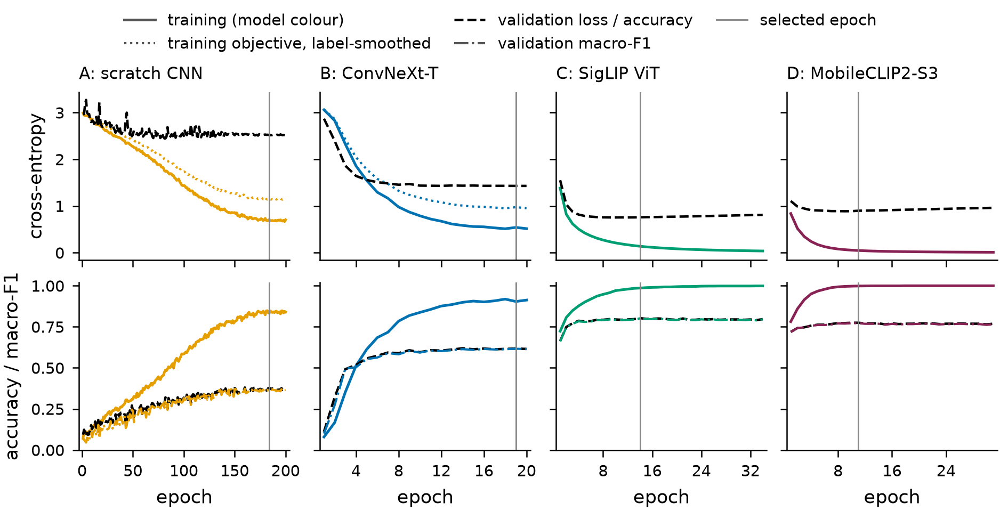
<figcaption><strong>Figure 4.</strong> Learning curves (one column per model). Top: cross-entropy; dotted: label-smoothed training objective (A, B). Bottom: training accuracy, validation accuracy and macro-F1. Training curves of A and B are measured on augmented batches; the grey line marks the epoch whose weights were tested.</figcaption>
</figure>

### 5.3 Per-class results and confusion matrices

Figure 5 plots the per-class test F1; the full per-class precision, recall and F1 values are in Table A.1 (Appendix A). Model C is best or tied for best in nearly every class; its weakest class is *resistor* (F1 0.61, recall 0.45) and its strongest *switch* (0.96). B is weakest on *fuse* (F1 0.34, recall 0.25). A exceeds F1 0.5 only for a few visually distinctive classes (*microcontroller board*, *switch*, *jumper wire*, *heat sink*). The confusion matrices (Figure 6) show A’s errors spread over the whole matrix, B’s concentrated in a few blocks, and <del>C’s matrix</del> <ins>those of C and D</ins> almost diagonal; Section 6.2 analyses the largest off-diagonal entries.

> **Model D:** this figure is the four-model version; the report currently shows A, B and C.

<figure data-latex-placement="p">
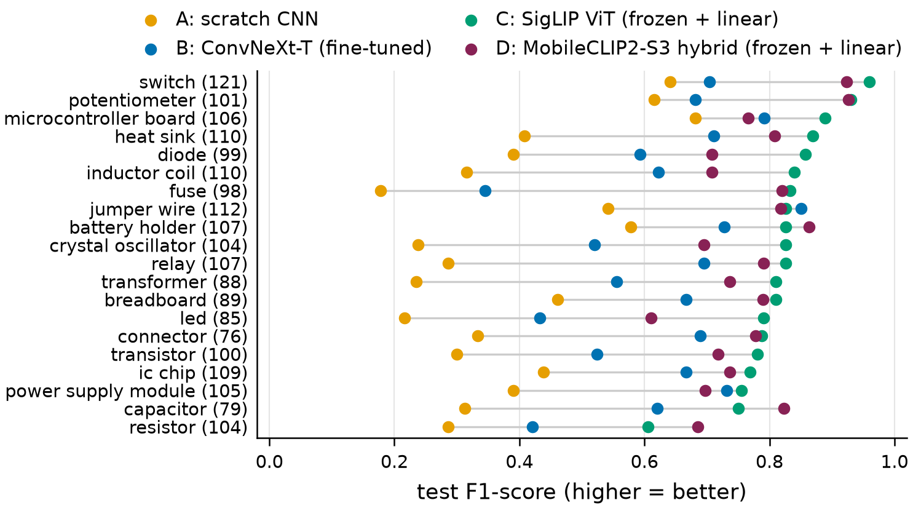
<figcaption><strong>Figure 5.</strong> Per-class test F1 of the <del>three</del> <ins>four</ins> models, sorted by model C; the number after each class is its training-set size.</figcaption>
</figure>

> **Model D:** this figure is the four-model version; the report currently shows A, B and C.

<figure data-latex-placement="p">
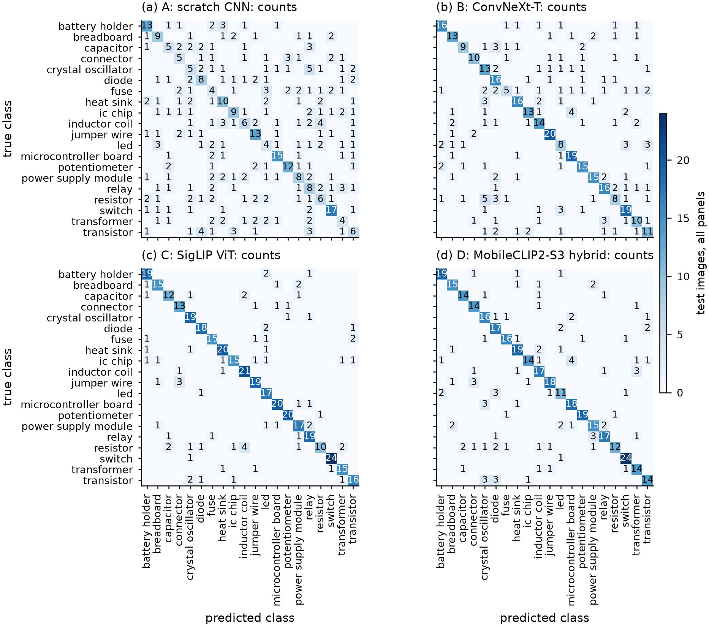
<figcaption><strong>Figure 6.</strong> Test confusion matrices <ins>of the four models</ins> (rows: true class; columns: predicted class; <em>n</em> = <del>418). (a)–(c) Counts</del> <ins>418): counts</ins> on one shared colour scale, so equal shades mean equal counts; empty cells are zero. <del>(d) Model C</del> <ins>The</ins> row-normalised <del>(the diagonal is</del> <ins>matrices (per-class recall on</ins> the <del>per-class recall); those of A and B</del> <ins>diagonal)</ins> are in the notebook.</figcaption>
</figure>

### 5.4 Correct and incorrect predictions

Figure 7 shows, for <del>each model,</del> <ins>A, B and C,</ins> six random correct predictions and <del>its</del> <ins>the</ins> six most confident errors with true class, prediction and softmax <del>confidence.</del> <ins>confidence; Figure B.2 (Appendix B) does the same for D.</ins> Many of C’s confident errors are images that do not show the labelled component: a DIP chip labelled *transistor*, a breadboard power module labelled *breadboard*, a fibre-optic pigtail and a coaxial plug labelled *jumper wire*, and an icon sheet and a “Capacitor vs Resistor” banner labelled *resistor*. A’s most confident errors include a sheet of package drawings labelled *diode*, an LED arrow sign labelled *power supply module* and handwritten notes labelled *inductor coil*.

<figure data-latex-placement="p">
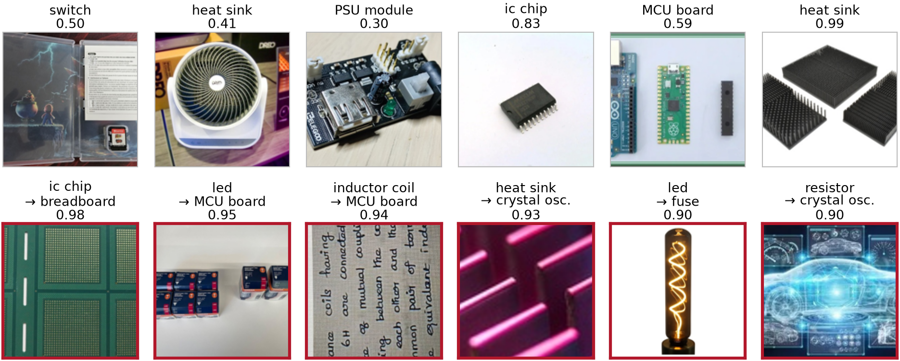

<em>Model A (scratch CNN)</em>

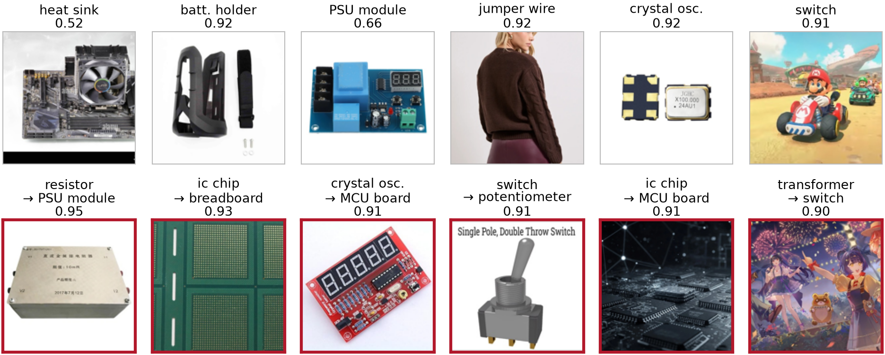

<em>Model B (ConvNeXt-T, fine-tuned)</em>

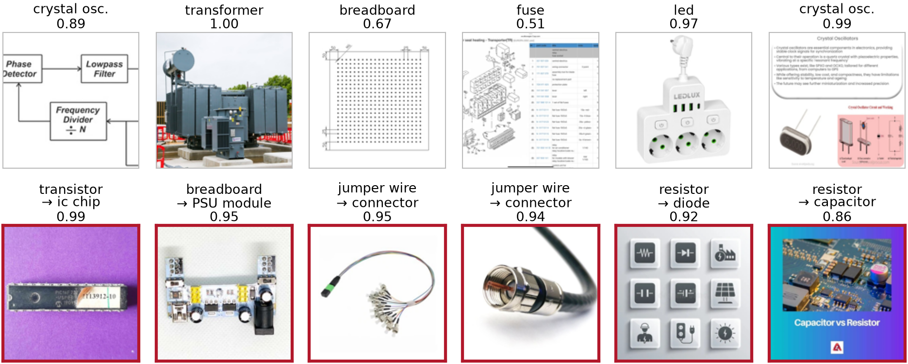

<em>Model C (SigLIP ViT, frozen + linear)</em>

<figcaption><strong>Figure 7.</strong> Six random correct predictions (top row of each panel) and the six most confident errors (bottom row, red frame, <em>true → predicted</em>) of every model on the test set. Confidence is the softmax probability of the predicted class. Abbreviations: MCU board = microcontroller board, PSU module = power supply module, crystal osc. = crystal oscillator, batt. holder = battery holder.</figcaption>
</figure>

### 5.5 Agreement between the models and computational cost

<del>All three models</del> <ins>A, B and C</ins> are <ins>all</ins> right on 143 test images and all <del>three</del> wrong on 57 (Figure 8). 75 images are recognised only by C and 109 by B and C but not A, whereas C is wrong on only 17 images that A or B get right (examples in Figure 9).

<figure>
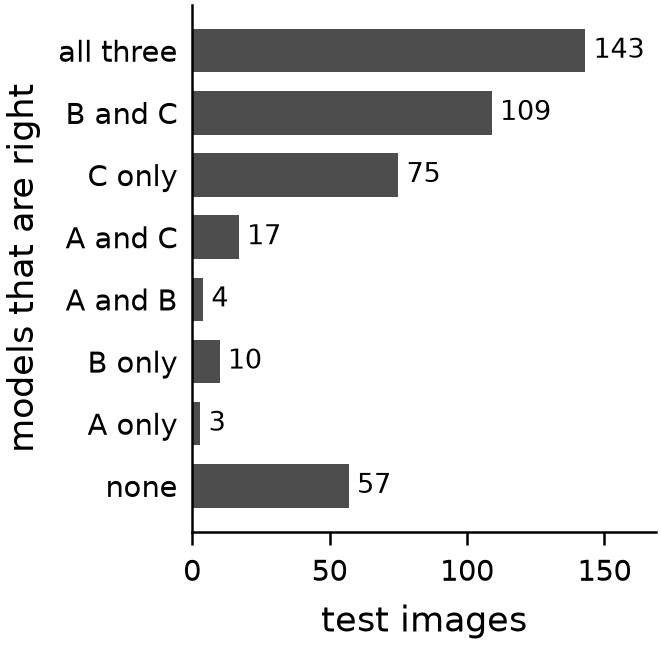
<figcaption><strong>Figure 8.</strong> Test images by the set of models <ins>among A, B and C</ins> that classify them correctly.</figcaption>
</figure>

<figure>
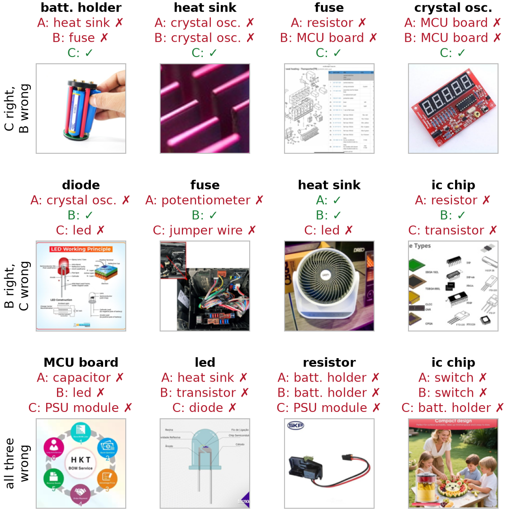
<figcaption><strong>Figure 9.</strong> Disagreements. Rows: C right and B wrong; B right and C wrong; all three wrong. Each title gives the true class (bold) and each model’s prediction; a green tick marks a correct and a red cross a wrong prediction. Abbreviations as in Figure 7.</figcaption>
</figure>

Accuracy has a price (Table B.3 in Appendix B): C needs 31.1 ms per image on the GPU at batch size 1, about 11 times as long as B (2.79 ms), and 893.5 ms on an 8-thread CPU, about 49 times as long as B (18.4 ms); its frozen backbone weighs 1,633.6 MB in fp32. <ins>D recovers most of that cost: 468.4 MB of weights and, timed on one PC with the same procedure, 2.5 times faster than C’s tower on the GPU and 14 times on the CPU.</ins>

## 6 Discussion, limitations and error analysis

### 6.1 Why the models differ

The ranking follows *how much relevant visual knowledge each model brings* to a 2,010-image problem, rather than depth or parameter count. **A** starts from random weights and must learn edges, textures, shapes and classes at once from about 100 images per class; its learning curves show it is data-limited, as does the improvement study of Section 6.3 (more epochs helped; more capacity, residual blocks, stronger augmentation and better initialisation did not), and its per-class F1 correlates with the number of training images (Spearman ρ over the 20 classes +0.51, against +0.56 for B and +0.43 for C). **B** re-uses ImageNet-22k features that already encode objects, materials and shapes, so it learns fast; but ImageNet contains few electronic parts, so the features are generic, and fine-tuning all 28 million parameters on 2,010 noisy images overfits (training accuracy 0.91 against 0.618 on validation). **C** uses a 428-million-parameter encoder pretrained on web image–text pairs. Its embedding already separates the classes: SigLIP zero-shot classification, with no training at all, reaches macro-F1 0.776 in the benchmark (Section 6.4). It is also the least affected by off-topic images (0.759 on flagged test images against 0.500 for B, Section 6.2), plausibly because such images resemble its web pretraining data. Freezing the backbone means label noise cannot distort it, and training the 23,060 head parameters takes 1.7 s for the whole grid on cached features. <ins>**D** applies the same strategy with a 122.8-million-parameter hybrid. Its features separate the classes less well than C’s (5.0 points) but far better than B’s fine-tuned ImageNet features (13.6 points): what the backbone has seen matters more than its family or whether it is fine-tuned.</ins>

### 6.2 Error analysis

**Look-alike components.** Table 6 lists the most frequent confusions. C’s largest are *resistor*→*inductor coil* (4) and *jumper wire*→*connector* (3); B’s are *resistor*→*crystal oscillator* (5) and *ic chip*→*microcontroller board* (4). These pairs share shapes: colour-banded axial bodies (some inductors look like fat resistors), cables with plugs, chips mounted on boards. *Resistor* is C’s hardest class: precision 0.91 but recall only 0.45, partly because several test “resistors” are icon sheets, banners or schematics. A’s confusions (e.g. *fuse*→*connector*, *fuse*→*switch*) are spread widely and often have no obvious visual explanation, consistent with a model that has not learned robust shape features. *Diode* and *led* are related devices that are often shown together in infographics (2 of C’s errors are *diode*→*led*). Summed over <del>the three models,</del> <ins>A, B and C,</ins> the most frequent confusions are resistor → crystal oscillator (8); jumper wire → connector (7); transistor → diode (7); crystal oscillator → relay (6).

> **Model D:** this table is changed (rows or columns for D added).

<table>
<caption><strong>Table 6.</strong> Most frequent test confusions (true → predicted) of A, B and C, from the confusion matrices in <code>results/itri626/metrics.json</code> (D’s are in the text); equal counts are listed alphabetically. MCU board: microcontroller board.</caption>
<tbody>
<tr>
<td style="text-align: center;"></td>
<td colspan="2" style="text-align: center;">A: scratch CNN</td>
<td colspan="2" style="text-align: center;">B: ConvNeXt-T (fine-tuned)</td>
<td colspan="2" style="text-align: center;">C: SigLIP ViT (frozen + linear)</td>
</tr>
<tr>
<td style="text-align: center;">#</td>
<td style="text-align: left;">True → predicted</td>
<td style="text-align: right;"><em>n</em></td>
<td style="text-align: left;">True → predicted</td>
<td style="text-align: right;"><em>n</em></td>
<td style="text-align: left;">True → predicted</td>
<td style="text-align: right;"><em>n</em></td>
</tr>
<tr>
<td style="text-align: center;">1</td>
<td style="text-align: left;">crystal oscillator → relay</td>
<td style="text-align: right;">5</td>
<td style="text-align: left;">resistor → crystal oscillator</td>
<td style="text-align: right;">5</td>
<td style="text-align: left;">resistor → inductor coil</td>
<td style="text-align: right;">4</td>
</tr>
<tr>
<td style="text-align: center;">2</td>
<td style="text-align: left;">inductor coil → resistor</td>
<td style="text-align: right;">4</td>
<td style="text-align: left;">ic chip → MCU board</td>
<td style="text-align: right;">4</td>
<td style="text-align: left;">jumper wire → connector</td>
<td style="text-align: right;">3</td>
</tr>
<tr>
<td style="text-align: center;">3</td>
<td style="text-align: left;">transistor → diode</td>
<td style="text-align: right;">4</td>
<td style="text-align: left;">capacitor → diode</td>
<td style="text-align: right;">3</td>
<td style="text-align: left;">battery holder → led</td>
<td style="text-align: right;">2</td>
</tr>
<tr>
<td style="text-align: center;">4</td>
<td style="text-align: left;">battery holder → heat sink</td>
<td style="text-align: right;">3</td>
<td style="text-align: left;">heat sink → crystal oscillator</td>
<td style="text-align: right;">3</td>
<td style="text-align: left;">breadboard → power supply module</td>
<td style="text-align: right;">2</td>
</tr>
<tr>
<td style="text-align: center;">5</td>
<td style="text-align: left;">capacitor → relay</td>
<td style="text-align: right;">3</td>
<td style="text-align: left;">led → switch</td>
<td style="text-align: right;">3</td>
<td style="text-align: left;">capacitor → inductor coil</td>
<td style="text-align: right;">2</td>
</tr>
<tr>
<td style="text-align: center;">6</td>
<td style="text-align: left;">connector → potentiometer</td>
<td style="text-align: right;">3</td>
<td style="text-align: left;">led → transistor</td>
<td style="text-align: right;">3</td>
<td style="text-align: left;">diode → led</td>
<td style="text-align: right;">2</td>
</tr>
</tbody>
</table>

**Data quality matters more than class imbalance.** On the 306 test images that the CLIP screen did not flag, accuracy is 0.435 (A), 0.686 (B) and 0.846 (C); on the 112 flagged ones it is 0.304, 0.500 and 0.759. B loses most (19 points; A 13, C 9), and C stays far ahead on flagged images, plausibly because its pretraining has seen such web content. <del>All three models</del> <ins>A, B and C all</ins> fail on 57 test images, many of them infographics, diagrams or scenes without the labelled component, where the label rather than the prediction is often questionable (Figure 9). Class imbalance, by contrast, is not an important factor: the size ratio is only 1.61, and C’s per-class F1 is not significantly related to class size (ρ = +0.43, p=0.06).

**Confidence is informative.** C’s mean softmax confidence is 0.87 on correct and 0.47 on wrong predictions (B: 0.76 and 0.43), so a reject option can catch many errors \[32\], \[33\]. The deployed model uses one: at a confidence threshold of 0.5 it answers 87.1% of the test images and is right on 0.909 of those.

### 6.3 Can the scratch CNN be improved?

Model A’s score invites the question whether a better recipe, rather than pretraining, would close the gap. A 24-experiment study answered it on the development folds only (`docs/SCRATCH_CNN_IMPROVEMENT_REPORT.md`; log in `docs/SCRATCH_CNN_IMPROVEMENT_LOG.md`; each change screened on folds 0–2 and confirmed on all five, with single-run noise of ±2–3 points). Input resolution (224 and 256 px), MixUp, width (2.2× and 4× the parameters), depth and residual blocks, label smoothing 0.2, flip test-time augmentation, whitening and identity initialisation, stronger augmentation, dropout 0.5, weight averaging and whole-picture resizing all changed nothing or made it worse. <del>Two things</del> <ins>One thing</ins> helped (Table <del>7). Training</del> <ins>7): training</ins> to convergence (200 instead of 120 epochs) added 3.5 points of five-fold macro-F1 on every <del>fold;</del> <ins>fold and 5.6 points on the test split;</ins> that schedule is the model A reported in this paper. <del>Knowledge distillation \[34\] from a logistic probe</del> <ins>It needs ten times the epochs of the fine-tuned network (200 against 20) and still overfits: 0.83 training accuracy against 0.378</ins> on <del>frozen SigLIP features, fitted per fold on that fold’s training rows only, added a further 4.6 ± 0.7 points on every fold, but it brings model C’s pretrained knowledge in through</del> <ins>validation at</ins> the <del>targets, so it is a fourth model rather than a better A. On the one sealed-test look the two recipes are indistinguishable (0.392 against 0.393 macro-F1; paired bootstrap -4.4 to +4.5 points: 418 images cannot resolve a 4-point difference between two single training runs).</del> <ins>selected epoch.</ins> On the 407 out-of-source Wikimedia photographs <del>both fall hard,</del> <ins>the scratch network falls</ins> to 0.257 <del>and 0.298</del> macro-F1 against 0.816 for the deployed SigLIP <del>model, and there the distillation gain reappears (+4.0 points, +0.3 to +7.9).</del> <ins>model.</ins> The lesson is the main comparison’s: features learned from 2,010 photographs of one web scrape describe that scrape, and the <del>only lever that moved</del> <ins>limit is</ins> the <del>scratch network, apart from letting it finish training, was a pretrained model’s knowledge.</del> <ins>data, not the training budget.</ins>

> **Proposed cut:** the row "A + distillation from C" is removed from this table.

| Recipe | Epochs | Dev. 5-fold macro-F1 | Test macro-F1 | Test acc. | Holdout macro-F1 | Holdout acc. |
|:---|:--:|:--:|:--:|:--:|:--:|:--:|
| A, previous build | 120 | 0.355 ± 0.015 | 0.336 | 0.354 | – | – |
| **A, this report** | 200 | 0.390 ± 0.007 | 0.392 | 0.400 | 0.257 | 0.283 |
| Deployed SigLIP model (R2) | – | – | 0.834 | 0.837 | 0.816 | 0.821 |

**Table 7.** Scratch-CNN improvement study. Development: grouped 5-fold macro-F1 (mean ± SD over folds). Test and holdout: one training run on the fixed split, scored once (`results/scratch_cnn_improvement/`). The 120-epoch row is the model A of the previous build of this report; R2 is the deployed model of Table 4.

### 6.4 Supporting evidence from the wider study

The project’s broader study (details in Appendix C) supports the comparison. Grouped 5-fold cross-validation over eleven families reproduces the ordering (macro-F1: scratch CNN 0.355 with the benchmark’s 120-epoch schedule, 0.390 with the 200-epoch schedule of Section 6.3; ConvNeXt-T fine-tuned 0.641, frozen SigLIP So400m probe 0.824), and every ImageNet-pretrained fine-tune (0.547–0.654) stays below SigLIP zero-shot classification without any training (0.776). The dataset’s original file-level split leaks duplicates and inflates linear-probe accuracy by 5.5 to 13.6 points, more for weaker models. On 407 fresh Wikimedia Commons photographs the deployed SigLIP-based model (R2) scored 0.821 accuracy, close to its in-distribution result.

### 6.5 Limitations

1.  **One split, one training seed.** With about 21 test images per class, one image moves a per-class F1 by up to about 0.05, and accuracy differences below about 4 points would not be significant. The cross-validation benchmark gives the same ordering.

2.  **Noisy labels and scope.** Labels are unreviewed search terms and 27.8% of the images are flagged as possibly off-topic (by an automated screen that no person verified). Measured accuracy therefore underestimates performance on clean photographs. Because no person checked the test labels either, per-class scores for homonym classes (*switch*, *transformer*) partly measure the scrape rather than the model.

3.  **Screen and model share a lineage.** The off-topic flags come from a CLIP model, a relative of C’s SigLIP encoder, so the flagged/unflagged comparison in Section 6.2 may favour C.

4.  **Residual near-duplicates.** The near-duplicate rule (pHash and CLIP thresholds) can miss heavily edited copies, so some train–test similarity may remain.

5.  **Unequal pretraining and budgets.** C’s backbone was trained on far more data than B’s, so the comparison measures model and pretraining together. The budgets of A and B were fixed by earlier cross-validation, not tuned exhaustively. A was then trained to convergence, and the study of Section 6.3 found no further recipe gain, so the gap of 42.3 points to C is not a budget artefact.

6.  **Cost.** C has 428.2 million parameters and needs about 893.5 ms per image on a CPU, which rules it out for microcontrollers or real-time video without a GPU.

7.  <ins>**Model D’s asymmetries.** D was timed on a different PC (Table B.3 gives C’s tower there as the anchor), its evaluation view removes no border while C’s removes 10%, and its weights carry Apple’s research-only licence, unlike the Apache-2.0 weights of B and C.</ins>

## 7 Conclusion

The answer to our question is clear: a frozen web-pretrained encoder with a linear head beats both fine-tuning and training from scratch on this data. On one leakage-free split and the same 418 test images the <del>three</del> <ins>four</ins> model families rank: a frozen SigLIP So400m ViT with a linear head (accuracy 0.823, macro-F1 0.817), <ins>a frozen MobileCLIP2-S3 hybrid with the same head (0.773, 0.770),</ins> a fine-tuned ConvNeXt-T (0.636, 0.628) and a VGG-style CNN trained from scratch (0.400, 0.392). The differences are statistically clear and confirmed by the 5-fold benchmark. Transfer learning is the decisive factor: ImageNet fine-tuning adds 23.7 percentage points over training from scratch, and large-scale image–text pretraining another 18.7. Trying to improve the scratch network directly (Section 6.3) did not change this picture: training it to convergence gained 3.5 points, <ins>and</ins> nothing in architecture, regularisation or initialisation gained <del>anything, and the one further gain came from distilling model C.</del> <ins>anything.</ins>

**Recommended model: C, the frozen SigLIP So400m ViT with a linear softmax head.** It is the most accurate by a wide margin, the most robust to off-topic web images, confident enough on correct answers for a reject option, and the cheapest to train (23,060 parameters, learned in seconds), provided a GPU or about a second per CPU image is acceptable. Where <ins>C is too heavy, model D is the second choice: 5.0 points lower with 3.5 times fewer parameters, 2.5 times faster on a GPU and 14 times on a CPU, for non-commercial use. Where</ins> inference <del>cost dominates (mobile devices, real-time video),</del> <ins>must be faster still,</ins> the fine-tuned ConvNeXt-T <del>is the practical second choice:</del> <ins>remains:</ins> about 11 times faster <ins>than C</ins> on a GPU, at about 18.7 percentage points lower. R2, the deployed variant of model C (probe refitted on training plus validation data and fused with the text head), scores 0.837 and is what we would ship. The clearest route to further gains is better data rather than a bigger model: relabelling the audited issues and cleaning the classes contaminated by homonyms (*switch*, *transformer*).

**Lessons learned.** On a few thousand noisy web images the choice of pretrained representation matters far more than the classifier trained on top, and a grouped, duplicate-aware split is needed before any of these differences can be trusted.

## References

\[1\] Y. Shao, L. Zhou, F. Tang, X. Shi, D. Chen, and S. Xia, “Comparative performance of finetuned ImageNet pre-trained models for electronic component classification,” in *Proc. 7th int. Conf. Universal village (UV)*, 2024, pp. 1–10. doi: [10.1109/uv63228.2024.11189118](https://doi.org/10.1109/uv63228.2024.11189118).

\[2\] L. Zhou and L. Zhang, “A novel convolutional neural network for electronic component classification with diverse backgrounds,” in *Modeling and simulation in manufacturing*, World Scientific, 2025, pp. 191–207. doi: [10.1142/9789819801473_0011](https://doi.org/10.1142/9789819801473_0011).

\[3\] Q. Ling and N. A. M. Isa, “Printed circuit board defect detection methods based on image processing, machine learning and deep learning: A survey,” *IEEE Access*, vol. 11, pp. 15921–15944, 2023, doi: [10.1109/access.2023.3245093](https://doi.org/10.1109/access.2023.3245093).

\[4\] mdfaisalahmed025, “Electronic Component Recognizer.” Kaggle dataset (20 classes), <https://www.kaggle.com/datasets/mdfaisalahmed025/electronic-component-recognizer>.

\[5\] A. Radford *et al.*, “Learning transferable visual models from natural language supervision,” in *Proc. 38th int. Conf. Mach. Learn. (ICML)*, in Proc. Mach. Learn. res., vol. 139. 2021, pp. 8748–8763.

\[6\] C. Northcutt, L. Jiang, and I. Chuang, “Confident learning: Estimating uncertainty in dataset labels,” *J. Artif. Intell. Res.*, vol. 70, pp. 1373–1411, 2021, doi: [10.1613/jair.1.12125](https://doi.org/10.1613/jair.1.12125).

\[7\] F. Pedregosa, G. Varoquaux, A. Gramfort, V. Michel, B. Thirion, *et al.*, “Scikit-learn: Machine learning in Python,” *J. Mach. Learn. Res.*, vol. 12, pp. 2825–2830, 2011.

\[8\] B. Barz and J. Denzler, “Do we train on test data? Purging CIFAR of near-duplicates,” *J. Imaging*, vol. 6, no. 6, p. 41, 2020, doi: [10.3390/jimaging6060041](https://doi.org/10.3390/jimaging6060041).

\[9\] S. Kapoor and A. Narayanan, “Leakage and the reproducibility crisis in machine-learning-based science,” *Patterns*, vol. 4, no. 9, p. 100804, 2023, doi: [10.1016/j.patter.2023.100804](https://doi.org/10.1016/j.patter.2023.100804).

\[10\] R. Wightman, “PyTorch Image Models (timm).” GitHub repository, <https://github.com/huggingface/pytorch-image-models>, 2019.

\[11\] K. Simonyan and A. Zisserman, “Very deep convolutional networks for large-scale image recognition,” in *Proc. Int. Conf. Learn. Represent. (ICLR)*, 2015.

\[12\] S. Ioffe and C. Szegedy, “Batch normalization: Accelerating deep network training by reducing internal covariate shift,” in *Proc. 32nd int. Conf. Mach. Learn. (ICML)*, in Proc. Mach. Learn. res., vol. 37. 2015, pp. 448–456.

\[13\] K. He, X. Zhang, S. Ren, and J. Sun, “Delving deep into rectifiers: Surpassing human-level performance on ImageNet classification,” in *Proc. IEEE int. Conf. Comput. Vis. (ICCV)*, 2015, pp. 1026–1034. doi: [10.1109/ICCV.2015.123](https://doi.org/10.1109/ICCV.2015.123).

\[14\] Z. Liu, H. Mao, C.-Y. Wu, C. Feichtenhofer, T. Darrell, and S. Xie, “A ConvNet for the 2020s,” in *Proc. IEEE/CVF conf. Comput. Vis. Pattern recognit. (CVPR)*, 2022, pp. 11966–11976. doi: [10.1109/cvpr52688.2022.01167](https://doi.org/10.1109/cvpr52688.2022.01167).

\[15\] K. He, X. Zhang, S. Ren, and J. Sun, “Deep residual learning for image recognition,” in *Proc. IEEE conf. Comput. Vis. Pattern recognit. (CVPR)*, 2016, pp. 770–778. doi: [10.1109/cvpr.2016.90](https://doi.org/10.1109/cvpr.2016.90).

\[16\] O. Russakovsky *et al.*, “ImageNet large scale visual recognition challenge,” *Int. J. Comput. Vis.*, vol. 115, no. 3, pp. 211–252, 2015, doi: [10.1007/s11263-015-0816-y](https://doi.org/10.1007/s11263-015-0816-y).

\[17\] A. Kumar, A. Raghunathan, R. Jones, T. Ma, and P. Liang, “Fine-tuning can distort pretrained features and underperform out-of-distribution,” in *Proc. Int. Conf. Learn. Represent. (ICLR)*, 2022.

\[18\] J. Yosinski, J. Clune, Y. Bengio, and H. Lipson, “How transferable are features in deep neural networks?” in *Adv. Neural inf. Process. Syst. (NeurIPS)*, 2014, pp. 3320–3328.

\[19\] S. Kornblith, J. Shlens, and Q. V. Le, “Do better ImageNet models transfer better?” in *Proc. IEEE/CVF conf. Comput. Vis. Pattern recognit. (CVPR)*, 2019, pp. 2656–2666. doi: [10.1109/cvpr.2019.00277](https://doi.org/10.1109/cvpr.2019.00277).

\[20\] A. Dosovitskiy *et al.*, “An image is worth 16x16 words: Transformers for image recognition at scale,” in *Proc. Int. Conf. Learn. Represent. (ICLR)*, 2021.

\[21\] X. Zhai, B. Mustafa, A. Kolesnikov, and L. Beyer, “Sigmoid loss for language image pre-training,” in *Proc. IEEE/CVF int. Conf. Comput. Vis. (ICCV)*, 2023, pp. 11941–11952. doi: [10.1109/iccv51070.2023.01100](https://doi.org/10.1109/iccv51070.2023.01100).

<ins>\[22\] F. Faghri *et al.*, “MobileCLIP2: Improving multi-modal reinforced training,” *Trans. Mach. Learn. Res.*, 2025.</ins>

<ins>\[23\] P. K. A. Vasu, J. Gabriel, J. Zhu, O. Tuzel, and A. Ranjan, “FastViT: A fast hybrid vision transformer using structural reparameterization,” in *Proc. IEEE/CVF int. Conf. Comput. Vis. (ICCV)*, 2023.</ins>

\[24\] B. Efron, “Bootstrap methods: Another look at the jackknife,” *Ann. Statist.*, vol. 7, no. 1, pp. 1–26, 1979, doi: [10.1214/aos/1176344552](https://doi.org/10.1214/aos/1176344552).

\[25\] Q. McNemar, “Note on the sampling error of the difference between correlated proportions or percentages,” *Psychometrika*, vol. 12, no. 2, pp. 153–157, 1947, doi: [10.1007/BF02295996](https://doi.org/10.1007/BF02295996).

\[26\] E. D. Cubuk, B. Zoph, J. Shlens, and Q. V. Le, “RandAugment: Practical automated data augmentation with a reduced search space,” in *Proc. IEEE/CVF conf. Comput. Vis. Pattern recognit. Workshops (CVPRW)*, 2020, pp. 3008–3017. doi: [10.1109/cvprw50498.2020.00359](https://doi.org/10.1109/cvprw50498.2020.00359).

\[27\] I. Loshchilov and F. Hutter, “Decoupled weight decay regularization,” in *Proc. Int. Conf. Learn. Represent. (ICLR)*, 2019.

\[28\] C. Szegedy, V. Vanhoucke, S. Ioffe, J. Shlens, and Z. Wojna, “Rethinking the Inception architecture for computer vision,” in *Proc. IEEE conf. Comput. Vis. Pattern recognit. (CVPR)*, 2016, pp. 2818–2826. doi: [10.1109/cvpr.2016.308](https://doi.org/10.1109/cvpr.2016.308).

\[29\] I. Loshchilov and F. Hutter, “SGDR: Stochastic gradient descent with warm restarts,” in *Proc. Int. Conf. Learn. Represent. (ICLR)*, 2017.

\[30\] A. Paszke *et al.*, “PyTorch: An imperative style, high-performance deep learning library,” in *Adv. Neural inf. Process. Syst. (NeurIPS)*, 2019.

\[31\] Astral Software, “Uv: An extremely fast Python package and project manager.” <https://docs.astral.sh/uv/>, 2024.

\[32\] C. Chow, “On optimum recognition error and reject tradeoff,” *IEEE Trans. Inf. Theory*, vol. 16, no. 1, pp. 41–46, 1970, doi: [10.1109/tit.1970.1054406](https://doi.org/10.1109/tit.1970.1054406).

\[33\] Y. Geifman and R. El-Yaniv, “Selective classification for deep neural networks,” in *Adv. Neural inf. Process. Syst. (NeurIPS)*, 2017.

**Removed:** \[32\]  G. Hinton, O. Vinyals, and J. Dean, “Distilling the Knowledge in a Neural Network.” arXiv preprint arXiv:1503.02531, 2015. Available: <https://arxiv.org/abs/1503.02531>

## A Full per-class results

Table A.1 gives the per-class test precision, recall and F1 of <del>the three main models,</del> <ins>model A, model B and model C, Table A.3 those of model D and its reference row R3,</ins> and Table A.2 those of the <del>two</del> reference rows <ins>R1 and R2, all</ins> on the same test images. The per-class image counts of every split are in Table 1.

<table>
<caption><strong>Table A.1.</strong> Per-class test precision (P), recall (R) and F1 (<em>n</em> = test images per class; <code>results/itri626/per_class.csv</code>). Best F1 per class in bold.</caption>
<tbody>
<tr>
<td style="text-align: left;"></td>
<td style="text-align: right;"></td>
<td colspan="3" style="text-align: center;">A: scratch CNN</td>
<td colspan="3" style="text-align: center;">B: ConvNeXt-T</td>
<td colspan="3" style="text-align: center;">C: SigLIP ViT</td>
</tr>
<tr>
<td style="text-align: left;">Class</td>
<td style="text-align: right;"><em>n</em></td>
<td style="text-align: center;">P</td>
<td style="text-align: center;">R</td>
<td style="text-align: center;">F1</td>
<td style="text-align: center;">P</td>
<td style="text-align: center;">R</td>
<td style="text-align: center;">F1</td>
<td style="text-align: center;">P</td>
<td style="text-align: center;">R</td>
<td style="text-align: center;">F1</td>
</tr>
<tr>
<td style="text-align: left;">battery holder</td>
<td style="text-align: right;">22</td>
<td style="text-align: center;">0.57</td>
<td style="text-align: center;">0.59</td>
<td style="text-align: center;">0.58</td>
<td style="text-align: center;">0.73</td>
<td style="text-align: center;">0.73</td>
<td style="text-align: center;">0.73</td>
<td style="text-align: center;">0.79</td>
<td style="text-align: center;">0.86</td>
<td style="text-align: center;"><strong>0.83</strong></td>
</tr>
<tr>
<td style="text-align: left;">breadboard</td>
<td style="text-align: right;">19</td>
<td style="text-align: center;">0.45</td>
<td style="text-align: center;">0.47</td>
<td style="text-align: center;">0.46</td>
<td style="text-align: center;">0.65</td>
<td style="text-align: center;">0.68</td>
<td style="text-align: center;">0.67</td>
<td style="text-align: center;">0.83</td>
<td style="text-align: center;">0.79</td>
<td style="text-align: center;"><strong>0.81</strong></td>
</tr>
<tr>
<td style="text-align: left;">capacitor</td>
<td style="text-align: right;">17</td>
<td style="text-align: center;">0.33</td>
<td style="text-align: center;">0.29</td>
<td style="text-align: center;">0.31</td>
<td style="text-align: center;">0.75</td>
<td style="text-align: center;">0.53</td>
<td style="text-align: center;">0.62</td>
<td style="text-align: center;">0.80</td>
<td style="text-align: center;">0.71</td>
<td style="text-align: center;"><strong>0.75</strong></td>
</tr>
<tr>
<td style="text-align: left;">connector</td>
<td style="text-align: right;">16</td>
<td style="text-align: center;">0.36</td>
<td style="text-align: center;">0.31</td>
<td style="text-align: center;">0.33</td>
<td style="text-align: center;">0.77</td>
<td style="text-align: center;">0.62</td>
<td style="text-align: center;">0.69</td>
<td style="text-align: center;">0.76</td>
<td style="text-align: center;">0.81</td>
<td style="text-align: center;"><strong>0.79</strong></td>
</tr>
<tr>
<td style="text-align: left;">crystal oscillator</td>
<td style="text-align: right;">21</td>
<td style="text-align: center;">0.24</td>
<td style="text-align: center;">0.24</td>
<td style="text-align: center;">0.24</td>
<td style="text-align: center;">0.45</td>
<td style="text-align: center;">0.62</td>
<td style="text-align: center;">0.52</td>
<td style="text-align: center;">0.76</td>
<td style="text-align: center;">0.90</td>
<td style="text-align: center;"><strong>0.83</strong></td>
</tr>
<tr>
<td style="text-align: left;">diode</td>
<td style="text-align: right;">21</td>
<td style="text-align: center;">0.40</td>
<td style="text-align: center;">0.38</td>
<td style="text-align: center;">0.39</td>
<td style="text-align: center;">0.48</td>
<td style="text-align: center;">0.76</td>
<td style="text-align: center;">0.59</td>
<td style="text-align: center;">0.86</td>
<td style="text-align: center;">0.86</td>
<td style="text-align: center;"><strong>0.86</strong></td>
</tr>
<tr>
<td style="text-align: left;">fuse</td>
<td style="text-align: right;">20</td>
<td style="text-align: center;">0.16</td>
<td style="text-align: center;">0.20</td>
<td style="text-align: center;">0.18</td>
<td style="text-align: center;">0.56</td>
<td style="text-align: center;">0.25</td>
<td style="text-align: center;">0.34</td>
<td style="text-align: center;">0.94</td>
<td style="text-align: center;">0.75</td>
<td style="text-align: center;"><strong>0.83</strong></td>
</tr>
<tr>
<td style="text-align: left;">heat sink</td>
<td style="text-align: right;">23</td>
<td style="text-align: center;">0.38</td>
<td style="text-align: center;">0.43</td>
<td style="text-align: center;">0.41</td>
<td style="text-align: center;">0.73</td>
<td style="text-align: center;">0.70</td>
<td style="text-align: center;">0.71</td>
<td style="text-align: center;">0.87</td>
<td style="text-align: center;">0.87</td>
<td style="text-align: center;"><strong>0.87</strong></td>
</tr>
<tr>
<td style="text-align: left;">ic chip</td>
<td style="text-align: right;">22</td>
<td style="text-align: center;">0.47</td>
<td style="text-align: center;">0.41</td>
<td style="text-align: center;">0.44</td>
<td style="text-align: center;">0.76</td>
<td style="text-align: center;">0.59</td>
<td style="text-align: center;">0.67</td>
<td style="text-align: center;">0.88</td>
<td style="text-align: center;">0.68</td>
<td style="text-align: center;"><strong>0.77</strong></td>
</tr>
<tr>
<td style="text-align: left;">inductor coil</td>
<td style="text-align: right;">23</td>
<td style="text-align: center;">0.40</td>
<td style="text-align: center;">0.26</td>
<td style="text-align: center;">0.32</td>
<td style="text-align: center;">0.64</td>
<td style="text-align: center;">0.61</td>
<td style="text-align: center;">0.62</td>
<td style="text-align: center;">0.78</td>
<td style="text-align: center;">0.91</td>
<td style="text-align: center;"><strong>0.84</strong></td>
</tr>
<tr>
<td style="text-align: left;">jumper wire</td>
<td style="text-align: right;">23</td>
<td style="text-align: center;">0.52</td>
<td style="text-align: center;">0.57</td>
<td style="text-align: center;">0.54</td>
<td style="text-align: center;">0.83</td>
<td style="text-align: center;">0.87</td>
<td style="text-align: center;"><strong>0.85</strong></td>
<td style="text-align: center;">0.83</td>
<td style="text-align: center;">0.83</td>
<td style="text-align: center;">0.83</td>
</tr>
<tr>
<td style="text-align: left;">led</td>
<td style="text-align: right;">18</td>
<td style="text-align: center;">0.21</td>
<td style="text-align: center;">0.22</td>
<td style="text-align: center;">0.22</td>
<td style="text-align: center;">0.42</td>
<td style="text-align: center;">0.44</td>
<td style="text-align: center;">0.43</td>
<td style="text-align: center;">0.68</td>
<td style="text-align: center;">0.94</td>
<td style="text-align: center;"><strong>0.79</strong></td>
</tr>
<tr>
<td style="text-align: left;">microcontroller board</td>
<td style="text-align: right;">22</td>
<td style="text-align: center;">0.68</td>
<td style="text-align: center;">0.68</td>
<td style="text-align: center;">0.68</td>
<td style="text-align: center;">0.73</td>
<td style="text-align: center;">0.86</td>
<td style="text-align: center;">0.79</td>
<td style="text-align: center;">0.87</td>
<td style="text-align: center;">0.91</td>
<td style="text-align: center;"><strong>0.89</strong></td>
</tr>
<tr>
<td style="text-align: left;">potentiometer</td>
<td style="text-align: right;">21</td>
<td style="text-align: center;">0.67</td>
<td style="text-align: center;">0.57</td>
<td style="text-align: center;">0.62</td>
<td style="text-align: center;">0.65</td>
<td style="text-align: center;">0.71</td>
<td style="text-align: center;">0.68</td>
<td style="text-align: center;">0.91</td>
<td style="text-align: center;">0.95</td>
<td style="text-align: center;"><strong>0.93</strong></td>
</tr>
<tr>
<td style="text-align: left;">power supply module</td>
<td style="text-align: right;">22</td>
<td style="text-align: center;">0.42</td>
<td style="text-align: center;">0.36</td>
<td style="text-align: center;">0.39</td>
<td style="text-align: center;">0.79</td>
<td style="text-align: center;">0.68</td>
<td style="text-align: center;">0.73</td>
<td style="text-align: center;">0.74</td>
<td style="text-align: center;">0.77</td>
<td style="text-align: center;"><strong>0.76</strong></td>
</tr>
<tr>
<td style="text-align: left;">relay</td>
<td style="text-align: right;">22</td>
<td style="text-align: center;">0.24</td>
<td style="text-align: center;">0.36</td>
<td style="text-align: center;">0.29</td>
<td style="text-align: center;">0.67</td>
<td style="text-align: center;">0.73</td>
<td style="text-align: center;">0.70</td>
<td style="text-align: center;">0.79</td>
<td style="text-align: center;">0.86</td>
<td style="text-align: center;"><strong>0.83</strong></td>
</tr>
<tr>
<td style="text-align: left;">resistor</td>
<td style="text-align: right;">22</td>
<td style="text-align: center;">0.30</td>
<td style="text-align: center;">0.27</td>
<td style="text-align: center;">0.29</td>
<td style="text-align: center;">0.50</td>
<td style="text-align: center;">0.36</td>
<td style="text-align: center;">0.42</td>
<td style="text-align: center;">0.91</td>
<td style="text-align: center;">0.45</td>
<td style="text-align: center;"><strong>0.61</strong></td>
</tr>
<tr>
<td style="text-align: left;">switch</td>
<td style="text-align: right;">25</td>
<td style="text-align: center;">0.61</td>
<td style="text-align: center;">0.68</td>
<td style="text-align: center;">0.64</td>
<td style="text-align: center;">0.66</td>
<td style="text-align: center;">0.76</td>
<td style="text-align: center;">0.70</td>
<td style="text-align: center;">0.96</td>
<td style="text-align: center;">0.96</td>
<td style="text-align: center;"><strong>0.96</strong></td>
</tr>
<tr>
<td style="text-align: left;">transformer</td>
<td style="text-align: right;">18</td>
<td style="text-align: center;">0.25</td>
<td style="text-align: center;">0.22</td>
<td style="text-align: center;">0.24</td>
<td style="text-align: center;">0.56</td>
<td style="text-align: center;">0.56</td>
<td style="text-align: center;">0.56</td>
<td style="text-align: center;">0.79</td>
<td style="text-align: center;">0.83</td>
<td style="text-align: center;"><strong>0.81</strong></td>
</tr>
<tr>
<td style="text-align: left;">transistor</td>
<td style="text-align: right;">21</td>
<td style="text-align: center;">0.32</td>
<td style="text-align: center;">0.29</td>
<td style="text-align: center;">0.30</td>
<td style="text-align: center;">0.52</td>
<td style="text-align: center;">0.52</td>
<td style="text-align: center;">0.52</td>
<td style="text-align: center;">0.80</td>
<td style="text-align: center;">0.76</td>
<td style="text-align: center;"><strong>0.78</strong></td>
</tr>
<tr>
<td style="text-align: left;">Macro average</td>
<td style="text-align: right;">418</td>
<td style="text-align: center;">0.40</td>
<td style="text-align: center;">0.39</td>
<td style="text-align: center;">0.39</td>
<td style="text-align: center;">0.64</td>
<td style="text-align: center;">0.63</td>
<td style="text-align: center;">0.63</td>
<td style="text-align: center;">0.83</td>
<td style="text-align: center;">0.82</td>
<td style="text-align: center;">0.82</td>
</tr>
</tbody>
</table>

<table>
<caption><strong>Table A.2.</strong> Per-class test results of the reference rows (<code>results/itri626/metrics.json</code>, key <code>references</code>). R1: scikit-learn logistic-regression probe (inverse regularisation <em>C</em> = 0.01) on the same frozen SigLIP features and training split as C. R2: the deployed model (probe fitted on train + validation, fused with the zero-shot text head, temperature 0.898).</caption>
<tbody>
<tr>
<td style="text-align: left;"></td>
<td style="text-align: right;"></td>
<td colspan="3" style="text-align: center;">R1: sklearn probe</td>
<td colspan="3" style="text-align: center;">R2: deployed</td>
</tr>
<tr>
<td style="text-align: left;">Class</td>
<td style="text-align: right;"><em>n</em></td>
<td style="text-align: center;">P</td>
<td style="text-align: center;">R</td>
<td style="text-align: center;">F1</td>
<td style="text-align: center;">P</td>
<td style="text-align: center;">R</td>
<td style="text-align: center;">F1</td>
</tr>
<tr>
<td style="text-align: left;">battery holder</td>
<td style="text-align: right;">22</td>
<td style="text-align: center;">0.77</td>
<td style="text-align: center;">0.91</td>
<td style="text-align: center;">0.83</td>
<td style="text-align: center;">0.83</td>
<td style="text-align: center;">0.86</td>
<td style="text-align: center;">0.84</td>
</tr>
<tr>
<td style="text-align: left;">breadboard</td>
<td style="text-align: right;">19</td>
<td style="text-align: center;">0.79</td>
<td style="text-align: center;">0.79</td>
<td style="text-align: center;">0.79</td>
<td style="text-align: center;">0.84</td>
<td style="text-align: center;">0.84</td>
<td style="text-align: center;">0.84</td>
</tr>
<tr>
<td style="text-align: left;">capacitor</td>
<td style="text-align: right;">17</td>
<td style="text-align: center;">0.80</td>
<td style="text-align: center;">0.71</td>
<td style="text-align: center;">0.75</td>
<td style="text-align: center;">0.81</td>
<td style="text-align: center;">0.76</td>
<td style="text-align: center;">0.79</td>
</tr>
<tr>
<td style="text-align: left;">connector</td>
<td style="text-align: right;">16</td>
<td style="text-align: center;">0.76</td>
<td style="text-align: center;">0.81</td>
<td style="text-align: center;">0.79</td>
<td style="text-align: center;">0.76</td>
<td style="text-align: center;">0.81</td>
<td style="text-align: center;">0.79</td>
</tr>
<tr>
<td style="text-align: left;">crystal oscillator</td>
<td style="text-align: right;">21</td>
<td style="text-align: center;">0.73</td>
<td style="text-align: center;">0.90</td>
<td style="text-align: center;">0.81</td>
<td style="text-align: center;">0.76</td>
<td style="text-align: center;">0.90</td>
<td style="text-align: center;">0.83</td>
</tr>
<tr>
<td style="text-align: left;">diode</td>
<td style="text-align: right;">21</td>
<td style="text-align: center;">0.86</td>
<td style="text-align: center;">0.86</td>
<td style="text-align: center;">0.86</td>
<td style="text-align: center;">0.86</td>
<td style="text-align: center;">0.86</td>
<td style="text-align: center;">0.86</td>
</tr>
<tr>
<td style="text-align: left;">fuse</td>
<td style="text-align: right;">20</td>
<td style="text-align: center;">0.94</td>
<td style="text-align: center;">0.85</td>
<td style="text-align: center;">0.89</td>
<td style="text-align: center;">0.94</td>
<td style="text-align: center;">0.80</td>
<td style="text-align: center;">0.86</td>
</tr>
<tr>
<td style="text-align: left;">heat sink</td>
<td style="text-align: right;">23</td>
<td style="text-align: center;">0.91</td>
<td style="text-align: center;">0.87</td>
<td style="text-align: center;">0.89</td>
<td style="text-align: center;">0.87</td>
<td style="text-align: center;">0.87</td>
<td style="text-align: center;">0.87</td>
</tr>
<tr>
<td style="text-align: left;">ic chip</td>
<td style="text-align: right;">22</td>
<td style="text-align: center;">0.94</td>
<td style="text-align: center;">0.73</td>
<td style="text-align: center;">0.82</td>
<td style="text-align: center;">0.94</td>
<td style="text-align: center;">0.77</td>
<td style="text-align: center;">0.85</td>
</tr>
<tr>
<td style="text-align: left;">inductor coil</td>
<td style="text-align: right;">23</td>
<td style="text-align: center;">0.84</td>
<td style="text-align: center;">0.91</td>
<td style="text-align: center;">0.88</td>
<td style="text-align: center;">0.91</td>
<td style="text-align: center;">0.87</td>
<td style="text-align: center;">0.89</td>
</tr>
<tr>
<td style="text-align: left;">jumper wire</td>
<td style="text-align: right;">23</td>
<td style="text-align: center;">0.83</td>
<td style="text-align: center;">0.83</td>
<td style="text-align: center;">0.83</td>
<td style="text-align: center;">0.76</td>
<td style="text-align: center;">0.83</td>
<td style="text-align: center;">0.79</td>
</tr>
<tr>
<td style="text-align: left;">led</td>
<td style="text-align: right;">18</td>
<td style="text-align: center;">0.73</td>
<td style="text-align: center;">0.89</td>
<td style="text-align: center;">0.80</td>
<td style="text-align: center;">0.68</td>
<td style="text-align: center;">0.94</td>
<td style="text-align: center;">0.79</td>
</tr>
<tr>
<td style="text-align: left;">microcontroller board</td>
<td style="text-align: right;">22</td>
<td style="text-align: center;">0.87</td>
<td style="text-align: center;">0.91</td>
<td style="text-align: center;">0.89</td>
<td style="text-align: center;">0.91</td>
<td style="text-align: center;">0.91</td>
<td style="text-align: center;">0.91</td>
</tr>
<tr>
<td style="text-align: left;">potentiometer</td>
<td style="text-align: right;">21</td>
<td style="text-align: center;">0.91</td>
<td style="text-align: center;">0.95</td>
<td style="text-align: center;">0.93</td>
<td style="text-align: center;">0.91</td>
<td style="text-align: center;">1.00</td>
<td style="text-align: center;">0.95</td>
</tr>
<tr>
<td style="text-align: left;">power supply module</td>
<td style="text-align: right;">22</td>
<td style="text-align: center;">0.71</td>
<td style="text-align: center;">0.77</td>
<td style="text-align: center;">0.74</td>
<td style="text-align: center;">0.70</td>
<td style="text-align: center;">0.73</td>
<td style="text-align: center;">0.71</td>
</tr>
<tr>
<td style="text-align: left;">relay</td>
<td style="text-align: right;">22</td>
<td style="text-align: center;">0.79</td>
<td style="text-align: center;">0.86</td>
<td style="text-align: center;">0.83</td>
<td style="text-align: center;">0.79</td>
<td style="text-align: center;">0.86</td>
<td style="text-align: center;">0.83</td>
</tr>
<tr>
<td style="text-align: left;">resistor</td>
<td style="text-align: right;">22</td>
<td style="text-align: center;">1.00</td>
<td style="text-align: center;">0.59</td>
<td style="text-align: center;">0.74</td>
<td style="text-align: center;">1.00</td>
<td style="text-align: center;">0.55</td>
<td style="text-align: center;">0.71</td>
</tr>
<tr>
<td style="text-align: left;">switch</td>
<td style="text-align: right;">25</td>
<td style="text-align: center;">0.96</td>
<td style="text-align: center;">0.92</td>
<td style="text-align: center;">0.94</td>
<td style="text-align: center;">0.96</td>
<td style="text-align: center;">0.96</td>
<td style="text-align: center;">0.96</td>
</tr>
<tr>
<td style="text-align: left;">transformer</td>
<td style="text-align: right;">18</td>
<td style="text-align: center;">0.78</td>
<td style="text-align: center;">0.78</td>
<td style="text-align: center;">0.78</td>
<td style="text-align: center;">0.78</td>
<td style="text-align: center;">0.78</td>
<td style="text-align: center;">0.78</td>
</tr>
<tr>
<td style="text-align: left;">transistor</td>
<td style="text-align: right;">21</td>
<td style="text-align: center;">0.84</td>
<td style="text-align: center;">0.76</td>
<td style="text-align: center;">0.80</td>
<td style="text-align: center;">0.85</td>
<td style="text-align: center;">0.81</td>
<td style="text-align: center;">0.83</td>
</tr>
<tr>
<td style="text-align: left;">Macro average</td>
<td style="text-align: right;">418</td>
<td style="text-align: center;">0.84</td>
<td style="text-align: center;">0.83</td>
<td style="text-align: center;">0.83</td>
<td style="text-align: center;">0.84</td>
<td style="text-align: center;">0.84</td>
<td style="text-align: center;">0.83</td>
</tr>
</tbody>
</table>

> **Model D:** new table.

<table>
<caption><strong>Table A.3.</strong> Per-class test results of model D and of R3, the packaged Small model: D’s frozen features with R2’s recipe (probe fitted on train + validation, fused with MobileCLIP 2’s zero-shot text head; <code>exports/mobileclip2_s3/</code>).</caption>
<tbody>
<tr>
<td style="text-align: left;"></td>
<td style="text-align: right;"></td>
<td colspan="3" style="text-align: center;">D: MobileCLIP2-S3 hybrid</td>
<td colspan="3" style="text-align: center;">R3: Small (fused)</td>
</tr>
<tr>
<td style="text-align: left;">Class</td>
<td style="text-align: right;"><em>n</em></td>
<td style="text-align: center;">P</td>
<td style="text-align: center;">R</td>
<td style="text-align: center;">F1</td>
<td style="text-align: center;">P</td>
<td style="text-align: center;">R</td>
<td style="text-align: center;">F1</td>
</tr>
<tr>
<td style="text-align: left;">battery holder</td>
<td style="text-align: right;">22</td>
<td style="text-align: center;">0.86</td>
<td style="text-align: center;">0.86</td>
<td style="text-align: center;">0.86</td>
<td style="text-align: center;">0.86</td>
<td style="text-align: center;">0.82</td>
<td style="text-align: center;">0.84</td>
</tr>
<tr>
<td style="text-align: left;">breadboard</td>
<td style="text-align: right;">19</td>
<td style="text-align: center;">0.79</td>
<td style="text-align: center;">0.79</td>
<td style="text-align: center;">0.79</td>
<td style="text-align: center;">0.83</td>
<td style="text-align: center;">0.79</td>
<td style="text-align: center;">0.81</td>
</tr>
<tr>
<td style="text-align: left;">capacitor</td>
<td style="text-align: right;">17</td>
<td style="text-align: center;">0.82</td>
<td style="text-align: center;">0.82</td>
<td style="text-align: center;">0.82</td>
<td style="text-align: center;">0.82</td>
<td style="text-align: center;">0.82</td>
<td style="text-align: center;">0.82</td>
</tr>
<tr>
<td style="text-align: left;">connector</td>
<td style="text-align: right;">16</td>
<td style="text-align: center;">0.70</td>
<td style="text-align: center;">0.88</td>
<td style="text-align: center;">0.78</td>
<td style="text-align: center;">0.72</td>
<td style="text-align: center;">0.81</td>
<td style="text-align: center;">0.76</td>
</tr>
<tr>
<td style="text-align: left;">crystal oscillator</td>
<td style="text-align: right;">21</td>
<td style="text-align: center;">0.64</td>
<td style="text-align: center;">0.76</td>
<td style="text-align: center;">0.70</td>
<td style="text-align: center;">0.73</td>
<td style="text-align: center;">0.90</td>
<td style="text-align: center;">0.81</td>
</tr>
<tr>
<td style="text-align: left;">diode</td>
<td style="text-align: right;">21</td>
<td style="text-align: center;">0.63</td>
<td style="text-align: center;">0.81</td>
<td style="text-align: center;">0.71</td>
<td style="text-align: center;">0.72</td>
<td style="text-align: center;">0.86</td>
<td style="text-align: center;">0.78</td>
</tr>
<tr>
<td style="text-align: left;">fuse</td>
<td style="text-align: right;">20</td>
<td style="text-align: center;">0.84</td>
<td style="text-align: center;">0.80</td>
<td style="text-align: center;">0.82</td>
<td style="text-align: center;">0.84</td>
<td style="text-align: center;">0.80</td>
<td style="text-align: center;">0.82</td>
</tr>
<tr>
<td style="text-align: left;">heat sink</td>
<td style="text-align: right;">23</td>
<td style="text-align: center;">0.79</td>
<td style="text-align: center;">0.83</td>
<td style="text-align: center;">0.81</td>
<td style="text-align: center;">0.83</td>
<td style="text-align: center;">0.87</td>
<td style="text-align: center;">0.85</td>
</tr>
<tr>
<td style="text-align: left;">ic chip</td>
<td style="text-align: right;">22</td>
<td style="text-align: center;">0.88</td>
<td style="text-align: center;">0.64</td>
<td style="text-align: center;">0.74</td>
<td style="text-align: center;">0.94</td>
<td style="text-align: center;">0.68</td>
<td style="text-align: center;">0.79</td>
</tr>
<tr>
<td style="text-align: left;">inductor coil</td>
<td style="text-align: right;">23</td>
<td style="text-align: center;">0.68</td>
<td style="text-align: center;">0.74</td>
<td style="text-align: center;">0.71</td>
<td style="text-align: center;">0.75</td>
<td style="text-align: center;">0.78</td>
<td style="text-align: center;">0.77</td>
</tr>
<tr>
<td style="text-align: left;">jumper wire</td>
<td style="text-align: right;">23</td>
<td style="text-align: center;">0.86</td>
<td style="text-align: center;">0.78</td>
<td style="text-align: center;">0.82</td>
<td style="text-align: center;">0.95</td>
<td style="text-align: center;">0.83</td>
<td style="text-align: center;">0.88</td>
</tr>
<tr>
<td style="text-align: left;">led</td>
<td style="text-align: right;">18</td>
<td style="text-align: center;">0.61</td>
<td style="text-align: center;">0.61</td>
<td style="text-align: center;">0.61</td>
<td style="text-align: center;">0.62</td>
<td style="text-align: center;">0.72</td>
<td style="text-align: center;">0.67</td>
</tr>
<tr>
<td style="text-align: left;">microcontroller board</td>
<td style="text-align: right;">22</td>
<td style="text-align: center;">0.72</td>
<td style="text-align: center;">0.82</td>
<td style="text-align: center;">0.77</td>
<td style="text-align: center;">0.87</td>
<td style="text-align: center;">0.91</td>
<td style="text-align: center;">0.89</td>
</tr>
<tr>
<td style="text-align: left;">potentiometer</td>
<td style="text-align: right;">21</td>
<td style="text-align: center;">0.95</td>
<td style="text-align: center;">0.90</td>
<td style="text-align: center;">0.93</td>
<td style="text-align: center;">0.91</td>
<td style="text-align: center;">0.95</td>
<td style="text-align: center;">0.93</td>
</tr>
<tr>
<td style="text-align: left;">power supply module</td>
<td style="text-align: right;">22</td>
<td style="text-align: center;">0.71</td>
<td style="text-align: center;">0.68</td>
<td style="text-align: center;">0.70</td>
<td style="text-align: center;">0.70</td>
<td style="text-align: center;">0.73</td>
<td style="text-align: center;">0.71</td>
</tr>
<tr>
<td style="text-align: left;">relay</td>
<td style="text-align: right;">22</td>
<td style="text-align: center;">0.81</td>
<td style="text-align: center;">0.77</td>
<td style="text-align: center;">0.79</td>
<td style="text-align: center;">0.75</td>
<td style="text-align: center;">0.82</td>
<td style="text-align: center;">0.78</td>
</tr>
<tr>
<td style="text-align: left;">resistor</td>
<td style="text-align: right;">22</td>
<td style="text-align: center;">0.92</td>
<td style="text-align: center;">0.55</td>
<td style="text-align: center;">0.69</td>
<td style="text-align: center;">0.92</td>
<td style="text-align: center;">0.55</td>
<td style="text-align: center;">0.69</td>
</tr>
<tr>
<td style="text-align: left;">switch</td>
<td style="text-align: right;">25</td>
<td style="text-align: center;">0.89</td>
<td style="text-align: center;">0.96</td>
<td style="text-align: center;">0.92</td>
<td style="text-align: center;">0.92</td>
<td style="text-align: center;">0.96</td>
<td style="text-align: center;">0.94</td>
</tr>
<tr>
<td style="text-align: left;">transformer</td>
<td style="text-align: right;">18</td>
<td style="text-align: center;">0.70</td>
<td style="text-align: center;">0.78</td>
<td style="text-align: center;">0.74</td>
<td style="text-align: center;">0.68</td>
<td style="text-align: center;">0.72</td>
<td style="text-align: center;">0.70</td>
</tr>
<tr>
<td style="text-align: left;">transistor</td>
<td style="text-align: right;">21</td>
<td style="text-align: center;">0.78</td>
<td style="text-align: center;">0.67</td>
<td style="text-align: center;">0.72</td>
<td style="text-align: center;">0.84</td>
<td style="text-align: center;">0.76</td>
<td style="text-align: center;">0.80</td>
</tr>
<tr>
<td style="text-align: left;">Macro average</td>
<td style="text-align: right;">418</td>
<td style="text-align: center;">0.78</td>
<td style="text-align: center;">0.77</td>
<td style="text-align: center;">0.77</td>
<td style="text-align: center;">0.81</td>
<td style="text-align: center;">0.80</td>
<td style="text-align: center;">0.80</td>
</tr>
</tbody>
</table>

## B Additional dataset and training details

Table B.1 lists the software and hardware of the training run.

| Component | Version / specification |
|:---|:---|
| Python | 3.12.14 |
| PyTorch / torchvision | 2.11.0+cu128 / 0.26.0+cu128 |
| timm (architectures and weights) | 1.0.30 |
| open_clip_torch | 3.3.0 |
| scikit-learn / NumPy / pandas | 1.9.1 / 2.5.4 / 3.0.6 |
| Pillow / matplotlib | 13.0.0 / 3.11.2 |
| ONNX / onnxruntime (deployment) | 1.23.2 / 1.31.0 |
| CUDA (torch build) / cuDNN | 12.8 / 91900 |
| GPU | NVIDIA GeForce RTX 4060 Ti, 7.7 GiB memory (compute capability 8.9) |
| NVIDIA driver | 615.71.09 |
| CPU / RAM | AMD Ryzen 7 8700F 8-Core Processor (16 logical cores) / 30.7 GiB |
| Operating system | Linux-7.2.7-1-cachyos-x86_64-with-glibc2.44 |
| Environment manager | uv (lock file `uv.lock`) |

**Table B.1.** Software and hardware of the training run of B and C (`results/itri626/environment.json`); the final run of A <ins>and the feature extraction and timing of D</ins> used a second machine (Section 4.4).

Table B.2 gives the state of each model at its selected epoch, Table B.3 model size and inference time, Figure B.1 the class distribution before and after cleaning and per split (the numbers are in Table 1), <ins>Tables B.4</ins> and <del>Table B.4</del> <ins>B.5</ins> the weight-decay <del>grid</del> <ins>grids of the heads of C and D, and Figure B.2 the correct and incorrect predictions</ins> of model <del>C’s head.</del> <ins>D.</ins>

> **Model D:** this table is changed (rows or columns for D added).

| Model | Epochs run | Best epoch | Train acc. | Val. acc. | Val. macro-F1 | Train CE | Val. CE |
|:---|---:|---:|---:|---:|---:|---:|---:|
| A: scratch CNN | 200 | 184 | 0.832 | 0.378 | 0.374 | 0.712 | 2.519 |
| B: ConvNeXt-T (fine-tuned) | 20 | 19 | 0.904 | 0.618 | 0.617 | 0.542 | 1.431 |
| C: SigLIP ViT (frozen + linear) | 34 | 14 | 0.986 | 0.803 | 0.801 | 0.139 | 0.759 |
| D: MobileCLIP2-S3 hybrid (frozen + linear) | 31 | 11 | 0.999 | 0.775 | 0.772 | 0.048 | 0.900 |

**Table B.2.** State at the selected (best validation macro-F1) epoch (`results/itri626/histories.json`). CE: cross-entropy.

> **Model D:** this table is changed (rows or columns for D added).

|  |  |  |  |  |  |  |  |
|:---|---:|---:|---:|---:|---:|---:|---:|
| Model | Params | Trainable | Input | Checkpoint | GPU, b=1 | GPU, b=32 | CPU, b=1 |
|  | (M) | params | (px) | (MB) | (ms/img) | (ms/img) | (ms/img) |
| A: scratch CNN | 1.19 | 1187636 | 160 | 4.56 | 0.52 | 0.046 | 1.7 |
| B: ConvNeXt-T (fine-tuned) | 27.84 | 27835508 | 224 | 106.24 | 2.79 | 0.803 | 18.4 |
| C: SigLIP ViT (frozen + linear) | 428.25 | 23060 | 384 | 0.10 | 31.10 | 22.475 | 893.5 |
| D: MobileCLIP2-S3 hybrid (frozen + linear)‡ | 122.78 | 61460 | 256 | 0.26 | 15.16 | 3.098 | 111.5 |
| C’s tower, on D’s PC‡ | 428.25 | – | 384 | – | 37.94 | 27.877 | 1563.3 |

**Table B.3.** Model size and inference time (`results/itri626/efficiency.csv`): forward pass of a preprocessed tensor after warm-up, fp16 on the GPU, fp32 on 8 CPU threads, without JPEG decoding and resizing. <del>C’s checkpoint holds</del> <ins>The checkpoints of C and D hold</ins> only the head; the backbone is the public weight file. <ins>‡D was timed on a second PC (RTX 4070 Laptop GPU); the last row is C’s tower on that PC under the same procedure, the anchor for the C-to-D ratios in the text.</ins>

<figure data-latex-placement="htbp">
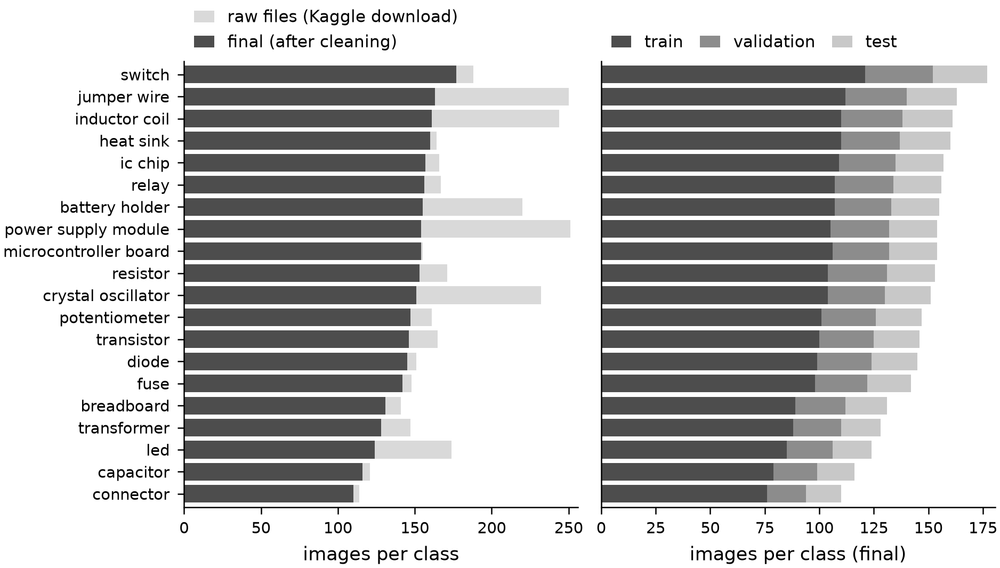
<figcaption><strong>Figure B.1.</strong> Left: images per class in the raw download (light) and after cleaning (dark). Right: the split of the cleaned images into training, validation and test sets (68.6 / 17.1 / 14.3%).</figcaption>
</figure>

| Weight decay | Best epoch | Epochs run | Val. acc. | Val. macro-F1 | Val. CE | Selected |
|-------------:|-----------:|-----------:|----------:|--------------:|--------:|:--------:|
|       0.0001 |         14 |         34 |    0.8028 |        0.8011 |  0.7595 |   yes    |
|        0.001 |         14 |         34 |    0.8028 |        0.8011 |  0.7594 |          |
|         0.01 |         14 |         34 |    0.8028 |        0.8011 |  0.7594 |          |
|          0.1 |         21 |         41 |    0.8008 |        0.7999 |  0.7736 |          |

**Table B.4.** Weight-decay selection for model C’s head on the validation set (learning rate 10⁻³, batch 256, at most 200 epochs, patience 20; `results/itri626/head_grid.csv`). The 3-way tie was broken by the pre-set smallest-value rule. CE: cross-entropy.

> **Model D:** new table.

| Weight decay | Best epoch | Epochs run | Val. acc. | Val. macro-F1 | Val. CE | Selected |
|-------------:|-----------:|-----------:|----------:|--------------:|--------:|:--------:|
|       0.0001 |         11 |         31 |    0.7749 |        0.7724 |  0.8995 |   yes    |
|        0.001 |         11 |         31 |    0.7749 |        0.7724 |  0.8995 |          |
|         0.01 |         11 |         31 |    0.7749 |        0.7724 |  0.8994 |          |
|          0.1 |         11 |         31 |    0.7749 |        0.7724 |  0.8979 |          |

<ins>**Table B.5.** The same weight-decay selection for model D’s head (`results/itri626/head_grid_D.csv`); all 4 values tie and the smallest was kept.</ins>

> **Model D:** new figure.

<figure data-latex-placement="htbp">
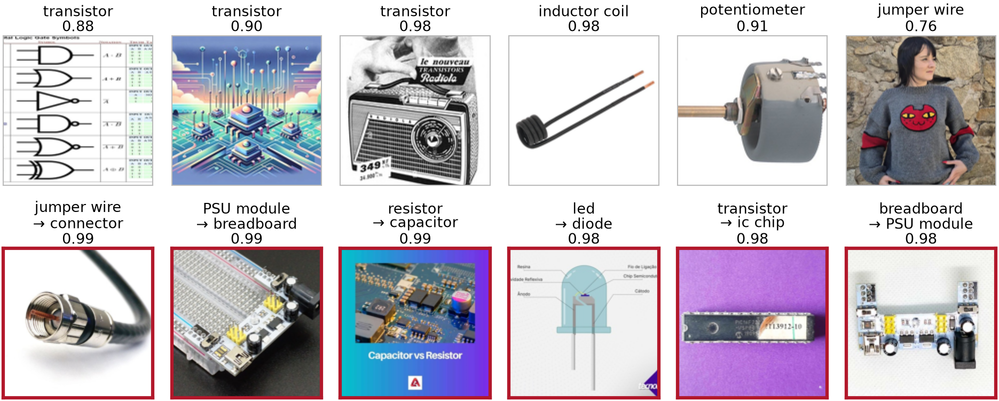
<figcaption><strong>Figure B.2.</strong> Model D (MobileCLIP2-S3 hybrid, frozen + linear): six random correct predictions (top) and the six most confident errors (bottom), as in Figure 7.</figcaption>
</figure>

## C Supporting analysis

This appendix details the supporting results summarised in Section 6.4 (full write-up: `docs/report/REPORT.md`). In Table C.1, fine-tuning used one fixed recipe per family, the probe is a logistic regression on frozen features, and zero-shot uses the model’s text encoder with class-name prompts and no training.

**Eleven-family benchmark.** Grouped 5-fold cross-validation on the 2,512 development images (Table C.1) reproduces the ordering: scratch CNN 0.355 macro-F1, ConvNeXt-T fine-tuned 0.641, frozen SigLIP So400m probe 0.824. All six ImageNet-pretrained fine-tunes lie between 0.547 and 0.654, SigLIP zero-shot classification without training (0.776) beats all of them, and partial fine-tuning of the SigLIP backbone (0.812, three folds) did not beat the frozen probe.

**Leakage of the original split.** Under the dataset’s original file-level split, 198 of the 853 deduplicated development images that it places in validation or test (23.2%) also have a copy in its training part (our own test images are excluded; Section 2.5 counts raw file entries instead), which inflates three linear probes by 5.5 (SigLIP), 11.0 (ConvNeXt-T) and 13.6 (ResNet-50) points (`results/leakage_simulation.csv`). Weaker models gain most, so leakage also compresses the gaps between models.

**Out-of-source test and deployment.** The deployed model (R2) was tested once on 407 Wikimedia Commons photographs collected after it was frozen (`data/web_holdout_v1/`): 0.821 accuracy and 0.816 macro-F1, close to its in-distribution result. Its weakest classes there are *led* (recall 0.47; 7 errors to *diode*), *switch* (0.52; real switches predicted *ic chip* 6 times, a consequence of the console-dominated training class) and *transformer* (0.67; 5 errors to *inductor coil*). It is exported to ONNX for an OpenCV demo and a Rust desktop application (`docs/DEMO.md`, `apps/gpui-demo/`).

<table>
<caption><strong>Table C.1.</strong> Supporting benchmark: grouped 5-fold CV macro-F1 (mean ± SD over folds) on the development set (<code>results/benchmark.csv</code>). †Three folds only. Model C itself corresponds to the SigLIP probe column.</caption>
<thead>
<tr>
<th style="text-align: left;">Family (variant)</th>
<th style="text-align: center;">Fine-tune</th>
<th style="text-align: center;">Frozen linear probe</th>
<th style="text-align: center;">Zero-shot</th>
</tr>
</thead>
<tbody>
<tr>
<td style="text-align: left;">Classical: HOG + colour histogram + SVM</td>
<td colspan="3" style="text-align: center;">0.206 ± 0.017 (classical pipeline)</td>
</tr>
<tr>
<td style="text-align: left;">Scratch CNN (model A’s network, 120-epoch recipe)</td>
<td style="text-align: center;">0.355 ± 0.015</td>
<td style="text-align: center;">–</td>
<td style="text-align: center;">–</td>
</tr>
<tr>
<td style="text-align: left;">ResNet-50</td>
<td style="text-align: center;">0.580 ± 0.012</td>
<td style="text-align: center;">0.515 ± 0.018</td>
<td style="text-align: center;">–</td>
</tr>
<tr>
<td style="text-align: left;">MobileNetV3-L</td>
<td style="text-align: center;">0.547 ± 0.016</td>
<td style="text-align: center;">–</td>
<td style="text-align: center;">–</td>
</tr>
<tr>
<td style="text-align: left;">EfficientNetV2-S</td>
<td style="text-align: center;">0.608 ± 0.024</td>
<td style="text-align: center;">–</td>
<td style="text-align: center;">–</td>
</tr>
<tr>
<td style="text-align: left;">ConvNeXt-T (as model B)</td>
<td style="text-align: center;">0.641 ± 0.034</td>
<td style="text-align: center;">0.593 ± 0.021</td>
<td style="text-align: center;">–</td>
</tr>
<tr>
<td style="text-align: left;">ViT-B/16 (AugReg)</td>
<td style="text-align: center;">0.654 ± 0.032</td>
<td style="text-align: center;">–</td>
<td style="text-align: center;">–</td>
</tr>
<tr>
<td style="text-align: left;">Swin-T</td>
<td style="text-align: center;">0.639 ± 0.034</td>
<td style="text-align: center;">–</td>
<td style="text-align: center;">–</td>
</tr>
<tr>
<td style="text-align: left;">DINOv2 (FT: ViT-B/14; probe: ViT-L/14)</td>
<td style="text-align: center;">0.668 ± 0.024</td>
<td style="text-align: center;">0.667 ± 0.019</td>
<td style="text-align: center;">–</td>
</tr>
<tr>
<td style="text-align: left;">CLIP (FT: ViT-B/16; others: ViT-L/14@336)</td>
<td style="text-align: center;">0.702 ± 0.017</td>
<td style="text-align: center;">0.721 ± 0.019</td>
<td style="text-align: center;">0.609 ± 0.029</td>
</tr>
<tr>
<td style="text-align: left;">SigLIP So400m/14@384 (backbone of C)</td>
<td style="text-align: center;">0.812 ± 0.023†</td>
<td style="text-align: center;">0.824 ± 0.012</td>
<td style="text-align: center;">0.776 ± 0.018</td>
</tr>
</tbody>
</table>

## D Reproduction

All commands run from the repository root with uv (Python 3.12). The images are not tracked in Git. Download the Kaggle dataset (Section 2.1) and unpack it to `data/raw/electronic-component-recognizer/` to rebuild `data/v2/images/` (2,930 JPEG files) with `tools/build_dataset_v2.py`; the result must reproduce manifest fingerprint `431315e87d2612cb`.

> **Model D:** the command block below is changed (model D added).

    uv sync                    # runtime environment (pyproject.toml + uv.lock)
    uv sync --group dev        # + pytest, ipykernel, jupyterlab
    uv run --no-config tools/build_dataset_v2.py   # only if data/v2/images/ is missing
    uv run python tools/export_splits.py --check    # verify data/v2/splits/*.csv
    uv run python scripts/itri626_experiments.py    # train A, B, C, D; score test (GPU)
    uv run jupyter nbconvert --to notebook --execute --inplace \
        notebooks/ITRI626_four_models.ipynb        # RETRAIN = False by default
    uv run --no-project --with numpy --with scipy \
        python docs/itri626_report/make_tables.py   # report tables and numbers
    cd docs/itri626_report && latexmk -pdf main.tex # this report

Setting `RETRAIN = True` in the first code cell of the notebook re-runs the experiment script before loading its outputs. `scripts/itri626_experiments.py` `--steps head reference <ins>head_D reference_D</ins> collect` re-runs only the CPU parts <del>(head</del> <ins>(the heads of</ins> C <ins>and D</ins> from cached features, the reference rows and the result collection). The model-A run reported here was not produced by `train_A` but imported from the improvement study’s fold-0 run with `tools/itri626_import_run.py`, so that the test split was scored only once for that recipe; re-running `train_A` trains a new network and spends a second look.

**Provenance of further numbers in the text.** Cleaning ablation (Section 2.3, item 4): `results/phase1/cleaning_ablation_siglip_so400m.csv`; label audit (item 5): `results/phase1/label_issues_v2.csv`; CLIP screen and its top distractors (Sections 2.3 and 2.6): `data/v2/review/ood_suspects.csv`; off-topic flags of the test images (Section 6.2): `data/v2/splits/test.csv`; reject option of the deployed model: `results/final/final_test_v2.json`; full write-up of the wider study (Section 6.4): `docs/report/REPORT.md`. Every number macro and its source file are listed in `docs/itri626_report/generated/key_numbers.json`.

## E Rubric compliance checklist

Table E.1 maps every requirement of the project brief to the place where it is addressed. The same list, with file paths, is in `docs/itri626_report/RUBRIC_CHECKLIST.md`.

> **Model D:** this table is changed (rows or columns for D added).

<table>
<caption><strong>Table E.1.</strong> Brief requirement → location in this report or repository.</caption>
<thead>
<tr>
<th style="text-align: left;">Requirement (brief section)</th>
<th style="text-align: left;">Where it is addressed</th>
</tr>
</thead>
<tbody>
<tr>
<td colspan="2" style="text-align: left;"><em>Problem definition and motivation (2 marks)</em></td>
</tr>
<tr>
<td style="text-align: left;">Classification task, aim, scope, motivation (brief §2, §4)</td>
<td style="text-align: left;">Section 1 (incl. research question and main findings)</td>
</tr>
<tr>
<td style="text-align: left;">Target classes and reasons for them (brief §2, §5)</td>
<td style="text-align: left;">Section 1, Table 1</td>
</tr>
<tr>
<td colspan="2" style="text-align: left;"><em>Dataset selection and preparation (4 marks)</em></td>
</tr>
<tr>
<td style="text-align: left;">Source, access link, licence, usage conditions (brief §5)</td>
<td style="text-align: left;">Section 2.1; README “ITRI626 submission”</td>
</tr>
<tr>
<td style="text-align: left;">Class definitions (brief §5)</td>
<td style="text-align: left;">Table 1</td>
</tr>
<tr>
<td style="text-align: left;">Images per class before and after cleaning (brief §5)</td>
<td style="text-align: left;">Table 1, Table 2, Figure B.1</td>
</tr>
<tr>
<td style="text-align: left;">Removed duplicates, corrupt files, irrelevant samples, uncertain labels (brief §5)</td>
<td style="text-align: left;">Section 2.3, Table 2</td>
</tr>
<tr>
<td style="text-align: left;">How labels were obtained, checked and corrected (brief §5)</td>
<td style="text-align: left;">Section 2.3 (last paragraph)</td>
</tr>
<tr>
<td style="text-align: left;">Class imbalance and how it was handled (brief §5)</td>
<td style="text-align: left;">Section 2.4; Section 6.2</td>
</tr>
<tr>
<td style="text-align: left;">Representative examples of every class (brief §5)</td>
<td style="text-align: left;">Figure 1</td>
</tr>
<tr>
<td style="text-align: left;">Ethics, privacy, lawful use, acknowledgement of internet data (brief §5)</td>
<td style="text-align: left;">Section 2.6, Section 2.1</td>
</tr>
<tr>
<td style="text-align: left;">Train/validation/test split; same test set for all models (brief §7.1)</td>
<td style="text-align: left;">Section 2.5; <code>data/v2/splits/</code></td>
</tr>
<tr>
<td style="text-align: left;">Leakage prevention by group identity (brief §7.1)</td>
<td style="text-align: left;">Section 2.5, Section 2.3 item 3, Section 6.4</td>
</tr>
<tr>
<td style="text-align: left;">Random seed, images per split, class distribution per split (brief §7.1)</td>
<td style="text-align: left;">Section 2.5, Table 1</td>
</tr>
<tr>
<td colspan="2" style="text-align: left;"><em>Model selection and methodology (4 marks)</em></td>
</tr>
<tr>
<td style="text-align: left;">At least three models from three families (brief §6)</td>
<td style="text-align: left;">Section 3: plain CNN, ConvNeXt, ViT; plus D, a convolution–attention hybrid (“another approved architecture”)</td>
</tr>
<tr>
<td style="text-align: left;">At least one model with transfer learning (brief §6)</td>
<td style="text-align: left;">B (fine-tuning), C and D (feature extraction), Section 3</td>
</tr>
<tr>
<td style="text-align: left;">Methods, transfer-learning approach, complete workflow (brief §6)</td>
<td style="text-align: left;">Section 3, Figure 2</td>
</tr>
<tr>
<td style="text-align: left;">Same split for all models; fair, justified hyperparameters (brief §6)</td>
<td style="text-align: left;">Section 4, Table 3, Table B.4</td>
</tr>
<tr>
<td colspan="2" style="text-align: left;"><em>Experimental setup and reproducibility (3 marks)</em></td>
</tr>
<tr>
<td style="text-align: left;">Preprocessing steps (brief §7.2)</td>
<td style="text-align: left;">Section 4 (Preprocessing)</td>
</tr>
<tr>
<td style="text-align: left;">Augmentation, training data only, realism argued (brief §7.2)</td>
<td style="text-align: left;">Section 4 (Augmentation), Figure 3</td>
</tr>
<tr>
<td style="text-align: left;">Model name, variant, pretrained weights; input size (brief §7.3)</td>
<td style="text-align: left;">Table 3</td>
</tr>
<tr>
<td style="text-align: left;">Batch size, gradient accumulation; epochs, early stopping (brief §7.3)</td>
<td style="text-align: left;">Table 3</td>
</tr>
<tr>
<td style="text-align: left;">Optimiser, learning rate, schedule; weight decay, loss (brief §7.3)</td>
<td style="text-align: left;">Table 3, Table B.4</td>
</tr>
<tr>
<td style="text-align: left;">Class weights or sampling; random seed (brief §7.3)</td>
<td style="text-align: left;">Table 3, Section 2.4</td>
</tr>
<tr>
<td style="text-align: left;">Software framework and library versions; hardware, GPU memory (brief §7.3)</td>
<td style="text-align: left;">Section 4.4, Table B.1</td>
</tr>
<tr>
<td style="text-align: left;">Fairness of the comparison (rubric)</td>
<td style="text-align: left;">Section 4.4 (paragraph “Fairness”), Table 3</td>
</tr>
<tr>
<td colspan="2" style="text-align: left;"><em>Results and evaluation (4 marks)</em></td>
</tr>
<tr>
<td style="text-align: left;">Test accuracy; precision, recall, F1; macro-F1 (brief §8)</td>
<td style="text-align: left;">Table 4</td>
</tr>
<tr>
<td style="text-align: left;">Per-class precision, recall and F1 (brief §8)</td>
<td style="text-align: left;">Figure 5; Table A.1, Table A.3, Table A.2 (Appendix A)</td>
</tr>
<tr>
<td style="text-align: left;">Confusion matrix (brief §8)</td>
<td style="text-align: left;">Figure 6 (all four models, shared colour scale)</td>
</tr>
<tr>
<td style="text-align: left;">Training and validation loss curves (brief §8)</td>
<td style="text-align: left;">Figure 4 (top row), Table B.2</td>
</tr>
<tr>
<td style="text-align: left;">Validation accuracy or F1 curve (brief §8)</td>
<td style="text-align: left;">Figure 4 (bottom row)</td>
</tr>
<tr>
<td style="text-align: left;">Several correct and incorrect predictions (brief §8)</td>
<td style="text-align: left;">Figure 7, Figure B.2, Figure 9</td>
</tr>
<tr>
<td style="text-align: left;">Comparison of all models (rubric)</td>
<td style="text-align: left;">Table 4, Table 5, Figure 8, Table B.3</td>
</tr>
<tr>
<td colspan="2" style="text-align: left;"><em>Discussion, error analysis and conclusion (2 marks)</em></td>
</tr>
<tr>
<td style="text-align: left;">Important classification errors (brief §8)</td>
<td style="text-align: left;">Section 6.2, Table 6</td>
</tr>
<tr>
<td style="text-align: left;">Effects of class imbalance and data quality (brief §8)</td>
<td style="text-align: left;">Section 6.2, Section 2.4</td>
</tr>
<tr>
<td style="text-align: left;">Plausible reasons for performance differences (brief §8)</td>
<td style="text-align: left;">Section 6.1</td>
</tr>
<tr>
<td style="text-align: left;">Limitations (brief §9)</td>
<td style="text-align: left;">Section 6.5</td>
</tr>
<tr>
<td style="text-align: left;">Justified conclusion and recommended model (rubric)</td>
<td style="text-align: left;">Section 7 (incl. lessons learned)</td>
</tr>
<tr>
<td colspan="2" style="text-align: left;"><em>Report quality and references (1 mark)</em></td>
</tr>
<tr>
<td style="text-align: left;">Nine-part structure, 10–15 pages, PDF (brief §9)</td>
<td style="text-align: left;">title page with group members and abstract; sections 1–7; references</td>
</tr>
<tr>
<td style="text-align: left;">Sources, pretrained models, software acknowledged (brief §9)</td>
<td style="text-align: left;">Section 2.1, Section 3, Table B.1, references</td>
</tr>
<tr>
<td colspan="2" style="text-align: left;"><em>Submission items (brief §11)</em></td>
</tr>
<tr>
<td style="text-align: left;">Report as PDF</td>
<td style="text-align: left;"><code>docs/itri626_report/main.pdf</code></td>
</tr>
<tr>
<td style="text-align: left;">Presentation slides</td>
<td style="text-align: left;">to be prepared by the group (not part of this repository)</td>
</tr>
<tr>
<td style="text-align: left;">Notebook with visible outputs, figures, metric tables</td>
<td style="text-align: left;"><code>notebooks/ITRI626_four_models.ipynb</code></td>
</tr>
<tr>
<td style="text-align: left;">Python scripts for data preparation and evaluation</td>
<td style="text-align: left;"><code>tools/build_dataset_v2.py</code>, <code>tools/export_splits.py</code>, <code>scripts/itri626_experiments.py</code>, <code>src/compclass/</code></td>
</tr>
<tr>
<td style="text-align: left;">README with dataset source, setup, reproduction steps</td>
<td style="text-align: left;"><code>README.md</code>, section “ITRI626 submission”</td>
</tr>
<tr>
<td style="text-align: left;">Split files or a script that recreates them</td>
<td style="text-align: left;"><code>data/v2/splits/</code>, <code>tools/export_splits.py</code></td>
</tr>
<tr>
<td style="text-align: left;">Repository link or archive; data access instructions</td>
<td style="text-align: left;">README “ITRI626 submission”; Appendix D</td>
</tr>
</tbody>
</table>
