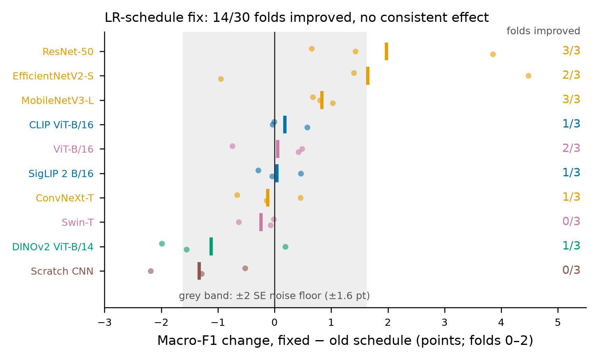
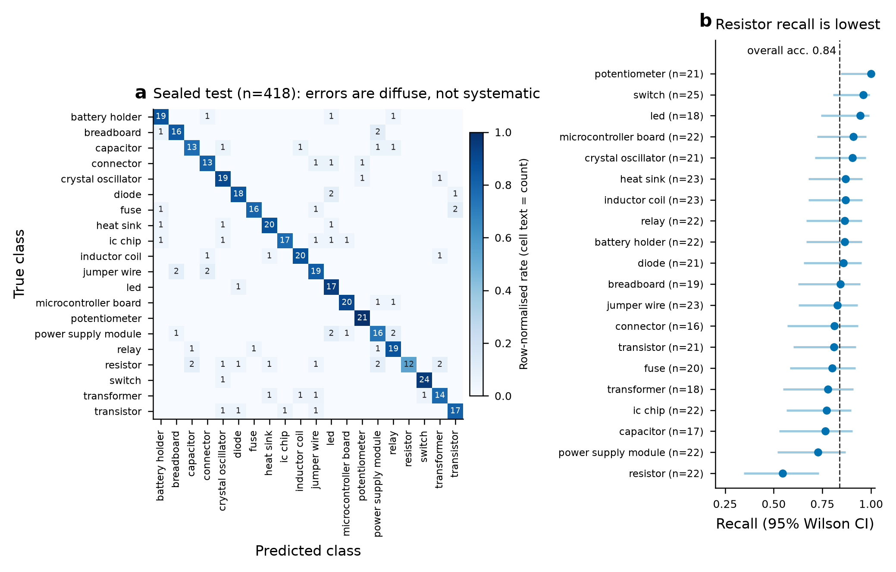

<!--
Build (pandoc >= 3):
  pandoc docs/report/REPORT.md -o report.pdf --resource-path=docs/report      # PDF via LaTeX
  pandoc docs/report/REPORT.md -s -o report.tex --resource-path=docs/report   # LaTeX source
Figures and tables are regenerated by:  uv run python scripts/make_report_figures.py
Every number below is read from a repository file; Appendix A maps each number to its source.
Booktabs versions of all tables are in docs/report/tables/*.tex.
-->

# Abstract {-}

We compare eleven model families — a hand-crafted HOG + colour-histogram SVM, a CNN trained from scratch, ImageNet
CNNs (ResNet-50, EfficientNetV2-S, MobileNetV3-L, ConvNeXt-T), ImageNet transformers (ViT-B/16, Swin-T), a
self-supervised transformer (DINOv2) and vision-language models (CLIP, and SigLIP with its SigLIP 2 variant) — on 20-class
electronic-component image classification. We use three adaptation regimes: zero-shot, frozen-feature linear probe and fine-tuning. The source data, a
web-scraped Kaggle dataset, was audited first. Of 3,530 files only 2,943 were unique, 13 duplicate groups carried
conflicting labels, and an automated CLIP screen flags 816 of the 2,930 retained images (27.8 %) as out of scope.
Example out-of-scope images include Nintendo Switch consoles filed under *switch* and brand logos under *fuse*. The earlier legacy split leaked duplicates:
198 of its 853 evaluation images duplicate a training image, which inflated accuracy by 5.5–13.6 points. On a
cluster-grouped 5-fold cross-validation of 2,512 development images, frozen web-scale vision-language features
dominate. A logistic-regression probe on SigLIP So400m/14\@384 reaches macro-F1 0.824 ± 0.012, above every
fine-tuned network. ImageNet fine-tunes reach 0.548–0.654, the scratch CNN 0.355 and HOG + SVM 0.206.
Fine-tuning beats the frozen probe for ImageNet, DINOv2 and CLIP-B backbones (+3.6 to +6.5 points, 5/5 folds) but
not for SigLIP. The final model is a calibrated, abstaining SigLIP So400m probe fused with the model's own
zero-shot head. It was evaluated once on a 418-image sealed test split: accuracy 0.837 (95 % CI 0.799–0.870), macro-F1
0.834, in-scope accuracy 0.869, ECE 0.034. Abstaining below confidence 0.5 answers 87 % of images at 90.9 %
accuracy. On a separately collected, sealed set of 407 Wikimedia Commons photos the same model reaches accuracy
0.821 (95 % CI 0.780–0.855) and macro-F1 0.816. In-distribution the zero-shot fusion adds nothing measurable, but on
these out-of-source photos it lifts accuracy from 0.779 (probe alone) to 0.821. The learning-rate-schedule fix,
flip test-time augmentation and training-data cleaning all have effects inside the noise floor of this data size.

# Introduction and goal

The project had two goals. The first was a fair comparison of model families for recognising common electronic
components (resistors, capacitors, ICs, relays, …) in internet photographs. The second was one exportable model
with about 80–85 % accuracy for an OpenCV desktop demo that can abstain when uncertain. A first iteration of the
project (now under `legacy/`) reported 0.71–0.76 accuracy. Those numbers were inflated by train/test duplicates
(Section 3.3). This report therefore rebuilds the evaluation from the data up. It asks four questions:

1. How much does each family and pretraining source contribute when tuning and evaluation are leakage-free?
2. At ~2.5k training images, should a pretrained backbone be frozen (probe / zero-shot) or fine-tuned?
3. What does accuracy cost in training time and trainable parameters?
4. How good is the final calibrated model on data it has never seen, and where does it fail?

The repository doubles as a learning resource. Per-family explainers are in `docs/models/`, concept notes in
`docs/concepts/`, and a reading order in `docs/LEARNING_PATH.md`.

# Dataset and data audit

## Source

The images come from the Kaggle dataset *electronic-component-recognizer* [1]. It is a web scrape with 20 class
folders: battery holder, breadboard, capacitor, connector, crystal oscillator, diode, fuse, heat sink, IC chip,
inductor coil, jumper wire, LED, microcontroller board, potentiometer, power supply module, relay, resistor,
switch, transformer, transistor. `tools/build_dataset_v2.py` decodes every file, collapses exact duplicates by
SHA-256, links near-duplicates and writes a versioned manifest, `data/v2/manifest.json` (version v2.0). The manifest has
one row per unique image, with a duplicate cluster, split, fold and quality flags. The file formats are
mixed: 1,486 JPEG, 787 WebP, 402 PNG, 245 AVIF, 20 GIF and 3 MPO among the unique decoded files. 345 images
needed alpha compositing.

## Audit findings

Figure 1 and Table 1 summarise the audit (`data/v2/leakage_report.json`).

* **Exact duplicates.** The 3,530 raw files contain 2,943 unique images. 533 duplicate groups account for 587
  redundant copies.
* **Conflicting labels.** 13 exact-duplicate groups carry two different labels (e.g. the same picture under
  *fuse* and *relay*, or under *breadboard* and *power supply module*). All 13 were excluded, leaving 2,930 rows.
* **Near-duplicates.** Perceptual hashing (pHash radius 10) combined with CLIP cosine similarity (≥ 0.85 with a
  pHash match, ≥ 0.92 without) links 234 rows into 91 near-duplicate clusters. Cluster sizes run from 2 to 29. Two
  near-duplicate clusters mix labels; their 4 rows are kept with a `near_dup_label_conflict` flag. Together with
  the singletons there are 2,787 clusters. These clusters are the grouping unit for every split.
* **Out-of-scope content.** A CLIP zero-shot screen compares each image against the 20 class prompts and nine
  distractor concepts (person, car, food, logo, text screenshot, cartoon/game art, circuit schematic, website
  screenshot, collage). It flags an image when distractor mass exceeds 0.25. It flags 816 rows (27.8 %): 704 in dev and 112 in the
  sealed test. The most frequent top distractors are circuit schematics (245), logos (180), cartoon/game art
  (130) and people (83) (`data/v2/review/ood_suspects.csv`). Contamination concentrates in classes whose name is
  a common English word (Figure 1b). 121 of 177 *switch* images are flagged, mostly Nintendo Switch consoles and game
  art, and 64 of 128 *transformer* images (toy robots, cartoons). Other flagged examples include the *Fuse* brand
  logos, relay-race graphics and stock portraits under *transistor* (montage: `data/v2/review/ood_suspects_top80.jpg`).
  The screen is automated and was not human-verified. Some flagged images, e.g. resistor circuit schematics, are
  arguably in scope.
* **Label errors.** A confident-learning-style audit [2] uses out-of-fold probe probabilities to find rows whose
  given label has very low probability while another class is highly probable. It lists 69 confident issues
  (`results/phase1/label_issues_v2.csv`), 11 of which are also OOD-flagged. The most common patterns are
  diode→transistor, microcontroller board→IC chip and jumper wire→breadboard (4 each).

{width=100%}

Table: Data-cleaning pipeline counts (`docs/report/tables/data_audit.csv`).

| Stage | Images |
|---|---:|
| Raw image files | 3,530 |
| Unique files (SHA-256) | 2,943 |
| Rows kept (conflicting-label exact duplicates removed) | 2,930 |
| Duplicate clusters (CV groups) | 2,787 |
| Rows in near-duplicate clusters | 234 |
| Rows flagged out-of-scope (CLIP) | 816 |

**Decision.** The flagged rows were **kept** in training and evaluation. Results are reported on all rows and on
the "in-scope" subset without the flag. Section 6.4 shows that removing them from training hurts.

# Evaluation protocol

## Splits

The manifest assigns whole duplicate clusters to splits (seed 42, `split_policy.group_key = cluster`). A sealed **test** split of 418 rows
(16–25 per class) is held out first. The remaining 2,512 **dev** rows are divided into five cluster-grouped
folds. Copies and near-copies of an image therefore never sit on both sides of any split. The largest
total-variation distance between class distributions across the outer grouped split is 0.017. All model selection used dev folds only. The test
split can be read only through `get_test(..., confirm=True)` / `compclass.final test --confirm`. It was read
**once**, for the final model, after every choice was frozen (Section 7).

## Metrics

Macro-F1 over the 20 classes is the primary metric because the classes are nearly balanced but errors on small
classes matter equally. Accuracy is secondary. We report the mean ± SD of the five fold scores. We also report in-scope
accuracy over rows without the OOD flag, pooled over folds. With 418 test images, the binomial standard error of
the test accuracy is ±1.8 points. Differences smaller than about 3.5 points between two models on the test split are
not resolvable.

## Why the legacy split leaked

The legacy experiments split files, not clusters. The 853 images in the legacy validation and test splits include
198 (23.2 %) that duplicate an image in the legacy training split (`results/leakage_simulation.csv`). Figure 2 and
Table 2 replay three linear probes under both protocols. On the duplicated rows the probes are nearly perfect
(95–99 %), and the legacy-style score is inflated by 5.5 points for SigLIP and by 11.0 and 13.6 points for
ConvNeXt-T and ResNet-50. Weaker models gain most because memorised copies substitute for features they lack. The
inflation therefore also *compresses* the gaps between families. Accuracy on the non-duplicated legacy rows is
still above grouped-CV accuracy (e.g. 0.860 vs 0.825 for SigLIP). The likely causes are near-duplicates that the
duplicate count misses, plus differences between the evaluation sets; this residual is not decomposed further here.

{width=100%}

Table: Leakage simulation (`results/leakage_simulation.csv`).

| Model (linear probe) | Grouped-CV acc. | Legacy-style acc. | Inflation (pts) | Acc. on duplicated rows | Acc. on other rows |
|---|---:|---:|---:|---:|---:|
| ResNet-50 | 0.5215 | 0.6577 | +13.6 | 0.9949 | 0.5557 |
| ConvNeXt-T | 0.5983 | 0.7081 | +11.0 | 0.9646 | 0.6305 |
| SigLIP So400m/14\@384 | 0.8252 | 0.8804 | +5.5 | 0.9495 | 0.8595 |

# Model families and adaptation regimes

## Taxonomy

The families are grouped by **pretraining source**, which turns out to be the main axis of variation (Table 3).
All pretrained weights come from `timm` / `open_clip`. The registry is `src/compclass/models/registry.py`.

Table: The eleven families compared (SigLIP 2 is treated as a variant of the SigLIP family, as in the model registry). Pretraining data and objective follow the cited papers; trainable parameters are from the fine-tuning runs.

| Group | Family (variant) | Pretraining | Params (M) | Ref. |
|---|---|---|---:|---|
| Classical | HOG + HSV histogram + RBF-SVM | none (hand-crafted) | — | [3] |
| From scratch | Scratch CNN (VGG-style, BN, GAP) | none | 1.19 | [4] |
| ImageNet CNN | ResNet-50 (a1 recipe) | ImageNet-1k supervised | 23.5 | [5] |
| ImageNet CNN | EfficientNetV2-S | ImageNet-21k → 1k supervised | 20.2 | [6] |
| ImageNet CNN | MobileNetV3-L | ImageNet-1k supervised | 4.2 | [7] |
| ImageNet CNN | ConvNeXt-T | ImageNet-22k → 1k supervised | 27.8 | [8] |
| ImageNet transformer | ViT-B/16 (AugReg) | ImageNet-21k → 1k supervised | 85.8 | [9] |
| ImageNet transformer | Swin-T | ImageNet-22k → 1k supervised | 27.5 | [10] |
| Self-supervised | DINOv2 ViT-S/B/L-14 | LVD-142M, self-distillation | 85.7 (B) | [11] |
| Vision-language | CLIP ViT-B/16, ViT-L/14(\@336) | 400M image–text pairs, contrastive | 85.8 (B) | [12] |
| Vision-language | SigLIP (B/16, So400m/14\@384; SigLIP 2 variant: same sizes) | WebLI image–text, sigmoid loss (SigLIP 2 adds captioning/self-distillation objectives) | 92.9 (B), 428.2 (So400m) | [13, 14] |

## Adaptation regimes

* **Zero-shot** (vision-language models only). Each image is assigned to the class whose template-averaged text
  embedding ("a photo of a {class}" …) has the highest cosine similarity. No training images are used.
* **Linear probe.** The backbone is frozen. Features from the eval-preprocessed image feed a standardised
  logistic regression, with C chosen inside each training fold by grouped CV (`compclass.features`). There are
  20 × (D + 1) trainable parameters, about 23k for D = 1152.
* **Fine-tune.** The pretrained network gets a new head. Training uses one hand-set YAML recipe per family
  (`configs/base.yaml` + `configs/<family>.yaml`): AdamW, linear warm-up then cosine decay, label smoothing 0.1,
  RandAugment and fp16 AMP. Where configured, it adds layer-wise LR decay and frozen-backbone warm-up epochs. Early
  stopping uses fold-validation macro-F1 (`compclass.train`). SigLIP So400m is too large to
  fine-tune fully on the 8 GB GPU, so only its last 4 blocks are trained ("partial fine-tune", 76.2M of 428.2M
  parameters, 3 folds).
* **Classical.** HOG + HSV colour histogram features with an RBF-SVM (`compclass.classical`).

All training ran on one RTX 4060 Ti (8 GB) (`results/gpu_witness_carlpc2.json`).

# Results

## Main benchmark

Figure 3 shows every method's fold-level macro-F1. Table 4 lists the headline rows; the full table, with
standard deviations, in-scope accuracy, training time and VRAM, is `docs/report/tables/benchmark_main.csv`.

{width=92%}

Table: Headline results, grouped 5-fold CV on data v2 (`results/benchmark.csv`; mean ± SD over folds).

| Method | Regime | Macro-F1 | Accuracy | In-scope acc. |
|---|---|---:|---:|---:|
| SigLIP So400m/14\@384 | linear probe | **0.824 ± 0.012** | 0.825 | 0.861 |
| SigLIP 2 So400m/14\@384 | linear probe | 0.814 ± 0.011 | 0.815 | 0.852 |
| SigLIP So400m/14\@384 (folds 0–2) | partial fine-tune | 0.812 ± 0.023 | 0.813 | 0.835 |
| SigLIP So400m/14\@384 | zero-shot | 0.776 ± 0.018 | 0.775 | 0.827 |
| SigLIP 2 B/16 | fine-tune | 0.733 ± 0.027 | 0.735 | 0.767 |
| CLIP ViT-L/14\@336 | linear probe | 0.721 ± 0.019 | 0.727 | 0.753 |
| CLIP ViT-B/16 | fine-tune | 0.702 ± 0.017 | 0.707 | 0.724 |
| DINOv2 ViT-B/14 | fine-tune | 0.668 ± 0.024 | 0.672 | 0.717 |
| DINOv2 ViT-L/14 | linear probe | 0.667 ± 0.020 | 0.668 | 0.721 |
| ViT-B/16 | fine-tune | 0.654 ± 0.032 | 0.659 | 0.712 |
| ConvNeXt-T | fine-tune | 0.641 ± 0.034 | 0.647 | 0.689 |
| Swin-T | fine-tune | 0.639 ± 0.034 | 0.644 | 0.694 |
| EfficientNetV2-S | fine-tune | 0.608 ± 0.024 | 0.616 | 0.653 |
| ResNet-50 | fine-tune | 0.580 ± 0.012 | 0.585 | 0.618 |
| MobileNetV3-L | fine-tune | 0.548 ± 0.016 | 0.556 | 0.584 |
| Scratch CNN | fine-tune (from scratch) | 0.355 ± 0.015 | 0.365 | 0.379 |
| HOG + HSV + SVM | classical | 0.206 ± 0.017 | 0.220 | — |

## Key findings

1. **Web-scale vision-language pretraining dominates.** The seven best entries are SigLIP / SigLIP 2 So400m
   variants (Figure 3). Even zero-shot SigLIP So400m (0.776), which uses no training images, beats every fine-tuned
   network except the partial fine-tune of the same backbone. CLIP ViT-L/14 probes reach 0.714–0.721. Self-supervised DINOv2 is clearly weaker as a frozen feature
   (ViT-L 0.667, ViT-B 0.633). Among ImageNet-pretrained networks the transformers (ViT-B 0.654, Swin-T 0.639)
   and ConvNeXt-T (0.641) lead, and ResNet-50 (0.580) and MobileNetV3-L (0.548) trail. Pretraining *data*
   matters more than architecture: ViT-B/16 with ImageNet-21k weights (0.654), DINOv2 ViT-B/14 (0.668), CLIP
   ViT-B/16 (0.702) and SigLIP 2 B/16 (0.733) are all 86–93M-parameter ViT-B models.
2. **Frozen ≥ fine-tuned only for the strongest backbones** (Figure 4, Table 5). On identical folds,
   fine-tuning SigLIP 2 B/16 *loses* 2.5 points to its own probe (0/5 folds better). The partial fine-tune of
   SigLIP So400m loses 0.9 points (1/3 folds), although that difference is within fold noise. For CLIP ViT-B/16, DINOv2 ViT-B/14, ConvNeXt-T
   and ResNet-50, fine-tuning gains 3.6–6.5 points and wins on 5/5 folds. The best fine-tune of any family
   (SigLIP So400m partial, 0.812) still does not beat the frozen probe of the same backbone (0.824).
3. **Learned features are indispensable.** The from-scratch CNN (0.355) and HOG + SVM (0.206) are far below every
   pretrained model. The gap from HOG to the scratch CNN measures what learning features from 2.5k images buys;
   the gap from the scratch CNN to the ImageNet fine-tunes (+19 to +30 points) measures what pretraining buys.
4. **Out-of-scope rows cost every family accuracy.** In-scope accuracy exceeds all-row accuracy for every
   method, by 1.3–5.7 points (e.g. 0.861 vs 0.825 for the best probe). Part of the remaining error therefore comes from
   the contaminated data rather than the classifier.

{width=85%}

Table: Paired probe vs fine-tune comparison (`docs/report/tables/probe_vs_finetune.csv`).

| Backbone | Fine-tune type | Folds | Probe macro-F1 | Fine-tune macro-F1 | Δ (pts) | FT wins |
|---|---|---|---:|---:|---:|---:|
| SigLIP 2 B/16 | full | 0–4 | 0.7581 | 0.7329 | −2.52 | 0/5 |
| SigLIP So400m/14\@384 | partial (last 4 blocks) | 0–2 | 0.8216 | 0.8124 | −0.92 | 1/3 |
| DINOv2 ViT-B/14 | full | 0–4 | 0.6326 | 0.6683 | +3.57 | 5/5 |
| CLIP ViT-B/16 | full | 0–4 | 0.6622 | 0.7020 | +3.99 | 5/5 |
| ConvNeXt-T | full | 0–4 | 0.5930 | 0.6408 | +4.78 | 5/5 |
| ResNet-50 | full | 0–4 | 0.5149 | 0.5801 | +6.52 | 5/5 |

## Accuracy versus cost

Figure 5 relates macro-F1 to fine-tuning time per fold and to the number of trainable parameters. Among
fine-tunes, accuracy follows the pretraining source rather than compute. MobileNetV3-L trains in 0.7 min per
fold and ResNet-50 in 1.6 min, while the SigLIP So400m partial fine-tune needs 17.5 min (76.2M trainable
parameters, 3.8 GB peak VRAM) and still ties its probe. On the trainable-parameter axis, the Pareto front consists
almost entirely of linear probes. A 23k-parameter logistic regression on frozen SigLIP So400m features matches
or exceeds a 76M-parameter fine-tune. The relevant deployment cost is therefore the *frozen backbone's inference*
cost (Section 7.4), not training.

{width=100%}

# Ablations

## Partial fine-tuning of the best backbone

Two partial fine-tunes of SigLIP So400m were run on folds 0–2. The first used the old schedule with 137.2M
trainable parameters (0.821, 23.3 min/fold). The second trained the last 4 blocks with the fixed schedule, 76.2M
parameters (0.812, 17.5 min/fold). The probe scores 0.822 on the same folds. Neither variant beats the
probe, so the final model keeps the backbone frozen.

## Learning-rate schedule fix (null result)

Phase-2 jobs 2A/2B ran with a bug: the learning-rate warm-up was not restarted when the backbone unfroze. Commit
`d6d4e09` fixed this and, in the same change, froze BatchNorm statistics during the head-only phase. The fix was
evaluated on folds 0–2 for ten families (Figure 6, `docs/report/tables/schedule_ablation.csv`). It improved 14 of
30 fold scores, with a mean change of +0.19 points (exact two-sided sign test p = 0.86). The SD of the per-fold
differences is 1.4 points, which gives a ±1.6-point noise floor (2 SE) for a 3-fold mean. Only the BatchNorm CNNs ResNet-50 (+2.0,
3/3 folds), EfficientNetV2-S (+1.6, 2/3) and MobileNetV3-L (+0.8, 3/3) moved consistently upward. This is
consistent with the BatchNorm change rather than the warm-up, but the two are confounded. The fixed-schedule runs
form the main table. The old-schedule runs are kept as `schedule = "old (bug)"` rows in `results/benchmark.csv`.

{width=80%}

## Horizontal-flip test-time augmentation

Averaging probe features over the image and its mirror changed macro-F1 by −0.50 points for SigLIP So400m (1/5
folds better) and by +0.57 points for SigLIP 2 So400m (5/5 folds better) (`results/phase1b/runs.jsonl`). The
effect is inconsistent across backbones and below one point either way. TTA, which doubles inference cost, was not adopted.

## Training-data cleaning hurts

Removing training rows was tested with the SigLIP So400m probe; all variants were still evaluated on all
out-of-fold rows (`results/phase1/cleaning_ablation_siglip_so400m.csv`). Dropping the 69 audited label issues
changed in-scope accuracy by +0.16 points (0.8612 → 0.8628), which is noise. Dropping all OOD-flagged rows
*reduced* in-scope accuracy by 0.9 points (→ 0.8523) and all-row accuracy by 3.3 points (0.8252 → 0.7922). Many flagged rows
evidently still carry useful class signal, or match the flagged test images. The training data were left
unchanged (v2.0).

## Zero-shot fusion (null in-distribution; helps out-of-source, Section 8)

An exploratory analysis in Phase 1 suggested that adding the backbone's zero-shot log-probabilities to the probe
(log p_probe + 0.25 · log softmax(50 · cos)) helped. Fusion weight and temperature were fixed a priori at
w = 0.25, T_zs = 50. Re-measured with the single preprocessing pipeline that the exported model actually uses
(`compclass.final fit`), fusion gives out-of-fold accuracy 0.8264 against 0.8248 for the probe alone (+0.16
points; `exports/final/fit_report.json`). On the sealed test the fused model scores 0.8373 and the probe alone
0.8445 (−0.72 points; `results/final/final_test_v2.json`), a tie within the ±1.8-point SE. Fusion is kept in
the exported graph because it is free at inference (one extra 1152 × 20 matrix product). We do not claim it
improves in-distribution accuracy. Per-image probe-only test predictions were not saved, so no paired (McNemar)
test is possible. On the out-of-source web holdout, however, the fused model beats the probe by 4.2 points
(Section 8).

Table: Ablation summary (`docs/report/tables/ablations.csv`). Probe/TTA rows: macro-F1; cleaning and fusion rows: accuracy.

| Ablation | Model | Baseline | Variant | Δ (pts) | Evidence |
|---|---|---:|---:|---:|---|
| hflip TTA | SigLIP So400m probe | 0.8238 | 0.8189 | −0.50 | 1/5 folds improved |
| hflip TTA | SigLIP 2 So400m probe | 0.8144 | 0.8201 | +0.57 | 5/5 folds improved |
| drop 69 label issues (in-scope acc.) | SigLIP So400m probe | 0.8612 | 0.8628 | +0.16 | pooled OOF |
| drop OOD-flagged rows (in-scope acc.) | SigLIP So400m probe | 0.8612 | 0.8523 | −0.89 | pooled OOF |
| zero-shot fusion, OOF | final model | 0.8248 | 0.8264 | +0.16 | 2,512 dev rows |
| zero-shot fusion, sealed test | final model | 0.8445 | 0.8373 | −0.72 | 418 rows, SE ≈ 1.8 pt |
| partial FT, old schedule, 137M trainable | SigLIP So400m | 0.8216 | 0.8206 | −0.10 | folds 0–2 |
| partial FT, fixed schedule, 76M trainable | SigLIP So400m | 0.8216 | 0.8124 | −0.92 | folds 0–2 |

# Final model card

## Model

Table 7 summarises the final model (`src/compclass/final.py`, artefacts in `exports/final/`).

Table: Final model card (`docs/report/tables/model_card.csv`).

| Field | Value |
|---|---|
| Architecture | frozen SigLIP So400m/14 image tower at 384 px → 1152-d feature → (i) standardised logistic-regression probe (C = 0.01, refit on all 2,512 dev rows), (ii) zero-shot head (cosine to template-averaged class text embeddings, scale 50); fused = log p_probe + 0.25 · log p_zs |
| Preprocessing | RGB; resize short side to 427 (bicubic); centre crop 384; scale 1/255; mean = std = 0.5; NCHW |
| Calibration | temperature T = 0.8977 fit on dev out-of-fold fused scores; OOF ECE 0.0501 → 0.0295 |
| Abstention | answer only if max probability ≥ 0.5, the smallest grid threshold whose OOF accepted accuracy is ≥ 0.90 (OOF coverage 0.846 at 0.909 accepted accuracy) |
| Dev OOF accuracy / macro-F1 | 0.8264 / 0.8256 |
| **Sealed test accuracy / macro-F1** | **0.8373 / 0.8337** (n = 418; accuracy 95 % Wilson CI 0.799–0.870) |
| Sealed test in-scope accuracy / macro-F1 | 0.8693 / 0.8681 (n = 306); OOD-flagged rows: 0.750 (n = 112) |
| Sealed test coverage / accepted accuracy | 0.871 / 0.909 at threshold 0.5 |
| Sealed test ECE (15 bins) | 0.0343 |
| Export | ONNX, 1,637.1 MB (external-data format); outputs `logits`, `probs`; `labels.json`, `preprocess.json` |
| onnxruntime parity | max \|Δp\| = 6.3 × 10⁻⁶ vs PyTorch, 100 % argmax agreement |
| onnxruntime CPU latency | 892.4 ms / image (CPUExecutionProvider) |
| OpenCV DNN | `cv2.dnn.readNetFromONNX` crashes (exit −11, segmentation fault) on this graph; the demo therefore runs inference with onnxruntime |

## Sealed-test behaviour

The sealed test accuracy (0.837) lies within one standard error of the dev OOF estimate (0.826), so there is no
sign of selection overfitting. The project's 80–85 % target is met. The test macro-F1 depends on only ~21 images per class, so
per-class numbers carry wide intervals (Figure 7b, Table 8). Errors are spread across many class pairs: no
off-diagonal cell exceeds 2 images. The clear weakness is **resistor** recall, 0.545 (12/22, precision 1.00). The ten
missed resistors scatter over seven classes (capacitor, transformer and power supply module 2 each).
Power supply module (F1 0.711) and capacitor (0.788) are next weakest. Potentiometer (recall 1.00) and switch
(0.96) are strongest. The high switch score is partly an artefact. 19 of the 25 test *switch* images are OOD-flagged
(mostly Nintendo Switch material), and 18 of those 19 are predicted correctly. The test split shares the dev
split's contamination, so a model can score well by learning "Nintendo Switch = switch".

{width=100%}

Table: Weakest and strongest classes on the sealed test (full table: `docs/report/tables/sealed_test_per_class.csv`).

| Class | Support | Precision | Recall | F1 | Recall 95 % CI |
|---|---:|---:|---:|---:|---|
| resistor | 22 | 1.000 | 0.545 | 0.706 | 0.35–0.73 |
| power supply module | 22 | 0.696 | 0.727 | 0.711 | 0.52–0.87 |
| capacitor | 17 | 0.812 | 0.765 | 0.788 | 0.53–0.90 |
| IC chip | 22 | 0.944 | 0.773 | 0.850 | 0.57–0.90 |
| switch | 25 | 0.960 | 0.960 | 0.960 | 0.80–0.99 |
| potentiometer | 21 | 0.913 | 1.000 | 0.955 | 0.85–1.00 |

## Calibration and abstention

After temperature scaling the model is well calibrated on unseen data (test ECE 0.034; Figure 8a). Bins with
fewer than ~20 images are noisy. Confidence-based abstention behaves on the test split much as it did out-of-fold
(Figure 8b, `docs/report/tables/abstention.csv`). At the chosen threshold 0.5 the model answers 87.1 % of test
images (OOF: 84.6 %) and is right on 90.9 % of them (OOF: 90.9 %). Raising the threshold to 0.8 would answer 68.1 % of
out-of-fold images at 95.2 % accuracy (test: 70.8 % at 97.0 %).

{width=100%}

## Deployment notes

The exported graph is exact in onnxruntime, but it is large: 1.6 GB, with about 0.9 s per image on CPU. OpenCV's DNN importer segfaults on it, so
the OpenCV demo (`docs/DEMO.md`) uses OpenCV for capture and drawing and onnxruntime for inference. Real-time
webcam use on CPU would need a smaller student model (Section 10).

# Web holdout: out-of-source evaluation

A second sealed set, `data/web_holdout_v1/` (fingerprint `5458af44e043b3aa`), contains 407 Wikimedia Commons
photographs (CC/PD licensed; credits in `data/web_holdout_v1/ATTRIBUTION.md`), 15–25 per class. It was built after
the final model was frozen: category listing, exact dedup, a CLIP ViT-B/32 leakage gate against every v2 image
(cosine ≥ 0.92 dropped; maximum kept similarity 0.903), exclusion of the nine photos already used in the demo, and a
strict manual visual review that kept only photos in which one component of the labelled class is dominant
(`data/web_holdout_v1/dropped.csv`; `tools/build_web_holdout.py`). It was evaluated **once**
(`results/final/final_test_web_holdout_v1.json`).

Table: Final model on the two sealed sets.

| Metric | Kaggle sealed test (n = 418) | Web holdout (n = 407) |
|---|---:|---:|
| Accuracy (95 % Wilson CI) | 0.837 (0.799–0.870) | 0.821 (0.780–0.855) |
| Macro-F1 | 0.834 | 0.816 |
| Probe-only accuracy (no zero-shot head) | 0.845 | 0.779 |
| Coverage at threshold 0.5 | 0.871 | 0.853 |
| Accuracy on accepted images | 0.909 | 0.891 |
| ECE | 0.034 | 0.050 |

Three observations.

1. **Out-of-source accuracy is close to in-distribution accuracy** (0.821 vs 0.837; the CIs overlap heavily), so
   the model is not tied to the Kaggle scrape's search-engine style.
2. **The zero-shot head pays off under distribution shift.** In-distribution the fusion was a null result
   (Section 6), but on the web holdout the fused model is correct on 334 images versus 317 for the probe alone
   (+4.2 points). This is consistent with reports that keeping a vision-language model's text classifier preserves
   robustness lost by a purely task-trained head (e.g. WiSE-FT). Per-image probe-only predictions were not saved,
   so a paired significance test is not available; the comparison is on the same 407 images.
3. **The weakest classes mirror training-data contamination.** Recall is lowest for *led* (0.47; 7 of its errors
   are predicted *diode*), *switch* (0.52; real toggle, slide and DIP switches are predicted *ic chip* 6 times, and
   the training *switch* class is dominated by Nintendo Switch images, Section 2) and *transformer* (0.67; 5 errors
   to *inductor coil*). *Crystal oscillator* (precision 0.60) and *diode* (precision 0.58) absorb these errors.

Caveats: the holdout is easier than an unbiased web sample by construction (one reviewer kept only clear,
single-component photos and dropped ambiguous ones), five classes have only 15 images, 144 of 984 selected candidates
were never downloaded because of Wikimedia rate limits, and the review decisions were made by an automated agent
looking at thumbnails, without a second annotator.

# Limitations and threats to validity

* **Single source dataset.** All train, CV and test images come from one Kaggle scrape with shared search-engine
  biases. The sealed test is in-distribution; the web holdout (Section 8) tests other internet photos, but
  generalisation to camera photos of real benches remains untested until target-domain data are collected.
* **Automated OOD flags.** The 27.8 % out-of-scope estimate and every "in-scope" number rest on an unverified CLIP
  screen with a hand-set threshold (0.25). It has false positives (e.g. resistor schematics) and surely misses some cases.
  The 69 label issues are likewise model-flagged and unreviewed.
* **Test-set size.** 418 images give a ±1.8-point SE on accuracy (95 % CI 0.799–0.870). Per-class recall rests on 16–25
  images. Test-split differences under ~3.5 points — including fusion vs probe-only — are not resolvable.
* **Unequal tuning budgets.** Fine-tunes used one hand-set recipe per family (`configs/*.yaml`) with no
  per-family hyper-parameter search. Probes tuned C by inner grouped CV. Zero-shot used fixed templates. A
  per-family search could narrow the probe–fine-tune gap for some backbones. The So400m partial fine-tune ran on 3
  folds only.
* **Early stopping on fold validation.** Fine-tunes pick their best epoch on the same fold they are scored on,
  which biases fine-tune CV scores slightly *upward*. This makes the "probe ≥ fine-tune" finding for SigLIP
  conservative, but inflates the fine-tune numbers in absolute terms.
* **One seed.** Every configuration was run once per fold. Fold SDs of macro-F1 (1.0–3.5 points) mix data and
  optimisation noise.
* **Confounded schedule fix.** The LR-schedule fix and the BatchNorm-freezing change shipped together (Section 6.2).
* **Provenance of summary tables.** `results/benchmark.csv` was cross-checked against the per-fold run records
  (maximum difference 4.9 × 10⁻⁵, rounding). `results/leakage_simulation.csv`, `results/schedule_ablation_folds012.csv`
  and the cleaning ablation were produced by analysis code that is not in the repository. Their inputs are in the
  repository but the exact procedure is documented only here.

# Future work

1. **Distil to a small CNN** (MobileNetV3 / EfficientNet-B0 class) using the SigLIP model's soft labels on the dev
   images plus unlabelled component photos. The goals are graphs that `cv2.dnn` can load and real-time CPU inference.
2. **Target-domain data.** Collect and label camera photos of physical components (the legacy camera-collection
   guide is in `legacy/docs/CAMERA_DATA_COLLECTION_GUIDE.md`).
3. **Human relabelling** of the 69 audited label issues and review of the 816 OOD flags. This would turn the in-scope
   subset into a verified benchmark and allow a clean retraining comparison.
4. **Fairer fine-tuning budgets:** a small per-family LR/epoch search with nested CV and several seeds, and full
   5-fold partial fine-tuning of SigLIP So400m.
5. **Resistor-specific cues** (colour-band reading, higher input resolution) for the weakest class.

# References {-}

1. Kaggle user `mdfaisalahmed025`. *Electronic Component Recognizer* image dataset, Kaggle
   (web-scraped, 20 classes). <https://www.kaggle.com/datasets/mdfaisalahmed025/electronic-component-recognizer>.
   Local copy described by `data/v2/manifest.json`.
2. C. G. Northcutt, L. Jiang, I. L. Chuang. Confident Learning: Estimating Uncertainty in Dataset Labels. *JAIR*
   70, 2021. arXiv:1911.00068.
3. N. Dalal, B. Triggs. Histograms of Oriented Gradients for Human Detection. *CVPR*, 2005. — C. Cortes,
   V. Vapnik. Support-Vector Networks. *Machine Learning* 20(3), 1995.
4. K. Simonyan, A. Zisserman. Very Deep Convolutional Networks for Large-Scale Image Recognition. arXiv:1409.1556,
   2014. — S. Ioffe, C. Szegedy. Batch Normalization. arXiv:1502.03167, 2015.
5. K. He, X. Zhang, S. Ren, J. Sun. Deep Residual Learning for Image Recognition. arXiv:1512.03385, 2015. —
   R. Wightman, H. Touvron, H. Jégou. ResNet strikes back: An improved training procedure in timm.
   arXiv:2110.00476, 2021.
6. M. Tan, Q. V. Le. EfficientNetV2: Smaller Models and Faster Training. arXiv:2104.00298, 2021.
7. A. Howard et al. Searching for MobileNetV3. arXiv:1905.02244, 2019.
8. Z. Liu, H. Mao, C.-Y. Wu, C. Feichtenhofer, T. Darrell, S. Xie. A ConvNet for the 2020s. arXiv:2201.03545, 2022.
9. A. Dosovitskiy et al. An Image is Worth 16x16 Words: Transformers for Image Recognition at Scale.
   arXiv:2010.11929, 2020. — A. Steiner et al. How to train your ViT? Data, Augmentation, and Regularization in
   Vision Transformers. arXiv:2106.10270, 2021.
10. Z. Liu et al. Swin Transformer: Hierarchical Vision Transformer using Shifted Windows. arXiv:2103.14030, 2021.
11. M. Oquab et al. DINOv2: Learning Robust Visual Features without Supervision. arXiv:2304.07193, 2023.
12. A. Radford et al. Learning Transferable Visual Models From Natural Language Supervision. arXiv:2103.00020, 2021.
13. X. Zhai, B. Mustafa, A. Kolesnikov, L. Beyer. Sigmoid Loss for Language Image Pre-Training. arXiv:2303.15343,
    2023.
14. M. Tschannen et al. SigLIP 2: Multilingual Vision-Language Encoders with Improved Semantic Understanding,
    Localization, and Dense Features. arXiv:2502.14786, 2025.
15. B. Barz, J. Denzler. Do We Train on Test Data? Purging CIFAR of Near-Duplicates. arXiv:1902.00423, 2019.
16. S. Kapoor, A. Narayanan. Leakage and the Reproducibility Crisis in ML-based Science. arXiv:2207.07048, 2022.
17. A. Kumar, A. Raghunathan, R. Jones, T. Ma, P. Liang. Fine-Tuning can Distort Pretrained Features and
    Underperform Out-of-Distribution. arXiv:2202.10054, 2022.
18. S. Kornblith, J. Shlens, Q. V. Le. Do Better ImageNet Models Transfer Better? arXiv:1805.08974, 2018 (CVPR 2019).
19. C. Guo, G. Pleiss, Y. Sun, K. Q. Weinberger. On Calibration of Modern Neural Networks. arXiv:1706.04599, 2017.
20. Y. Geifman, R. El-Yaniv. Selective Classification for Deep Neural Networks. arXiv:1705.08500, 2017.

All arXiv identifiers, titles, first authors and years above were checked against the arXiv API on 2026-10-18.

Context for the methods: duplicate leakage in web-scraped benchmarks [15, 16]; probe vs fine-tune trade-offs
[17, 18]; temperature scaling [19]; and confidence-based abstention as selective classification [20].

# Appendix A: number provenance {-}

`docs/report/tables/key_numbers.json` holds every computed number with its source file and is regenerated by
`scripts/make_report_figures.py`. The script asserts that the sealed-test confusion matrix, accuracy, macro-F1 and
ECE recomputed from `results/final/final_test_v2_preds.npz` equal `results/final/final_test_v2.json`, and that
`results/benchmark.csv` equals the mean of the per-fold run records.

| Quantity (section) | Source file |
|---|---|
| Raw/unique/duplicate/cluster/OOD counts (2) | `data/v2/leakage_report.json` |
| Per-class OOD share, dev/test OOD counts, test switch flags (2, 7.2) | `data/v2/manifest.json` (`flags`) |
| OOD top distractors, examples (2) | `data/v2/review/ood_suspects.csv`, `data/v2/review/ood_suspects_top80.jpg` |
| Label issues (2) | `results/phase1/label_issues_v2.csv` |
| Leakage simulation (3.3) | `results/leakage_simulation.csv` |
| Benchmark table (5) | `results/benchmark.csv`; per fold: `results/phase1/raw/runs.jsonl`, `results/phase1b/runs.jsonl`, `results/phase2/runs_fixed.jsonl` |
| Probe vs fine-tune (5.2) | per-fold records above |
| Schedule ablation (6.2) | `results/schedule_ablation_folds012.csv`; per fold: `results/phase2/raw_oldschedule/runs_{A,B}.jsonl`, `results/phase2/runs_fixed.jsonl` |
| TTA (6.3) | `results/phase1b/runs.jsonl` vs `results/phase1/raw/runs.jsonl` |
| Cleaning (6.4) | `results/phase1/cleaning_ablation_siglip_so400m.csv` |
| Fusion OOF, temperature, abstain table (6.5, 7) | `exports/final/fit_report.json` |
| Sealed test (7) | `results/final/final_test_v2.json`, `results/final/final_test_v2_preds.npz`, `exports/final/labels.json` |
| Export, parity, latency, OpenCV failure (7) | `exports/final/export_report.json`, `exports/final/preprocess.json` |
| Hardware (4) | `results/gpu_witness_carlpc2.json` |
| Legacy numbers (1) | `legacy/README.md`, `legacy/docs/EXPERIMENT_LOG.md` |

Out-of-fold per-row predictions for further analysis (ensembles, McNemar tests between CV methods) are in
`results/phase1/raw/oof/*.npz`, `results/phase1b/oof/*.npz` and `results/phase2/preds_fixed/*.npz`.
